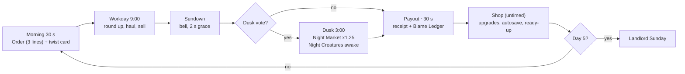
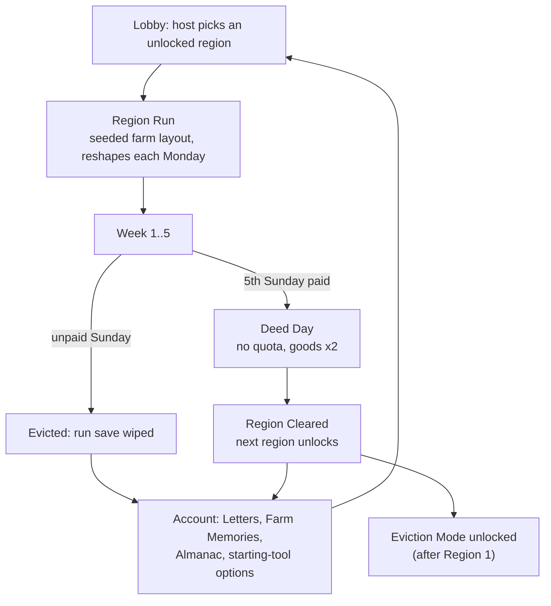
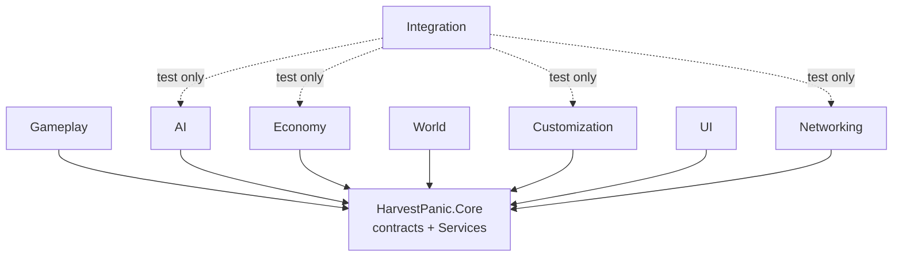
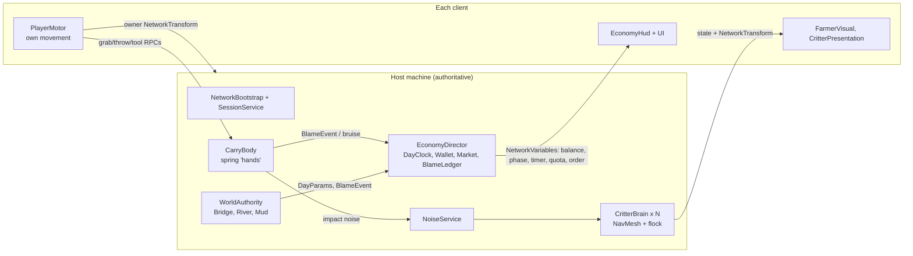

# HARVEST PANIC — Game Design Document

**First-person 2–4 player co-op farm chaos** · Unity 6.3 LTS + URP · Netcode for GameObjects + Steam · Windows & macOS

Version 1.0 — 2026-10-20 · Master GDD consolidating the 34 system GDDs in `design/gdd/`, the art & audio bibles, the level docs and the current build. Each section ends with **Status in build** (Built / Partial / Planned). Values marked *(proposed)* are new and need owner sign-off. Chapter sources live in `design/master-gdd/`.

## Contents

- [1. Vision & Pitch](#1-vision--pitch)
- [2. Audience, Player Experience & Session Shape](#2-audience-player-experience--session-shape)
- [3. Core Loop Overview](#3-core-loop-overview)
- [4. The Farmer (Player Character & Controls)](#4-the-farmer-player-character--controls)
- [5. Carrying, Physics & Tools](#5-carrying-physics--tools)
- [6. Livestock, Crops & Goods](#6-livestock-crops--goods)
- [7. The Bridge & Environmental Hazards](#7-the-bridge--environmental-hazards)
- [8. Time Structure: Day, Week, Night](#8-time-structure-day-week-night)
- [9. Economy](#9-economy)
- [10. Progression & Campaign](#10-progression--campaign)
- [11. World, Characters & Levels](#11-world-characters--levels)
- [12. Co-op, Multiplayer & Social Comedy](#12-co-op-multiplayer--social-comedy)
- [13. Character Customization](#13-character-customization)
- [14. UI, HUD, Menus & Accessibility](#14-ui-hud-menus--accessibility)
- [15. Business, Platforms & Marketing](#15-business-platforms--marketing)
- [16. Art & Audio Direction](#16-art--audio-direction)
- [17. Technical Design](#17-technical-design)
- [18. Production Plan & Status](#18-production-plan--status)
- [Appendix: Glossary & Document Index](#appendix-glossary--document-index)

---

# 1. Vision & Pitch

> Owner: Creative Director · Sources: `design/game-concept.md`, `design/gdd/game-overview.md`, `design/gdd/consistency-report.md`, `design/art/art-bible.md` · Engine: Unity 6.3 LTS + URP + Netcode for GameObjects + Steam

## 1.1 Elevator Pitch

**HARVEST PANIC** is a first-person online co-op physics comedy for 2–4 friends. Your crew inherits Grandpa's cursed farm, and his debts come with it. Every day you chase runaway livestock and crops that have grown legs, drag them across one terrible rope bridge to market, and try to sell them before sundown. Every Sunday the Landlord collects rent. The goods fight back, the weather fights back, the night fights back, and your friends drop the pig in the river.

## 1.2 Logline

*Four incompetent heirs, one shared wallet, one rickety bridge, and a Landlord who wants his money every Sunday.*

## 1.3 High Concept

| Field | Value |
|---|---|
| Genre | Co-op "friendslop" physics comedy with a roguelite debt loop |
| Camera | First-person; other players see your full body (user decision, 2026-10-11) |
| Players | 2–4 online (Steam lobbies, listen server); solo is playable with scaled quotas but is not the focus |
| Session | One Day = 10–15 min · one Week = 1–2 h · one Region ≈ 5.6–6 h |
| Platforms | Windows + macOS on Steam |
| Price | Premium, ~$9.99 (see Chapter 15) |
| Art | "A storybook farm that gets dented": warm, toy-like and hand-painted by day, cold-lit and crooked by night |
| Core verbs | Chase, grab, carry together, throw, cross, sell, blame |

**Player fantasy:** *"We are four incompetent heirs barely keeping a haunted farm afloat, and it is everyone's fault but mine."*

## 1.4 The "And Also" Test

> It's like **R.E.P.O.** (carry fragile loot together for a quota), **and also the loot runs away from you, screams, and has to be carried across a bridge that wants you dead.**

The difference from other quota-co-op games is that the valuables have their own goals. In R.E.P.O. and Lethal Company the loot is passive and the monsters are the threat. In HARVEST PANIC the loot is also the threat. A pig is worth $60, runs at 5.6 m/s, squeezes through fence gaps, and struggles in your arms. Every sale is a small chase followed by a small heist.

## 1.5 Comparable Titles and Positioning

| Title | What we take | What we do differently |
|---|---|---|
| **Lethal Company** | Escalating quota, proximity voice that makes death funny, light horror spikes | We are not a horror game. Night is optional (the Dusk vote) and is played for comedy. The quota is paid with money you earned on camera, not with scrap. |
| **R.E.P.O.** | Physics carrying of fragile valuables, bruise = lost value, upgrades between rounds | Goods flee and fight back. One fixed chokepoint (the Bridge) becomes the daily stage. |
| **PEAK** | Low price, cheap hardware, ragdoll failure, rescuing friends | We are a horizontal hauling game, not a climbing game. Our tension comes from the clock and the rent, not from a summit. |
| **Chained Together** | One person's mistake drops everyone | Multi-hand carries (a cow needs 3 carriers) and a shared wallet create the same "we all fall" feeling without a literal chain. |
| **Overcooked** | Time pressure and shouting-based coordination | Physics plus proximity voice instead of a recipe grid. The chaos is systemic, not hand-authored. |
| **Content Warning** | Filming your friends' failures is part of the product | Grandpa's Camcorder records automatically. You never have to choose between playing and filming. |
| **Meccha Chameleon** (2026 viral hit) | A single readable, clip-able mechanic that makes strangers laugh in 10 s | Our clip mechanic is "something valuable went into the river and here is who did it." |
| **Goat Simulator** | Physics absurdity as the point | We give the absurdity stakes: the rent. Failure is funny because it costs something. |
| **Gamble With Your Friends** (2026) | One shared bank account creates blame and betrayal | Our Blame Ledger itemizes exactly who cost what, and the optional Golden Egg betrayal is revealed on Sunday. |

### Positioning map

```
                  STAKES / STRUCTURE (quota, progression)
                               ^
          Lethal Company   R.E.P.O.        HARVEST PANIC
                               |           (high stakes, goods fight back)
   PASSIVE LOOT  <-------------+------------->  LOOT HAS LEGS
                               |
          Goat Simulator   PEAK            Overcooked (orders, not physics)
                               v
                     SANDBOX / LOW STAKES
```

Our corner is **high stakes + loot that fights back**. No current hit owns it.

## 1.6 Design Pillars

Four pillars, all falsifiable, all binding on every department.

### Pillar 1: Everything Has Legs
Every valuable thing fights to escape.
*Design test:* if an item just sits there, give it a personality.

| Do | Don't |
|---|---|
| Pigs squeeze through gaps, chickens scatter as a swarm, the prize pumpkin needs 4 carriers and splats | Add a valuable crate that just waits to be picked up (the build's generic crate is a placeholder, not a model) |
| A pig can walk back out of the Sale Pen during its 2 s acceptance | Make selling a menu click |
| Art: goods are more saturated than the world (Art V2 "Loot Pops, World Rests") | Let a valuable blend into the background |

### Pillar 2: Heavy Together, Blamed Together
Shared loads, a shared wallet and shared failure.
*Design test:* does this make players need or blame each other?

| Do | Don't |
|---|---|
| Carry speed scales with hands; a cow needs 6 hands (3 players) | Give a solo upgrade that removes the need to coordinate |
| One wallet; the receipt itemizes "Dave: dropped pig into river ×3, −$240" | Give private wallets or per-player scores that compete |
| Audio: the mix leaves 300 Hz–2 kHz clear for voice | Bury voice chat under music |

### Pillar 3: The Farm Gets Worse, You Get Better
Escalating quotas and curses against your growing toolkit.
*Design test:* does the week end harder than it started, and did the crew's choices close the gap?

| Do | Don't |
|---|---|
| Quota grows ×1.35 per week while median income grows ×1.25; upgrade choices close the gap | Make the quota flat or let grinding money solve everything |
| Chaos cap rises: 2 major modifiers in Week 1, 3 in Week 2, 4 from Week 3 | Throw every hazard at a Week 1 crew |
| Account unlocks are sidegrades and cosmetics | Sell or grant permanent stat power |

### Pillar 4: Failure Is the Content
Every disaster is funny, recorded and cheap to recover from.
*Design test:* is losing here a clip, or just a chore?

| Do | Don't |
|---|---|
| Daytime knockouts recover in place for free; barn respawn costs $25–55 depending on the week | Permadeath of a character, long respawn timers |
| Camcorder auto-saves the 30 s before every disaster | Ask players to remember to hit record |
| Disaster-rewarding Letters outnumber success Letters | Punish the player who caused the funniest moment beyond a sting on the receipt |

### Anti-pillars (what this game is NOT)
- **Not a combat game.** You herd, you don't fight. No weapons, no health bars on animals.
- **Not punishing.** No character permadeath, no lost account progress on a failed run.
- **Not a grind.** No farming-sim crop timers, no chores for their own sake.
- **Not pay-to-win.** No loot boxes, no paid currency, no gameplay power for sale.
- **Not gore horror.** Horror comes from lighting, never from blood (Art V4).

## 1.7 Tone and Humour Rules

The tone is **cozy slapstick with a crooked night**: Looney Tunes physics on a picture-book farm, with a Scooby-Doo level of scare after dark.

1. **Deadpan institutions, panicking people.** The Landlord, the receipt and Grandpa's notes are calm and bureaucratic. The players are the ones screaming. ("Storm today. Bridge will leave. Do not follow bridge.")
2. **Punch up at the debt, never down at a player.** Blame is a joke about a moment, not about skill. Nicknames ("Butterfingers", "Structural Engineer") rotate daily and can be disabled.
3. **Animals are never harmed on screen.** A bruised pig shows cartoon stars and a bandage decal. A "Ruined" good gets a sad sound, not a corpse. No blood VFX anywhere.
4. **Every scare resolves into a gag.** The Scarecrow only moves when nobody is looking, and it's comic, not traumatic. Night is opt-in.
5. **Bounded harm for pranks.** No social feature can spend wallet money, destroy goods, or take more than 5 s of control from a player.
6. **Writing voice:** short, specific, numerical. "−$240" is funnier than "a lot of money." Tabloid camcorder titles: "LOCAL MAN LOSES PIG, DIGNITY."
7. **Cultural care.** Myth-derived creatures are renamed if they borrow a sacred concept (e.g. "Copycat Coyote").

## 1.8 The "Laugh Moment" Philosophy

**Target: a laugh-worthy moment roughly every 3 minutes per crew**, and at least one shareable bridge disaster per day without prompting. This is a production target, not a hope.

How we manufacture clip-able chaos:

| Ingredient | Why it produces clips | System |
|---|---|---|
| A visible stake | Viewers instantly understand "that pumpkin was worth $300" | Goods value, floating price tags |
| A single chokepoint | Every haul passes the same camera-friendly stage | The Bridge (20 planks, mid-span sag) |
| Physics that can fail | Outcomes are surprising even to the players | Carry, ragdoll, plank breaking |
| A named culprit | The joke has a punchline: who did it | Blame Ledger |
| Automatic recording | The clip exists before anyone thinks to film | Grandpa's Camcorder |
| A voice reaction | Friends screaming is half the clip | Proximity voice |

**The clip formula:** *setup (something valuable) → tension (the bridge, the clock) → physics failure → named blame → replay.* Every new feature should strengthen at least one link in this chain. The art test applies too: *would it look funny in a 15-second vertical clip with no sound?*

## 1.9 Target Fantasy and Aesthetics (MDA)

| Rank | Aesthetic | How it shows up |
|---|---|---|
| 1 | **Fellowship** | Shared wallet, multi-hand carries, voice, blame and awards |
| 2 | **Sensation** | Physics slapstick, ragdolls, splats, the bridge sway |
| 3 | **Challenge** | The escalating weekly quota |
| 4 | **Discovery** | New species, curses, regions, the Almanac |
| 5 | **Expression** | Cosmetics, emotes, chalkboard, Crew Photo |
| 6 | Narrative | Light: Grandpa's letters and tapes, the Landlord |

Self-Determination Theory check: **Relatedness** through shared failure, **Competence** through beating harder Sundays, **Autonomy** through route, upgrade and Dusk choices.

**Status in build:** Partial. Pillars 1, 2 and 4 are playable in the Muddlebury slice (fleeing pig and chickens, multi-hand carry, shared wallet, receipt with blame lines, breakable bridge). Pillar 3 is partial (weekly quota and Landlord rules exist; upgrades do not). Camcorder and proximity voice are Planned.

---

# 2. Audience, Player Experience & Session Shape

> Owner: Creative Director · Sources: `game-overview.md`, `day-loop.md`, `week-quota.md`, `region-campaign.md`, `onboarding-accessibility.md`, `frontend-lobby.md`, `meta-progression.md`

## 2.1 Target Players

| Segment | Who | What they want | What we give them |
|---|---|---|---|
| **Primary** | Friend groups aged 16–30 already playing R.E.P.O., PEAK, Lethal Company, Chained Together on voice chat | A new game to laugh at together on Friday night, cheap enough that the whole group buys it | A $9.99 premium price, a 4-pack bundle, a one-click Steam invite |
| **Secondary** | Streamers and content creators | Reliable laugh moments roughly every 3 minutes, readable at a glance by viewers | The Bridge as a fixed stage, the Camcorder, tabloid receipts, streamer mode |
| **Tertiary** | Cozy farm fans (Stardew, Overcooked crossover) | The farm fantasy with a chaotic twist | Storybook art, a cozy day, an opt-in night; a possible Cozy Mode later |

**Hardware:** must run on base M-series Macs and mid-range PCs at 1080p (Mac Medium target 60 fps). Stylized, light rendering in URP.

## 2.2 Player Motivations

| Motivation | Satisfied by |
|---|---|
| "I want to laugh with my friends" | Physics failure, friend-throwing, ragdolls, the receipt |
| "I want to beat the Landlord" | Weekly quota, the Sunday cliffhanger |
| "I want to prove it wasn't me" | Blame Ledger, MVD and Pig Whisperer awards |
| "I want to show people" | Camcorder export, Crew Photo |
| "I want to collect and dress up" | Grandpa's Letters, ~120 cosmetics, the Almanac |
| "I want a harder challenge" | Later regions, Eviction Mode leaderboards |

## 2.3 First 10 Minutes

Target: launch to first input in the Lobby Yard in **≤ 25 s**; a rookie hauling pigs within **2 minutes**.

| Time | What happens | Intended feeling |
|---|---|---|
| 0:00 | Title → Host (≤ 3 clicks). The Lobby Yard loads: Grandpa's porch, a mirror, a wardrobe, hay bales to throw | "Oh, I can already mess around" |
| 0:30 | Friends arrive by Steam invite. Someone throws a hay bale at someone. Players ready up by standing on the porch; the host rings the dinner bell | Play before the game starts |
| 1:00 | (First launch only) Grandpa's Tape #1, ~4 min solo: grab a slow pig, cross the bridge, a plank breaks, sell, receipt "−$30 for the plank". Skippable; friends who skipped get a 60 s Quick Tape in the lobby | "I get it" |
| 1:30 | Morning (30 s): the Morning Order (3 lines, e.g. "3 Pigs · 6 Eggs · 1 Prize Pumpkin") and the twist card | A clear goal |
| 2:00 | Workday starts (9:00). The crew splits at the fork in the road: pigs north, chickens south | Ownership, chaos |
| ~3:00 | **First laugh**: a pig wriggles free, a chicken swarm explodes, someone gets carried | The promise kept |
| 5–8 min | First bridge crossing with goods. Planks creak. The prize pumpkin needs 4 people | Tension, coordination |
| 9:30 | Sundown bell, a last-second dive at the Sale Pen with the 2 s photo finish | Climax |
| 10:00 | Payout receipt with named blame lines. "Next Day" | "One more" |

**Success criteria (from the vertical slice):** in a 4-player playtest players laugh within 3 minutes, at least one shareable bridge disaster happens unprompted, and at least 3 of 4 players ask to go again.

## 2.4 First Hour

- **Days 1–4 of Week 1.** The crew learns the pig and chicken personalities, the feed bucket lure and the net, and that a plank costs $30 to patch.
- **First shop visits** between days (Planned): one or two cheap upgrades from the ~$540 Week 1 slack.
- **First Dusk vote**: "Go out at night for 25% more money?" with a Scarecrow visible in the background.
- **First Landlord Sunday** (~60–75 min in): awards, the Golden Egg reveal if someone pocketed one, the slow abacus count. Target: **≥ 80% of first-time 4-player crews pay Week 1.**
- By the end of the hour the crew has a running joke (a nickname, a rival pig) and a reason to come back: a new Landlord rule and a higher quota.

## 2.5 First Week of Ownership (real-world)

| Sessions | Experience |
|---|---|
| Night 1–2 | Weeks 1–3 of Region 1. Cow, goat and bull arrive; weather cards start mattering. Probably a first eviction around Week 3–5 |
| Night 3–4 | Second run with Letters unlocked, a tool sidegrade and better upgrade choices. Median first run ends on the Week 4 or 5 Sunday |
| Night 5–7 | Region 1 clear for committed crews (median clear 5–8 h, ≥ 40% of teams fail at least once first). Deed Day celebration. Region 2 or Eviction Mode unlocks |

Targets: first-attempt Region 1 clear ≈ 25% of crews; ≥ 60% by the third attempt. A new cosmetic every ≤ 45 min in the first 10 h.

## 2.6 Session Length

| Unit | Length | Natural stopping point |
|---|---|---|
| Day | 9:30 without Dusk, ~12:40 with Dusk, ~14 min with payout and shop | The receipt (autosave at Shop) |
| Week | 5 Days + Sunday ≈ 1–2 h | After Sunday payment |
| Region | 5 paid weeks ≈ 5.6–6 h | Deed Day |
| Eviction ladder | 3-day weeks, endless | The eviction |

Every day ends on an autosave so a crew can stop after any receipt and resume later. Any roster player can host the Resume ("migration-lite").

## 2.7 Solo vs 2–4 Players

The game is designed for 4, tuned for 2–4, and playable solo.

| Crew | Quota scale S_p | Week 1 quota | Notes |
|---|---|---|---|
| 1 player | 0.45 | $540 | Playable, not a focus. Awards reduce to MVD + Pig Whisperer with self-deprecating copy |
| 2 players | 0.65 | $780 | Heavy goods are hard; the prize pumpkin (4 carriers) is a stretch goal |
| 3 players | 0.85 | $1,020 | The cow (3 carriers) fully staffs the crew |
| 4 players | 1.00 | $1,200 | The intended experience |

Rules: player count is sampled Monday morning. A mid-week leaver re-scales the quota pro-rata from the next day so a ragequit doesn't doom the others. Joiners can enter at any phase except the Sunday cutscene, spawning at the barn with 2 s protection. Order quantities also scale by S_p.

**Open question (proposed answer):** solo should be "supported, not balanced around" and marketed as such (proposed).

## 2.8 Emotional Curve of a Day

```
Intensity
  ^                                         * dive at the pen
  |                                *   *   * *
  |                      *  bridge*  *        \     payout laugh
  |              *    *   *                     \  *
  |      chase *   *                             \/  \
  |   *                                                 \ shop (calm)
  | * morning                                            *___
  +--------------------------------------------------------------> time
   0:00 0:30          5:00              9:00 9:30   ~12:40  ~14:00
   Order  Workday (spread out, then funnel)  Sundown  (Dusk)  Payout/Shop
```

1. **Morning: anticipation.** Read the order, joke about the twist.
2. **Early Workday: playful.** Low stakes, the crew spreads out.
3. **Mid Workday: tension.** Everything funnels to the bridge.
4. **Sundown: panic.** The music shifts, the town bell spooks critters.
5. **Dusk (optional): dread and greed.** ×1.25 value, Night Creatures awake.
6. **Payout: release.** The receipt is half celebration, half court case.
7. **Shop: calm planning.** Flow break before the next day.

## 2.9 Emotional Curve of a Week

| Day | Feeling | Driver |
|---|---|---|
| Monday | Confidence ("loads of time") | New quota on the chalkboard, the farm has moved |
| Tue–Wed | Rhythm and greed | Upgrades come online, Dusk gambles |
| Thursday | Doubt | Math against the quota |
| Friday | Heist-finale desperation | "The Landlord is coming and we are $60 short" |
| Sunday | Courtroom | Awards, egg reveal, slow count, then a hug or a gloriously catastrophic eviction |

Eviction is designed as a payoff, not a punishment: a cutscene where the barn is towed away with the pig on the roof, a Camcorder montage of the week, and Letters that reward failing.

**Status in build:** Partial. Lobby Yard with porch ready-up and dinner bell, the full day phases (Morning → Workday → Dusk → Payout) and the Sunday pay/evict receipt are Built. Tape #1 tutorial, shop, Dusk vote UI, Sunday cutscene and solo-specific award copy are Planned.

---

# 3. Core Loop Overview

> Owner: Creative Director · Sources: `day-loop.md`, `week-quota.md`, `region-campaign.md`, `shared-wallet-economy.md`, `goods-value.md`, `eviction-mode.md`, `meta-progression.md`
> Detailed rules and formulas live in the system chapters. This chapter shows how the four loops nest and feed each other.

## 3.1 Loop Stack

| Loop | Length | Goal | Fail state | Pillar |
|---|---|---|---|---|
| Moment-to-moment | 30–90 s per haul | Get one good sold, unbruised | Drop, bruise, escape, river | Everything Has Legs |
| Day | 10–15 min | Fill the Morning Order, earn money before sundown | A poor day (no hard fail) | Failure Is the Content |
| Week | 1–2 h | Pay the Landlord on Sunday | **Eviction** (run ends) | The Farm Gets Worse, You Get Better |
| Campaign | ~6 h per region | Pay 5 Sundays to clear the region | Run reset; account unlocks persist | The Farm Gets Worse, You Get Better |
| Endgame | Endless | Climb Eviction Mode rungs | First unpaid Sunday | Same |

## 3.2 Moment-to-Moment: Catch → Carry → Cross → Sell

```
   +---------+     +---------+     +-----------+     +---------+
   |  SPOT   | --> |  CATCH  | --> |   CARRY   | --> |  CROSS  |
   | (order, |     | net,    |     | 1-8 hands,|     | the     |
   |  price) |     | lure,   |     | struggle, |     | Bridge  |
   +---------+     | corner  |     | stamina   |     +----+----+
        ^          +----+----+     +-----+-----+          |
        |               | escape         | drop/bruise    | plank breaks /
        |               v                v                | river spit-out
        |          (chase again)   (value lost, blame)    v
        |                                            +---------+
        +------------- next good <------------------ |  SELL   |
                                                     | rest 2 s|
                                                     | in pen  |
                                                     +---------+
```

1. **Spot.** The Morning Order says what pays ×1.5 today. Goods show their worth (pig $60, chicken $15, egg $5, prize pumpkin $300).
2. **Catch.** Critters flee from threat and noise. Tools: net, feed bucket lure (built); lasso and whistle (planned). Sprint (6.5 m/s) beats the pig (5.6 m/s), but sprinting is loud.
3. **Carry.** A player has 2 hands. Carriers = ceil(hands/2): pig 2 hands (1 player), cow 6 (3), prize pumpkin 8 (4). Living goods struggle. Impacts above 400 N·s bruise and cut value. The last 3 touchers in a 3 s window share the blame (0.6 / 0.3 / 0.1).
4. **Cross.** The Bridge is the only crossing: 40 m, 20 planks, sagging in the middle. Overloaded planks break; the river spits goods and players out downstream at the "Lost & Found" pile.
5. **Sell.** A good is sold after resting **2.0 s** in the Sale Pen. Living goods can walk back out. Money enters the shared wallet instantly.

**Feeds the Day:** every sale adds money and fills order lines; every failure adds a Blame line and a Camcorder tape.

## 3.3 Daily Loop



| Phase | Duration | Key numbers |
|---|---|---|
| Morning | 30 s (skippable) | 3 order lines; filled lines pay ×1.5 |
| Workday | 540 s (range 300–720) | Market open |
| Sundown | last 30 s warning | Items landing within 2 s of the bell still count |
| Dusk (optional) | 180 s | Value ×1.25; majority vote, host breaks ties |
| Payout | ~30 s | Order Complete Bonus = $60 × week number |
| Shop | untimed | Upgrades (Planned), autosave |

Players caught outside the barn or market at the end are "lost in the dark": barn respawn fee and the `Stranded` blame verb. Unsold livestock wanders back into the wild pool.

**Feeds the Week:** the day's net money moves the crew toward (or away from) the Sunday Due. Upgrades bought in the Shop raise tomorrow's income.

## 3.4 Weekly Loop (Rent Sunday)

```
  Mon      Tue      Wed      Thu      Fri         SUNDAY
 [Day1]-->[Day2]-->[Day3]-->[Day4]-->[Day5]--> [Landlord arrives]
   |        |        |        |        |               |
   +--shop--+--shop--+--shop--+--shop--+        SundayAudit: 5 awards,
                                                Golden Egg reveal
   ("The Landlord doesn't believe in Saturdays")       |
                                                Balance >= Due ?
                                                 /           \
                                              YES             NO
                                               |          Collateral 60 s
                                    week +1, quota x1.35, (sell upgrades 50%)
                                    new Landlord rule,     /        \
                                    chaos cap +1,       paid       EVICTED
                                    respawn fee up        |       (run ends,
                                               \__________/        unlocks kept)
                                                    |
                                               next Monday
```

**Quota** `Q(w) = round_to_10(1,200 × 1.35^(w−1) × S_p × RegionDifficulty)`:

| Week | 4p | 3p | 2p | 1p |
|---|---|---|---|---|
| 1 | $1,200 | $1,020 | $780 | $540 |
| 2 | $1,620 | $1,380 | $1,050 | $730 |
| 3 | $2,190 | $1,860 | $1,420 | $980 |
| 4 | $2,950 | $2,510 | $1,920 | $1,330 |
| 5 | $3,990 | $3,390 | $2,590 | $1,790 |

Due = quota + any overdraft IOU (wallet floor −$200). Median income grows ×1.25/week against quota ×1.35/week: **upgrade choices are the skill that closes the gap.** Respawn fee by week: $25 / 30 / 40 / 45 / 50 / 55.

**Feeds the Campaign:** each paid Sunday is one rung toward the region deed; each eviction feeds account counters (Letters, Almanac, Farm Memories).

## 3.5 Campaign Loop (Regions)



| # | Region → Town | Signature | Difficulty | Phase |
|---|---|---|---|---|
| 1 | Grandpa's Farm → Muddlebury | The plank bridge; toll $5 per crossing with goods | 1.00 | Early Access |
| 2 | Misty Riverlands → Ferrytown | Rafts, islands, tides | 1.20 | Update 1 |
| 3 | Haunted Orchard → Hollow Hill | 40% night, hiding apples | 1.45 | Update 2 |
| 4* | Sunburnt Ranch → Dustwater | Stampedes, heat spoilage | 1.70 | Expansion idea |
| 5* | Frostbite Fjord → Icemouth | Ice physics, yaks | 2.00 | Expansion idea |

Each region's day draws its own species plus previous regions' species at half weight, so the roster widens. The bridge and market are fixed; the farm side is regenerated from the seed every week ("Farm moved again. Don't ask.").

**Endgame: Eviction Mode.** 3-day weeks, quota `$400 × 1.28^rung × S_p`, one permanent Eviction Notice per paid Sunday, daily seed, Steam leaderboards per crew size. Target median Rung 6.

## 3.6 How the Loops Feed Each Other

| From → To | What flows | Why it matters |
|---|---|---|
| Haul → Day | Money, order lines, blame lines, tapes | Each haul is a small story the receipt retells |
| Day → Week | Net cash vs. Due; Shop upgrades | Today's mistakes are Friday's panic |
| Week → Day | New Landlord rule, higher chaos cap, more species | Next Monday plays differently |
| Week → Campaign | Paid Sundays or eviction | Failure is a reset, not a loss |
| Campaign → Week | Starting-tool sidegrades, new region pools, RegionDifficulty | Variety without stat power |
| All → Account | Letters, Farm Memories (10–35 per day), Almanac | Every session leaves something behind |

The Day Modifier contract (weather, curses, Landlord rules, region twists, Eviction Notices) is the single pipe through which every loop changes the next, so content scales by multiplying systems rather than authoring levels.

**Status in build:** Partial. Moment-to-moment loop Built (pig/chicken AI, net and feed bucket, multi-hand carry, bruising, breakable bridge, river, Sale Pen 2 s acceptance). Daily loop Built (Morning/Workday/Dusk/Payout, receipt, order bonus). Weekly loop Partial (quota, Sunday pay/evict, Landlord rule draw; no shop, Collateral or cutscene). Campaign, PCG, meta and Eviction Mode Planned.

---

# 4. The Farmer (Player Character & Controls)

> Sources: `design/gdd/player-character.md`, `physics-carry.md`, `character-customization.md`, `consistency-report.md`; code `Gameplay/Config/PlayerTuning.cs`, `Gameplay/Player/*`, `Customization/FarmerEmotes.cs`, `Prefabs/Player/Input/PlayerControls.inputactions`.
> Pillar: **Failure Is the Content**.

## 4.1 Design Intent

The farmer is a clumsy heir who is competent for about four seconds at a time. Moving around should feel responsive and fair. Falling over should feel earned and funny, never random. Getting back up is fast, so a fall is a joke and not a punishment.

Three rules shape everything in this chapter:

1. **The body is honest.** Every fall has a cause the player can name: "I was sprinting with the pumpkin, tired, in mud."
2. **Recovery is cheap; mistakes are expensive.** A knockdown costs seconds. The money cost comes from what you dropped, not from the fall itself.
3. **Your friends see the slapstick.** You play in first person, but other players see your full body, so every pratfall is a show for the rest of the crew.

Status in build: Built (the intent is met by the current controller).

## 4.2 Camera & View

| Item | Value | Notes |
|---|---|---|
| View | First person | Like R.E.P.O., Lethal Company and PEAK. The body turns with the camera. |
| Eye height | 0.64 m above the capsule centre (≈1.6 m from the ground) | `EyeAboveCentre` |
| Base FOV | 90° | Range 80–110 (an accessibility option) |
| Sprint FOV kick | +8° | Blends at speed 8/s |
| Head bob | 1.6 cm at 1.8 Hz (walk), scaled by ground speed | 0 in comfort mode (proposed) |
| Camera shake on impact | up to 4°, full at 900 N·s, decays 2/s | Strength = impulse / 900 |
| Pitch limit | ±85° | |
| Mouse sensitivity / pad look | 0.12 / 160°/s | Rebindable in options |

- **Local view:** you see your own first-person arms. You never see your own full body while you are standing.
- **Other players:** they always see your full third-person farmer with cosmetics, name tag and emotes.
- **Ragdoll and knockout camera:** the camera attaches to the ragdoll's head and tumbles with it, so you watch yourself fall. It snaps back to eye level when you get up.
- **Targeting:** there is a small dot in the centre of the screen. A trace runs 1.8 m forward from the camera and drives the interaction prompt (§4.9).

Status in build: Built.

## 4.3 Movement

| Parameter | Value | Code knob |
|---|---|---|
| Walk | 4.0 m/s | `WalkSpeed` |
| Sprint | 6.5 m/s | `SprintSpeed` |
| Crouch (quiet-walk) | 2.0 m/s | `CrouchSpeed` |
| Jump apex | 1.1 m | `JumpApex` |
| Gravity (controller) | 20 m/s² | Snappier than real gravity, on purpose |
| Ground / air acceleration | 40 / 8 m/s² | Responsive on the ground, limited steering in the air |
| Capsule height stand / crouch | 1.8 / 1.2 m, radius 0.35 m | Standing up from a crouch checks for headroom first |
| Body mass | 70 kg | Used when friends carry or throw you |

**Speed while carrying:** your speed is multiplied by the carry speed factor from Chapter 5 (0.35–1.0).

**How the speeds compare to the animals:** a pig sprints at 5.6 m/s and a chicken at 6.2 m/s, so a sprinting player can run both down. A bull sprints at 6.5 m/s, the same as the player, so you can never outrun it. This is intentional and still an open question for the owner (see consistency report Q5).

**Crouch = quiet-walk ("Shush"):** crouched footsteps make no noise. Walking makes a footstep noise of 0.10 every 1.5 m. Sprinting makes 0.25 every 2.2 m. Animals hear these sounds (Chapter 6, §6.4), so sneaking up on an animal is a real tactic.

**Dive (planned):** costs 20 stamina and lunges you 3 m forward. It ends in a 0.8 s belly-flop. If you touch an animal during the dive, you grab it. The dive is in the design but not in the code yet.

Status in build: Partial. Walk, sprint, crouch and jump are built and tuned. Dive is Planned.

## 4.4 Stamina

| Parameter | Value |
|---|---|
| Maximum | 100 |
| Sprint drain | 15/s |
| Carry drain | 8 × load_ratio per s (0–8/s; this adds to the sprint drain) |
| Regeneration | 25/s after a 1.0 s delay, but only when you are not sprinting |
| Exhaustion | At 0, sprint is disabled until stamina is back to 30 |
| Low-stamina weakness | Below 20 stamina, your ragdoll threshold is multiplied by 0.7 |
| Lasso tug (planned) | 10/s while pulling on a lassoed animal |
| Dive (planned) | 20 per dive |

The worst case is sprinting while fully loaded, which drains 23/s. That empties a full bar in about 4.3 s, which matches the "competent for four seconds" fantasy. Stamina is the main reason a heavy carry turns into a pratfall. A tired player is weaker, slower to recover and easier to knock over.

Status in build: Built (`StaminaModel`).

## 4.5 Knockdown: Ragdoll, Shove & Trip

### What makes you ragdoll

| Trigger | Rule |
|---|---|
| Hard impact | Impulse greater than the ragdoll threshold (formula below) |
| Loaded trip | Sprinting with load ≥ 70% on a slope steeper than 25° |
| Plank break | Standing on a plank when it breaks (Chapter 7) |
| Bull charge | 1,800 N·s, which is a straight knockout (§4.6) |
| Goat headbutt | 600 N·s. On its own this is below 900, but it knocks a tired, loaded farmer down |
| Faint emote | A voluntary 2 s ragdoll, and you drop whatever you are holding |

**Ragdoll threshold**
```
threshold = 900 N·s × (1 − 0.4 × load_ratio) × (stamina < 20 ? 0.7 : 1.0) × (in mud ? 0.8 : 1.0)
```
The threshold ranges from 302 to 900 N·s. A farmer who is fully loaded, tired and standing in mud is about three times easier to knock over. That is exactly where the bridge sits.

When you ragdoll, you are launched at 0.006 m/s per N·s of impulse, capped at 12 m/s. **Anything you were holding is released with your hand's velocity, so it flies.**

### Shove (proposed)

The source GDDs do not define a player-on-player shove. Proposed rule: tap Interact on a teammate who is upright to make a 300 N·s "nudge". This is below the ragdoll threshold of a fresh, empty-handed player, but it can topple a teammate who is tired and loaded. Cooldown 2 s. It is logged in the Blame Ledger as `YeetedTeammate` only if it causes a drop or a river fall. The goal is "help them along" comedy without free griefing. The design rule is unchanged: you can only *grab* a teammate who is knocked out.

### Recovery

- Get-up becomes available once the body moves slower than 0.5 m/s for 0.5 s. Press **Jump** to stand up (1.2 s animation). The prompt reads "SPACE: Get up".
- Button-mashing does nothing. This is an accessibility choice.
- If you get up inside geometry, you are moved to the nearest walkable point within 2 m.
- The server decides ragdoll state. The client predicts the start of a ragdoll, and the server corrects it within 200 ms.

Status in build: Partial. Ragdoll, the threshold formula, launch, get-up and faint are Built. Shove is Planned (proposed).

## 4.6 Knockout, Revive & Barn Respawn

**Knockout (KO):** you are knocked out by an impulse ≥ 1,800 N·s (2× the ragdoll threshold) or by 3 ragdolls within 20 s.

| KO rule | Value |
|---|---|
| Duration | 8 s, with stars over your head. Your voice still works but is muffled by 50% |
| Revive | A teammate holds E for 1.5 s. The prompt reads "Tap E: Carry / Hold E: Revive" (a tap is anything under 0.25 s) |
| Carry a KO'd friend | They count as a 70 kg body that needs 2 hands. You can carry them and throw them (yes, into the wagon) |
| Everyone KO'd | Everyone gets up after 8 s. There is no daytime wipe |
| Cost | **Free.** A daytime KO recovers where you fell |

**Barn respawn is the only thing that costs a fee.** You respawn at the barn after 5 s when:

| Cause | Blame verb |
|---|---|
| Falling into the river or below the kill height (−25 m) | `Drowned` |
| Being knocked out by a night creature | `KnockedOut` |
| Being stranded outside the barn or market zone at day end | `Stranded` |

The fee comes out of the shared wallet. It goes up each week: **$25 / 30 / 40 / 45 / 50 / 55**. It is charged to the player who died, so the Ledger can say "Dave drowned 4 times: −$100". If the wallet is short, it can go down to the −$200 overdraft floor. Anything beyond that becomes a Landlord IOU. If someone throws a KO'd friend into the river, the friend gets `Drowned` and the thrower gets `YeetedTeammate` (the throw counts for 6 s afterwards).

Status in build: Partial. KO, revive, carrying KO'd players, river/kill-height respawn and the fee hook are Built. Night-creature KO and stranding are Planned with their systems.

## 4.7 First-Person Arms

Your own arms are drawn as simple cartoon tubes. They are posed by code, not by animation clips, so they react to whatever you are holding.

| Pose | Behaviour | Key values |
|---|---|---|
| Idle | Loose fists, low in front of you | Hand at (±0.19, −0.25, 0.52) m in camera space |
| Reach | Hands move toward a grabbable you aim at | Up to 0.52 m reach, 65% blend |
| Grip | Palms press on the sides of the held object, near its top edge | Up to 0.42 m half-spread; arms can stretch to 1.6× for wide items |
| Throw | Wind back 0.16 m as you charge, then a 0.3 s swing | |
| Sway | Breathing, lag when you turn, bob when you walk | Look-sway capped at 3.5 cm |

The sleeve, cuff, glove and skin colours come from your cosmetic loadout. The arms cast no shadows on themselves. Held objects float 1.05 m ahead of your eyes and 0.3 m below your eye line. Tools are held rigidly at your right hand.

Status in build: Built (EditMode tests cover the arm IK, poses and grip).

## 4.8 Control Scheme

| Action | Keyboard & Mouse | Gamepad | Notes |
|---|---|---|---|
| Move | W A S D | Left stick | |
| Look | Mouse | Right stick | |
| Jump / Get up | Space | A / Cross (south) | Also stands you up from a ragdoll |
| Sprint | Left Shift (hold) | Left stick click | |
| Crouch / quiet-walk | Left Ctrl or C (hold) | Right stick click | |
| Interact: grab / drop / revive | E (tap; hold to revive) | X / Square (west) | Tap again while holding to drop |
| Throw | Left mouse (hold to charge, release to throw) | Right trigger | Full charge after 1.0 s |
| Use tool | Right mouse (hold) | Left trigger | Net swing, feed shake |
| Holler (shout) | H | Y / Triangle (north) | Noise 0.8, 2 s cooldown |
| Emote slots 1–4 | 5 / 6 / 7 / 8 | D-pad (proposed) | Wave, Point, Dance, Faint by default |
| Push-to-talk / open voice | V (proposed) | Back/View (proposed) | Proximity voice is open-mic by default |
| Tool slot swap | 1 / 2 (proposed, planned) | LB / RB (proposed) | Changing tools takes 0.4 s |
| Pause / menu | Esc | Start | |

You can rebind every action. Holding an action never requires mashing a button.

Status in build: Partial. Every binding without a "proposed" tag is in `PlayerControls.inputactions` and `FarmerEmotes`. The gamepad emote bindings, tool slots and voice key are Planned.

## 4.9 Interaction Prompts

There is one line of text under the crosshair. It comes from the carry system (`PromptFormat`).

| Situation | Prompt |
|---|---|
| Aiming at a grabbable | `E: Grab (have/need hands)`, e.g. `E: Grab (2/8 hands)` |
| Aiming at a KO'd friend | `Tap E: Carry  Hold E: Revive`, then `Reviving... 60%` |
| Holding something | `E: Drop  LMB: Throw` plus the tool's use prompt |
| Not enough hands | `(dragging 2/8 hands)` |
| Charging a throw | `[75%]` |
| Ragdolled at rest | `SPACE: Get up` |
| Knocked out | `Knocked out (5s)` |

Key names change to match the active device (proposed for gamepad glyphs).

Status in build: Built (text; device glyphs Planned).

## 4.10 Holler, Emotes & Ping

Players who do not want to use a microphone still need to be loud and expressive. Every one of these actions is also a game mechanic, because animals react to noise.

| Action | Duration / cooldown | Game effect |
|---|---|---|
| **Holler** (H) | 2 s cooldown | Noise 0.8 from your head. Scares nearby animals, and you can use it to call your friends |
| **Wave** | 1.5 s / 1.5 s | Noise 0.6, a friendly shout |
| **Point** | 1.2 s / 1.2 s | Places a coloured ping where you aim (up to the ping range), in your name-tag colour |
| **Dance** | Loops until you move / 1 s | Cosmetic only |
| **Faint** | 2 s / 5 s | A real ragdoll. You drop whatever you are holding. Strategic or self-sabotage |

The server enforces the cooldowns and a rate limit for each player. You can swap emotes in the barn wardrobe. Starter emotes are free, and more are unlocked through meta-progression.

Status in build: Built.

## 4.11 Edge Cases

- **You ragdoll while holding something:** the item flies off with your hand's velocity. If it bruises, it is your fault.
- **You ragdoll on a moving wagon:** your body keeps the wagon's velocity.
- **You join a game in progress:** you spawn at the barn with 2 s of protection.
- **Cheating on grabs:** the server rejects any grab farther than 1.8 + 0.75 m away.

## 4.12 Acceptance Criteria

- A fully loaded sprint down a 30° slope ragdolls you every time. An empty-handed sprint never does.
- Get-up is offered within 1.5 s of the body coming to rest.
- One teammate can pick up, carry and throw a KO'd player.
- A river fall in Week 1 respawns you at the barn after 5 s, takes $25 from the wallet and logs `Drowned`.
- Holler creates a Noise Event with loudness 0.8.

---

# 5. Carrying, Physics & Tools

> Sources: `design/gdd/physics-carry.md`, `farm-tools.md`, `wagon-vehicles.md`, `goods-value.md`, `consistency-report.md`; code `Gameplay/Carry/*`, `Gameplay/Config/CarryTuning.cs`, `ToolTuning.cs`, `Gameplay/Tools/NetTool.cs`, `FeedBucketTool.cs`.
> Pillar: **Heavy Together, Blamed Together**.

## 5.1 Design Intent

"PIVOT! PIVOT!" Carrying is the core verb of HARVEST PANIC. A held object hangs from springs at your hands. It is never snapped rigidly in place, so it swings, bumps and bruises. Lifting together should feel strong. One person letting go should feel catastrophic. Every drop has a name on it, and that feeds the Blame Ledger.

Status in build: Built.

## 5.2 Pick Up, Hold, Drop

1. **Aim and grab:** look at an object within **1.8 m** and tap **E**. The client asks the server, and the server confirms within one round trip. The server accepts grabs up to 2.55 m to allow for lag.
2. **Hands:** each player gives **2 hands** to one held object. In the current build a player holds one thing at a time.
3. **Hold point:** the object floats 1.05 m in front of your eyes and 0.3 m below your eye line. Each grip is a spring: stiffness 1,500, damping 120, maximum force 2,500 N.
4. **Drop:** tap **E** again. A drop counts as the dropper's fault for any bruise in the next 2 s.
5. **Slip:** if your grip is stretched more than **1.2 m** for **0.3 s**, you lose your hold. This happens when you snag on fences or when an animal yanks free.
6. **Stuck item:** if a held object does not move for 5 s, it is nudged to free space (proposed in the GDD, not yet coded).
7. **Lag spike:** the server keeps your last hold target for 300 ms before it releases the object.

Status in build: Built (the stuck-item nudge is Planned).

## 5.3 Weight Classes

Each goods item lists the **hands** needed to lift it. Each player supplies 2, so the number of carriers needed is half the hands, rounded up. With fewer hands than that, the object is **dragged** along the ground instead of lifted.

| Class | Hands (carriers) | Examples | Mass (build) | Feel |
|---|---|---|---|---|
| Pocket | 1 (1) | Egg, carrot, turnip, chicken, tools | 0.06–5 kg | Fast, throwable, easy to lose |
| Armful | 2 (1) | Pig, egg crate, goat, sheep, KO'd friend | 4–70 kg | One player, slowed |
| Heavy | 4 (2) | Prize llama, Tumble Melon | ~60–80 kg (proposed) | Needs two people |
| Team | 6 (3) | Cow, bull | 300 / 900 kg | Three people, at the speed floor |
| Monster | 8 (4) | Prize Pumpkin (180 kg), fully grown Growing Pumpkin | 180 kg | Whole crew. Comedy guaranteed |

**Carry speed**
```
load_ratio  = clamp(mass_kg / (hands_attached × 25), 0, 1)
carry_speed = clamp(1 − 0.5 × load_ratio, 0.35, 1.0)
```
| Example | Result |
|---|---|
| Chicken, 5 kg, 2 hands | 0.95 → 3.8 m/s walk |
| Pig, 40 kg, 1 player | load 0.8 → 0.6 → 2.4 m/s |
| Pumpkin, 180 kg, 4 players | load 0.9 → 0.55 |
| Cow, 300 kg, 3 players | 0.35 (the floor) |

The load ratio also drives stamina drain (8 × load/s) and lowers your ragdoll threshold (Chapter 4).

Status in build: Built (`CarryMath`).

## 5.4 Two-Player and Team Carries

- **Grabbing a shared object:** players grab the same object at different points. The prompt shows the progress, e.g. "E: Grab (2/8 hands)".
- **Steering:** the object moves toward the average of all carriers' targets. If carriers pull in opposite directions, the object **spins** instead of the pulls cancelling. This is the "helicopter cow".
- **Losing a carrier:** if a carrier lets go, slips or ragdolls and the hands fall below what is needed, the object drops within 0.5 s and bruises. The person who let go is blamed.
- **Tug-of-war:** two players pulling one 1-hand item: the stronger pull keeps it and the other slips. A 1-hand item is never held by two people at once.
- **Heave:** a single player can throw a 2-hand item only if it weighs 40 kg or less.

Status in build: Built.

## 5.5 Throwing

Hold **LMB** to charge (full charge at 1.0 s), then release to throw along your view, aimed slightly upward. Your own velocity is added.
```
v = lerp(4, 14, charge) × clamp(10 / mass_kg, 0.3, 1.0)   m/s
```
| Item | Full-charge speed |
|---|---|
| Turnip, 2 kg | 14 m/s (travels 15 m or more) |
| Chicken, 5 kg | 14 m/s |
| Pig, 40 kg | 4.2 m/s (a heave) |

A thrown object stays "Thrown" until it hits something or 2 s pass. Its impacts are blamed on the thrower (`Threw`). Throwing an object that needs more hands than you have just drops it.

Status in build: Built.

## 5.6 Bruising & Goods Damage

Any impact on a held object, or on an object released less than 2 s ago, is converted to design impulse units and checked against the bruise threshold.

| Rule | Value |
|---|---|
| Bruise threshold `I_min` | 400 N·s |
| Bruise gain | `ΔBP = (I − 400) / 40 × Fragility × BruiseMult` |
| Cap per hit | 60 BP. Impulses above 20,000 are ignored as physics glitches |
| "Heavy impact" | Above 800 N·s (louder: noise 0.6 instead of 0.3) |
| Who is blamed | The last 3 people to touch it within 3 s, newest first (shares 0.6 / 0.3 / 0.1). Holding the object refreshes your touch every 1 s |
| Held object hits a player | Knocks them back (feeds into their ragdoll threshold) |

Example: dropping a pig from shoulder height gives about 1,200 N·s → 16 BP → Scuffed (−15% value). Bruise states and their value effects are in Chapter 6.

Status in build: Built.

## 5.7 Carry Stacking (proposed)

No source GDD defines stacking. Proposed rule for the owner to decide: a player carrying a **crate or basket** (Egg Crate, 2 hands) can place up to 6 Pocket items in it. The container then becomes one body, with a mass equal to the sum of its contents. Each hit on the container passes its bruise on to every item inside, at ×0.5. Stacking crates on top of each other is not allowed. Players use the wagon for that. The point is to reward loading a basket without letting a player carry 20 eggs safely. Today the Egg Crate is a single $30 item and does not hold anything.

Status in build: Planned (proposed).

## 5.8 Farm Tools

Tools are physical 1-hand objects that hang on barn racks. You can drop them, throw them or lose them in the river. The design gives each player 2 tool slots (switching takes 0.4 s). Using a tool takes one hand, so tools compete with carrying. Two-hand carries put the tool away automatically. In the current build you hold a tool like any other item, and RMB uses it.

| Tool | How it works | Key numbers | Build |
|---|---|---|---|
| **Net** | Hold RMB: a 0.5 s wind-up, then a swing. Catches one Small critter or Pocket item into a bag, which becomes a 1-hand item | Reach 1.5 m, 90° arc, 1.0 s cooldown. Catch chance `clamp(0.95 − 0.1 × Agility, 0.4, 0.95)` (chicken 55%). A caught animal has a 20% chance to escape every 5 s unless the bag is in a pen or wagon. Big Net: holds 3 | Built |
| **Feed bucket** | Hold RMB to shake. Makes food noise 0.4 every 0.5 s, which lures hungry animals within 15 m. Throwing feed makes a lure that lasts 20 s | 10 uses. Refills within 6 m of the barn | Built (shake). Thrown lure Planned |
| **Lasso** | Hold to aim with an arc preview, release to throw. A hit ties a 6 m rope. Hold to reel in; at 1.5 m you grab the animal automatically | Range 12 m. Rope breaks at 4,000 N. Pulling costs 10 stamina/s | Planned |
| **Whistle** | A short blow scares animals (noise 0.7). A long blow (1 s) rallies sheep and the guard dog | 3 s cooldown. Scaring a carried animal gives it +50% struggle for 2 s | Planned |

**Lasso tug-of-war**
```
player_anchor = 600 N × (stamina > 0 ? 1 : 0.4) × (helpers_on_rope + 1) × ground (grass 1.0, plank 0.8, mud 0.6)
dragged if critter_pull > player_anchor
```
Pull forces: chicken 50, goat 400, pig 500, cow 900, bull 1,600 N. One player can hold a pig. It takes three on grass to hold a bull. Otherwise you get the "lasso water-ski".

**Losing tools:** a tool that falls in the river washes up downstream after 30 s, or is lost. Lost tools are restocked each morning for **$15** each (Blame verb `LostTool`). Upgrades: Big Net, Reinforced Lasso, Golden Bucket, Handheld Lantern (Chapter on upgrades).

Status in build: Partial. Net and feed bucket are Built. Lasso, whistle, tool slots and thrown feed are Planned.

## 5.9 Ropes (Tethers)

A rope connects two bodies with a cable: 6 m for a lasso, 3 m for a hitch point. It breaks at 4,000 N. You can tie a rope to a wagon, a post, an animal or another player. If one end of the rope is in the river, the current pulls on it and can drag the other person in.

Status in build: Planned.

## 5.10 Wagons & Vehicles

| Vehicle | Spec | Build |
|---|---|---|
| **Wagon** | 120 kg, 4 wheels, bed 2.0 × 1.2 m, 0.4 m walls. Soft cap 400 kg of cargo (Bigger Wagon: 550/700/850) | Planned |
| **Wheelbarrow** (Alpha) | 1 player, 1 wheel, 80 kg, tips at 30° | Planned |
| **Raft** (Post, Riverlands) | Drifts with a 1.5 m/s current, poled by players, carries 250 kg | Planned |

**Wagon rules**
- **Moving it:** there are 2 handle grips at the front and 2 push points at the back. Each player adds 900 N. The front handle steers (axle up to 35°). A brake lever (1 hand) locks the wheels.
- **Top speed:** `v_max = clamp(Σforce / (total_mass × k), 0, 6) m/s`, where k is dirt 1.5, mud 3.0, plank 1.2. Example: 2 players with 220 kg on dirt reach 5.45 m/s; in mud, 2.7 m/s.
- **Cargo:** cargo sits loose in the bed. The target is about 1 item bouncing out per 100 m of rough road at 5 m/s. A **tarp** (1 hand, 1.5 s to tie) locks the cargo in place but costs 10% speed. The tarp is free in the VS build.
- **Tipping:** the wagon tips past 50° of roll and spills everything. Two players need 2 s to set it upright.
- **Wheels:** 100 HP each. Hits above 1,500 N·s deal impulse/50 damage. A wheel at 0 HP falls off. Repair costs $50, or use a Field Repair Kit.
- **Animals:** a hitched animal pulls with its own pull force toward whatever *it* wants. A rider can lead it with the feed bucket.
- **River:** a wagon that falls in floats for 10 s and then sinks. It is returned next morning for $40.
- **Blame:** cargo that bounces out logs `SpilledCargo` against the driver (or the last pusher if nobody is driving). A tip logs `TippedWagon`. A player riding in the bed counts as 70 kg of cargo.

Status in build: Planned. The Muddlebury slice moves goods by hand and with the market pen.

## 5.11 Physics Comedy Rules

These rules keep the chaos funny instead of frustrating.

1. **Readable cause:** every failure has a visible trigger: wobble, slip distance, a creak, the 0.4 s alert "tell". Nothing happens off-screen.
2. **Wobble on purpose:** the hold point shakes with `amp = 0.05 m × (1 + 2 × speed_ratio) × (1 + struggle)` at 1.3 Hz. Faster and more panicked means more wobble.
3. **Cheap bodies, expensive cargo:** falls cost seconds. Bruises cost dollars.
4. **Damage has a ceiling:** at most 60 BP per hit, so one bounce cannot destroy a Pristine pumpkin.
5. **A name on everything:** a 3-second touch history means the Ledger always has someone to blame, or "Nobody" or "the Pumpkin" when that is funnier.
6. **No griefing friends:** you cannot grab or lasso a teammate who is awake. Throwing a knocked-out friend is allowed and logged.
7. **The server decides:** the server runs all physics. Clients predict hand poses only.

## 5.12 Acceptance Criteria

- 2 players cannot lift a 6-hand cow. 3 players can.
- If 1 of 4 carriers lets go of the cow, it drops within 0.5 s.
- A 2 kg item thrown at full charge travels at least 15 m on flat ground.
- Every hit above 400 N·s on a goods item produces exactly one bruise with the correct instigator (50-drop automated test).
- A single player nets a chicken in 3 attempts or fewer on average.

---

# 6. Livestock, Crops & Goods

> Sources: `design/gdd/livestock-roster.md`, `critter-ai.md`, `goods-value.md`, `cursed-crops.md`, `consistency-report.md` (goods-value prices are canonical); code `AI/*` (`CritterTuning`, `CritterState`, `CritterAssetBuilder`), `Economy/Logic/EconomyTuning.cs`, `Economy/Editor/EconomyAssetBuilder.cs`.
> Pillar: **Everything Has Legs**.

## 6.1 Design Intent

"The pig is smarter than us." Anything worth money is trying to leave. Animals are cheeky but readable opponents. They show a clear tell before they bolt, they double back past the slowest friend, and they come running for the feed bucket. You win by out-thinking them as a team: flank them, lure them, stay quiet. Raw reflexes are not enough. Each species is a different puzzle, so mastery means knowing *which friend handles which animal*.

Every species is defined purely by data: a personality asset plus a goods entry. Adding a new animal needs no new code.

Status in build: Built (data-driven framework; 2 species authored).

## 6.2 Livestock Roster

Speeds are in m/s. For comparison, the player walks at 4.0 and sprints at 6.5. Prices follow the canonical goods-value table.

| Species | Tier | Personality | Walk / sprint | Base $ | Hands (carriers) | Fragility | Signature behaviour | Best counter |
|---|---|---|---|---|---|---|---|---|
| **Pig "Hamlet"** | VS | Greedy, sneaky, dramatic | 2.8 / 5.6 | 60 | 2 (1) | 0.8 | Squeezes under fences. Squeals (noise 0.7) when grabbed | Feed bucket (0.9 attraction); drive it into a corner |
| **Chicken** | VS | Skittish, flock | 2.5 / 6.2 | 15 | 1 (1) | 0.6 | A flock of 6–10 bursts in every direction and regroups after 15 s | Net; approach quietly |
| **Goat "Gary"** | Alpha | Curious climber | 3.0 / 5.2 | 70 | 2 (1) | 0.5 | Climbs roofs, wagons and bridge rails. Headbutts goods out of your hands (600 N·s) | Lasso; let it come to you |
| **Cow "Big Martha"** | Alpha | Lazy, stubborn | 1.5 / 3.0 | 150 | 6 (3) | 0.7 | Refuses to move. Moos every 20 s (noise 0.5) | Feed bucket (0.95); push as a team |
| **Bull "Sir Reginald"** | Alpha | Aggressive guard | 2.5 / 6.5 | 200 | 6 (3) | 0.4 | Guards the cows. Charges (1,800 N·s = KO) at sprinters within 10 m or anyone in red; 6 s cooldown | A decoy friend; lasso plus 2 more players |
| **Sheep** | EA | Timid herd-follower | 2.6 / 4.8 | 80 (wool 20) | 2 (1) | 0.6 | The flock follows the bell-wether leader | Grab the leader; long whistle |
| **Duck** | EA | Smug swimmer | 2.2 / 4.0 (swim 5.0) | 35 | 1 (1) | 0.6 | Heads for water and is immune to soaking | Raft; net it from the bridge |
| **Prize Llama "Doris"** | EA | Judgmental spitter | 2.7 / 5.0 | 400 | 4 (2) | 0.9 | Spits at the loudest player within 8 m (2 s screen splat, 10 s cooldown) | Speak softly (loudness under 0.3) |

### Personality fields (key values)

| Species | Alert radius (m) | Noise sensitivity | When cornered | Size | Agility | Pull (N) | Players needed to hold securely | Struggle (N·s) |
|---|---|---|---|---|---|---|---|---|
| Pig | 10 | 1.0 | Juke | Medium | 3 | 500 | 2 | 150 |
| Chicken | 8 | 1.4 | Juke | Small | 4 | 50 | 1 | 40 |
| Goat | 9 | 0.7 | Charge | Medium | 4 | 400 | 1 | 120 |
| Sheep | 12 | 1.2 | Freeze | Medium | 2 | 350 | 1 | 80 |
| Cow | 6 | 0.5 | Freeze | Large | 0 | 900 | 3 | 200 |
| Bull | 14 | 0.8 | Charge | Large | 2 | 1,600 | 3 | 300 |
| Duck | 9 | 1.1 | Juke | Small | 3 | 80 | 1 | 40 |
| Llama | 10 | 1.5 (voice ×2) | Play dead | Large | 1 | 600 | 2 | 150 |

**Mass in the build:** pig 30 kg (critter prefab) or 40 kg (goods prop), chicken 2.5–5 kg. Planned: cow 300 kg, bull 900 kg (both used in the bridge load calculation).

**Spawning:** each day, the number of animals that spawn is the morning order count × 1.25, rounded up, so there are spares to lose. If a gate is opened, each penned animal has a 60% chance to leave (cow 30%, ×0.4 with the Electric Fence).

**Region critters (Post/Expansion, stub data):** Walking Catfish, Goose, Otter, Black Cat, Bat Swarm (Regions 2–3); Longhorns, Roadrunner (9 m/s), Armadillo, Yak, Penguin, Reindeer (Regions 4–5).

Status in build: Partial. Pig and Chicken are Built with the values above. Goat, Cow and Bull (Alpha) and Sheep, Duck and Llama (EA) are Planned.

## 6.3 Critter AI States

The server runs every animal brain at **10 Hz** and sends the current state to clients as a single byte.

| State | Entered when | Behaviour | Leaves when |
|---|---|---|---|
| **Idle** | No threat | Stands or grazes for 2–5 s | It decides to wander, or a threat or lure appears |
| **Wander** (graze) | The idle timer ends | Walks to a random point within 6 m of home at 50% speed | A threat or lure appears |
| **Alert** | Threat ≥ 0.3 (chicken 0.25) | Faces the threat for a **0.4 s tell** (ears up, sound sting) | Threat ≥ 0.55 → Flee. Below 0.3 for 3 s → Idle |
| **Flee** (panic) | Threat ≥ 0.55 (chicken 0.45) | Runs to points 12 m away from the combined threat direction, rechecking every 0.25 s. Uses shortcuts players can't (pig under fences) | Calms down, gets cornered or gets grabbed |
| **Calm** | Threat below 0.15 | Winds down for 4 s (chicken 3 s) | Back to Idle, or a new threat |
| **Lured** | Lure attraction beats threat × 0.8 | Walks to the food and eats. Ignores threats below 0.5. A food noise is remembered for 8 s | Food is gone, eating finishes, or threat jumps above 0.8 |
| **Cornered** | The escape path is more than 3× the straight distance and 2 or more players are within 4 m | Its personality response for 2–5 s: Juke (dash at 1.15× sprint), Freeze, Charge or Play Dead | The timer ends or it is grabbed |
| **Carried** | Grabbed | Struggles every 0.5–1.5 s and may break free | Dropped or thrown → Stunned. Delivered → sold |
| **Stunned** | Thrown, dropped or hit | Dizzy: 1.5 s (0.6 s after a drop, 0.25 s after breaking free) | The timer ends |
| **Escaped** | Reaches an off-map escape area | Despawns. Its value is lost and the last toucher is blamed with `LetEscape` | — |

**Breaking free while carried:**
```
P_break per struggle = clamp((SecureCarriers − carriers) × 0.20 + 0.05, 0, 0.9)
```
For a pig held by one player, that is 25% per struggle, so it breaks free after about 3–5 s on average. Held by two players, it never breaks free. (The GDD used 0.35 per missing carrier. The build uses 0.20 to hit the 3–5 s target, and the build value is canonical.) When it breaks free, it hops away at 3 m/s.

**Stuck animals:** if an animal makes no progress for 3 s, it looks for a new path. After 8 s, it is warped to a nearby walkable point. When more than 40 animals are active, the ones far from all players update less often.

**Flocks (chickens):** a scatter sends each bird outward with ±50° of random spread. Birds within 12 m join the flock, and the flock regroups within 3 m after 15 s.

**Planned:** the sheep herd that follows its leader and the bull's guard behaviour. The bull guards cows (the "Guard" mode).

Status in build: Partial. Every state except Escaped volumes, Follow and Guard is Built (`CritterBrain`, `CritterFlock`, `ThreatTracker`). Escape areas and sheep and bull herding are Planned.

## 6.4 Perception & Noise

**Threat from each source:**
```
T = clamp(0.5 × proximity + 0.2 × sprinting + 0.15 × in_sight + noise + 0.6 × damage, 0, 1)
proximity = 1 − distance / AlertRadius;  sprinting = horizontal speed > 5.2 m/s inside the radius
noise = loudness × sensitivity × source_mult × (1 − distance / noise_radius)   (decays 0.25/s)
damage decays 0.3/s
Total threat = the highest source + 0.25 × the sum of the others
```
Example: a player sprints within sight, 4 m from a pig: 0.3 + 0.2 + 0.15 = 0.65, so the pig flees. Sneaking up quietly at walking pace scores 0.3 + 0.15 = 0.45, which only puts the pig on Alert.

| Noise | Loudness |
|---|---|
| Walk footstep / sprint footstep / crouch | 0.10 / 0.25 / none |
| Holler, shout emote | 0.8 |
| Wave | 0.6 |
| Pig squeal when grabbed | 0.7 |
| Light / heavy impact | 0.3 / 0.6 |
| Feed bucket shake (food tag: **lures**, never adds threat) | 0.4 |
| Whistle short / long (planned) | 0.7 |
| Plank crack | 0.3 |
| Proximity voice | Scales with how loudly you speak |

Sight cone: 220° (chicken 300°). A player who stands still and silent may draw a curious animal closer (pig curiosity 0.2). That is a real stealth-catch tactic.

Status in build: Built (voice-driven noise depends on proximity voice, which is Planned).

## 6.5 Crops & Goods Catalogue

| Goods | Category | Base $ | Fragility | Hands (carriers) | Tier | Build |
|---|---|---|---|---|---|---|
| Egg | Product | 5 | 2.0 | 1 (1) | VS | Built |
| Egg Crate | Product | 30 | 1.5 | 2 (1) | VS | Built |
| Carrot | Crop | 8 | 0.8 | 1 (1) | VS | Built |
| Turnip | Crop | 10 | 1.0 | 1 (1) | Alpha (in build early) | Built |
| Prize Pumpkin | Crop | 300 | 1.5 | 8 (4), 180 kg | VS | Built |
| Golden Egg | Special | 150 (never decays) | 2.0 | 1 (1) | Alpha | Planned |
| Mandrake | Cursed crop | 45 | 1.2 | 1 (1) | Alpha | Planned |
| Growing Pumpkin | Cursed crop | 40 × 1.05^(seconds held/10), capped at 2.5× | 1.3 | 2→8 | Alpha | Planned |
| Golden Cob (Maze Corn) | Cursed crop | 40 | 1.0 | 1 (1) | EA | Planned |
| Tumble Melon | Cursed crop | 80 | 1.4 | 4 (2) | EA | Planned |
| Moonberries | Crop | 15 | 1.8 | 1 (1) | EA | Planned |
| Wool | Product | 20 | 0.3 | 1 (1) | EA | Planned |

Livestock values are in §6.2.

## 6.6 Value Rules: Bruises & Freshness

**Sale value** (fixed at the moment the market accepts the item, which takes 2 s):
```
V = round(BaseValue × Bruise × Freshness × Demand(0.6–1.5) × Order(1.5 if it fills an order line) × Modifiers (Dusk ×1.25))
```
A Pristine Prize Pumpkin that fills an order at normal demand sells for **$450**.

| Bruise state | Bruise points | Value multiplier |
|---|---|---|
| Pristine | under 10 | 1.00 |
| Scuffed | 10–34 | 0.85 |
| Bruised | 35–64 | 0.60 |
| Busted | 65–99 | 0.30 |
| Ruined | 100 | Crops: 0 (sells as "compost" for $1). Livestock: 0.25, and the animal turns **Grumpy** (flees 1.5× faster and gets more aggressive) |

- Bruise points come from hits (Chapter 5) and from water. Fully under water: crops take 15 BP/s, livestock 5 BP/s, ducks 0. The water penalty is called `Soaked`.
- Livestock heal 5 BP every 30 s while in a pen. Crops never heal.
- **Freshness:** `F = clamp(1 − max(0, t − grace)/decay, 0.5, 1)`. For crops, grace is 120 s and decay is 480 s, so a crop hits the 0.5 floor 10 minutes after harvest. For products, grace is 180 s and decay is 600 s. Livestock never lose freshness. Decay pauses at Dusk.
- Unsold goods left in the field at day end despawn, unless they are stored in the Barn Cellar upgrade.
- Every value loss of $2 or more creates one Blame Event naming who caused it.

Status in build: Built (bruise, freshness, sale, compost, Grumpy tag). Grumpy movement mods and pen healing are Partial.

## 6.7 Cursed Crops (Alpha/EA)

Cursed crops are crops that fight back. They are the "Everything Has Legs" pillar applied to vegetables.

| Crop | Curse |
|---|---|
| **Mandrake** | Screams when pulled from the ground. The scream is a crop noise heard up to about 43 m and stuns anyone within 3 m for 1 s. The Earmuff Hat protects you |
| **Growing Pumpkin** | Keeps growing while it is held. Its value rises ×1.05 every 10 s, but it also needs more hands (2→8). If it grows past what you can hold, it pins you, and the blame goes to "Pumpkin" |
| **Golden Cob** | Hidden inside the maze-corn field |
| **Tumble Melon** | Rolls away downhill |

Region curses come later (e.g. Hiding Apples in the Orchard).

Status in build: Planned.

## 6.8 Acceptance Criteria

- A pig flees a sprinting player within 0.4–0.6 s and gets at least 8 m away in open ground in 90% of runs.
- A holler within 10 m sends every skittish animal into Flee. A walk footstep does not.
- Feed shaken 8 m from a calm pig lures it within 5 s.
- One player holding a pig loses it after 3–5 s on average. Two players never lose it.
- Dropping a pig with a 1,200 N·s impact gives 16 BP (Scuffed).
- A crop's freshness is 0.75 at 240 s and 0.5 from 600 s onward.

---

# 7. The Bridge & Environmental Hazards

> Sources: `design/gdd/bridge-hazards.md`, `rival-farmers.md`, `weather-twists.md`, `wagon-vehicles.md`, `goods-value.md`, `consistency-report.md`; code `World/Runtime/PlankMath.cs`, `BridgePlank.cs`, `BridgeController.cs`, `BridgeNetSync.cs`, `RiverVolume.cs`, `MudZone.cs`, `WorldDayParams.cs`, `World/Editor/BuildMuddlebury.cs`.
> Pillars: **Failure Is the Content**, **The Farm Gets Worse, You Get Better**, **Heavy Together, Blamed Together**.

## 7.1 Design Intent

"Okay, one at a time. ONE AT A TIME." The road to market crosses a sagging rope-and-plank bridge over a river. Every day's money has to cross it, so the bridge is the **boss fight of every day**: a slow, tense crossing where everyone is a backseat driver. Hazards follow one rule: **warn, then punish.** Every collapse is telegraphed by creaks and cracks that everyone hears, so the crew blames each other, not the game. Every hazard is driven by data, so weather, upgrades, the Landlord and rivals can retune it day by day.

Status in build: Built (Muddlebury slice: bridge, river, mud).

## 7.2 The Breakable Bridge

### Layout

| Property | GDD (VS spec) | **Built (Muddlebury scene)** |
|---|---|---|
| Length | 24 m | **40 m** |
| Planks | 20 × 1.2 m | **20 × 2.0 m** (0.14 m thick) |
| Width | 2.4 m | 2.4 m |
| Sag | — | 0.7 m dip at the centre (parabolic) |
| Rails | Rope rails at 1 m. Grabbing a rail stops a fall (uses 1 hand) | Rope rails about 1.05 m above the deck, posts every 2 planks. Rail grab not built |
| Water surface | — | 4.2 m below the farm ground |

The built bridge is longer than the spec on purpose: a 40 m crossing takes about 10 s at walking pace and about 18 s for a loaded team carry, which gives the tension time to build. The scene is canonical. **Owner decision:** update `bridge-hazards.md` §7 to 40 m / 2 m, or shorten the scene.

**Load:** each plank counts the total mass whose centre sits on its footprint. Nothing is counted twice. Players count as 70 kg, plus whatever they carry. Goods, animals and wagons count their physics mass (bull 900 kg). Load is sampled every 0.2 s.

### Integrity, Warnings and Collapse

Every plank starts each day at **integrity 100**.

| Stage | Trigger | Feedback |
|---|---|---|
| **Intact** | Integrity 100–51 | Normal wood thuds. Damage still builds silently whenever the load is over the safe load |
| **Cracked** | Integrity ≤ 50 | Darker cracked-plank material and a creak (Hazard noise 0.3, tag `Noise.Creak`, so it also spooks nearby animals). From now on damage builds **50% faster** |
| **Broken** | Integrity ≤ 0 | The plank drops away (Hazard noise 0.75, `Noise.PlankBreak`, then a splash). Everything on it falls: players get a downward shove so they fall instead of floating. Blame verb `BrokePlank` goes to the **heaviest player on the plank** |

**Damage formulas (`PlankMath`)**
```
damage/s   = max(0, load_kg − 250 × Bridge.SafeLoadMult) × 0.2 × (cracked ? 1.5 : 1) × Bridge.PlankBreakMult
impact dmg = impulse / 40, only for single impacts above 800 N·s (a thrown pumpkin, a falling wagon)
```

**How long a fresh plank lasts under a constant load** (default multipliers):

| Situation | Load per plank | Damage/s | Cracks after | Breaks after |
|---|---|---|---|---|
| One player, empty-handed or carrying a pig | 70–110 kg | 0 | never | never |
| Whole party of 4 standing on one plank | 280 kg | 6 | 8.3 s | 13.9 s |
| Loaded wagon (520 kg over 2 planks) | 260 kg | 2 | 25 s | 42 s |
| 4-player cow carry (580 kg over 2 planks) | 290 kg | 8 | 6.3 s | 10.4 s |
| 4 players + Prize Pumpkin bunched on one plank | 460 kg | 42 | 1.2 s | 2.0 s |
| The bull | 900 kg | 130 | under 0.4 s | under 0.7 s |

**Design read:** a single player crossing is always safe. A team carry that **keeps moving** makes it across, because no plank holds the group for more than a few seconds and planks only crack. The crew **stopping to argue** on one plank snaps it. Bunching up tightly around the pumpkin is the expensive mistake. Lingering is the mistake, not crossing.

### Modifiers

| Day parameter | Effect | Source |
|---|---|---|
| `Bridge.SafeLoadMult` | Storm (after minute 6) ×0.7 → 175 kg. Mabel's sabotage ×0.5 → 125 kg, **only on the 2–3 planks she loosened** | weather-twists, rival-farmers |
| `Bridge.PlankBreakMult` | Bridge Reinforcement Lv1 ×0.7, Lv2 ×0.45. Landlord "No Running" ×1.3. Landlord Helpful Visit ×0.5 | farm-upgrades, landlord-events |

Example: in a Storm, the party of 4 on one plank takes 21 dmg/s and the plank breaks in about 4 s instead of 14 s.

### Sway (Planned)
Moving mass makes the deck swing sideways: `A = min(0.4, 0.02 × Σ(|v_lateral| × mass_kg) / 100)` m. Wind adds a force. The built bridge has a static sag but no sway.

### Repair

| Repair | Cost / time | Build |
|---|---|---|
| **Morning reset:** every plank is repaired for free at the start of each day. It is also reset when a run is resumed (migration-lite) | Free | Built (`BridgeController.RepairAll`) |
| **Mid-day patch kit:** one player places it on a gap and it restores 1 plank | **$30** and 3 s (1 s with the Hammer upgrade). The charge appears on the Payout receipt | Planned |
| **Fix a sabotaged plank:** hold Interact on the loose plank | 1.5 s (instant with the Hammer). Free | Planned |

**Gaps:** one broken plank leaves a 2.0 m gap in the built bridge. Two broken planks leave a 4.0 m gap, which cannot be jumped (the jump apex is 1.1 m). **Note:** the GDD rule "a 2-plank gap (2.4 m) is jumpable empty-handed but not while carrying a 2-hand load" was written for 1.2 m planks. With 2 m planks, a *single* broken plank fills that role. This should be confirmed in playtests.

Status in build: Partial. Plank load, integrity, crack and break, impact damage, day multipliers, network sync and the morning reset are Built, and `PlankMath` is covered by EditMode tests. Sway, rail grab, the patch kit, Hammer fixes and sabotage visuals are Planned.

## 7.3 River & Water

| Rule | GDD | Built |
|---|---|---|
| Current | 2.5 m/s downstream | Not simulated. Bodies are swept along a spline |
| Where things go | Spit-out pile **120 m** downstream, after **15–25 s** | Swept along the river path to the pile at the end of the spline, with ±1.5 m scatter, after 15–25 s. Items bob and spin on the way, which makes a good "watch your pumpkin float by" moment |
| Goods | `Soaked` bruise: crops 15 BP/s, livestock 5 BP/s, duck 0 (goods-value) | A single `Soaked` hit of 600 N·s per entry |
| Players | Barn respawn after 5 s plus the weekly fee ($25 in Week 1), verb `Drowned` | Teleported to the barn respawn point (a 3 s fallback if the respawn system does not take over) |
| Animals | Swimmers swim to the bank. Others take the spit-out | Spit-out for all animals (swimmer species are not built) |
| Splash | `Noise.Splash` | Hazard noise 0.6, tag `Splash` |
| Wagon (Planned) | Floats for 10 s, then sinks. Recovered next morning for $40 | — |
| Tools | Wash up after 30 s or are lost. Restocked for $15 | Planned |
| Ropes (Planned) | Current force on a rope with one end in the water can pull a player in | — |
| Kill height | Below −25 m counts as `Drowned` | Built |

**Owner decision:** the build applies one fixed Soaked hit on entry. The GDD applies damage per second while the item is submerged. Choose one. Per-second soak needs the item to stay underwater, but the spline sweep keeps items on the surface.

Status in build: Built (sweep, spit-out pile, soak hit, drowning respawn, splash). Per-second soak, swimmers, wagon and rope interactions are Planned.

## 7.4 Mud

| Effect | Value | Build |
|---|---|---|
| Player speed | ×0.6 (walk 4.0 → 2.4 m/s). Day parameter `Mud.SpeedMult` can override it | Built |
| Ragdoll threshold | ×0.8 | Built |
| Footsteps | Tag `Noise.Squelch` | Built |
| Wagon rolling resistance | 3.0 (dirt 1.5), so a loaded wagon moves about half as fast | Planned (no wagon yet) |
| Lasso anchor | ×0.6 | Planned |
| Wool | Mud cancels the clean-wool ×1.2 bonus | Planned |
| Weather | Rain: mud radius ×1.5. Mud Day grows the mud areas under the same rules | Partial (day-parameter hook) |

Mud is placed on the approaches to the bridge on purpose, so that tired, loaded and muddy all stack in the same spot right before the boss fight.

Status in build: Built (`MudZone`).

## 7.5 Other Hazards

| Hazard | Effect | Build |
|---|---|---|
| **Slopes** | Sprinting with load ≥ 70% on a slope steeper than 25° makes you trip (Chapter 4). The road down to the bridge is the main slope | Built |
| **Fences and gates** | Block players. Pigs squeeze under fences. An opened gate means a 60% chance each penned animal leaves | Built (fences) / Planned (gate rolls) |
| **Rope rail** | An item lodged on the rail falls into the river after 10 s | Planned |
| **Weather twists** | Storm (safe load ×0.7 after minute 6), Mud Day, wind (affects sway), Drizzle, Flood, Blood Moon | Partial (day-parameter hooks) |
| **Night creatures** | Scarecrow, Barn Thing and Crows (coin theft $10 per hit, up to $50 per day). Night KOs mean a barn respawn and the fee | Planned |
| **Landlord events** | Farm Walk opens the gates. Quiet Hours lowers voice range. No Running makes plank damage ×1.3 | Planned |

## 7.6 Rival Farmers (EA)

Rival farmers are NPC neighbours built as "humanoid critters". They use the critter personality framework with a Thief trait and extra steal and sabotage behaviours.

| Rival | Tactic | Counter | Weakness |
|---|---|---|---|
| **Cousin Clem** | Waits for the wagon to be unattended for 10 s, then grabs the highest-value small item (2 hands or fewer) and runs to his cart | Leave a guard; tackle him (he drops the loot) | Faints if you shout at him from less than 3 m (loudness 0.8 or more: 100%; 0.5–0.8: 40%) |
| **The Pruitt Twins** | One distracts you (honks, lures your animals with a feed bucket) while the other poaches livestock | Split up; catch the distracting twin first and the other gives up | Get confused when more than 30 m apart |
| **Mabel "The Saboteur"** | Loosens 2–3 bridge planks (safe load ×0.5) and greases the ramp | Inspect and fix the planks (hold Interact 1.5 s; instant with the Hammer) | Walks slowly; easy to chase off |
| **Big Earl** (Post) | Shoves goods out of your hands (900 N) and steals the wagon itself | Lasso his boots; a 3-player tackle | Distracted by pie |

**Visit rules**
- Chance per day: `0.15 + 0.05 × DayIndex`, capped at 0.5, starting from Day 2. Never on Day 1 or in the tutorial.
- One rival per day (two on days the Landlord flags).
- The rival arrives 2–5 minutes into the day. They stay until they steal something, get tackled twice, or sundown (rivals fear the night too).
- **Steal target score:** `Value × (1 / CarryHands) × Unattended`. An item counts as unattended when no player has been within 8 m for 10 s.
- **Tackle:** sprint into a rival. The rival ragdolls for 2 s and drops what they are carrying. Two tackles and the rival leaves the farm.
- **Rival cart:** parked at the map edge. Stolen goods sit in it for 90 s before it leaves. You can take anything back. There is a 30% chance of a bonus item worth $50–150 ("steal-back").
- **Blame:** `Stolen` goes to the nearest or last player responsible for the unguarded item. `StealBack` is logged when goods are recovered. Theft never takes the wallet below $0.
- **Comedy edge cases:** a stolen animal keeps its own AI and may escape from the rival and run back to you. A rival on a breaking plank falls into the river, comes out soggy and leaves.

Status in build: Planned (EA).

## 7.7 Network & Authority

The server owns plank integrity, breaks, river sweeps and theft. Plank state is sent to every client reliably whenever it changes (`BridgeNetSync`), with a target of under 200 ms after a break. Clients play the creak, crack and break feedback the moment the new state arrives, so the whole crew hears the same warning at the same time. That is essential for a fair argument.

Status in build: Built.

## 7.8 Edge Cases

- **Wagon wheel over a gap:** the wheel drops. The wagon tips if its roll exceeds 50°.
- **A knocked-out friend on a plank:** counts as 70 kg. Friends can throw them across a 2 m gap.
- **A plank breaks under a group carry:** every carrier on it falls, and the object drops and bruises. The heaviest player on the plank gets `BrokePlank`, and the drop shares follow the touch history.
- **The bull charges onto the bridge:** at 900 kg it breaks a plank in under a second. Blame goes to "Bull".
- **Load on the boundary between two planks:** a body counts only on the plank under its centre, so a team spread across two planks shares the load naturally.

## 7.9 Acceptance Criteria

- A single player crossing alone never cracks a plank.
- A 4-player cow carry that stops mid-bridge breaks a plank in 10–15 s (formula: 10.4 s).
- Every break is preceded by the crack stage (integrity ≤ 50) with the creak cue on all clients.
- Every body that falls into the river appears at the spit-out pile within 25 s. Goods are marked Soaked.
- A broken plank emits a 0.75 noise and a Blame Event naming the heaviest player on it.
- Plank state matches on all clients within 200 ms of a break.
- Mud reduces walk speed to 2.4 m/s.
- (Planned) A plank patch costs $30 and appears on the Payout receipt.

---

# 8. Time Structure: Day, Week, Night

> **Owner**: systems-designer · **Sources**: `design/gdd/day-loop.md`, `week-quota.md`, `night-creatures.md`, `weather-twists.md`, `landlord-events.md`, `rival-farmers.md`, `consistency-report.md`; code `HarvestPanic/Assets/Scripts/Economy/` (`DayClock`, `EconomyDirector`, `EconomyTuning`, `DayModifierStack`, `EconomyAssetBuilder`)
> **Convention**: values come from the canonical GDDs or the code. New values are marked **(proposed)**. Every section ends with **Status in build** (Built / Partial / Planned).

---

## 8.1 Time Scales at a Glance

HARVEST PANIC runs on three nested clocks. The **day** is the unit of play: one panicked haul across the bridge. The **week** is the unit of pressure: five days of earning, then the Landlord collects rent on Sunday. The **region** is the unit of victory: pay five Sundays in a row and the farm is yours (until the next one).

| Scale | Length (real time) | Contents | Pressure source |
|---|---|---|---|
| Day | ~10–14 min | Morning → Workday → (Dusk) → Payout → Shop | Workday timer, Morning Order |
| Week | ~65–75 min | Days 1–5 (Mon–Fri) + Landlord Sunday (~90 s) | Weekly quota (rent) |
| Region run | ~5.6–6 h | 5 paid weeks + Deed Day | Quota grows ×1.35 per week |
| Eviction rung | ~40–45 min | 3 days + Sunday | Endless quota ladder (see Ch. 10) |

**Why these lengths.** A 10–15 minute day is long enough for a full plan → disaster → recovery arc and short enough that a failed day never feels like wasted evening. Five days give the crew room to recover from one bad day before rent is due, so a single disaster rarely ends a run on its own, but two or three can.

**Status in build:** Built for day and week. The calendar (`DayClock`) tracks the run day (0-based), the week (1-based) and the day of the week (1–5). Region runs and Eviction rungs are Planned.

---

## 8.2 The Day: Phase Sequence

The day is a host-authoritative state machine: the host runs the clock and every client mirrors it. Timed phases move on by themselves. Payout, Sunday and Evicted wait for a button press.

```
 Morning ──30 s──► Workday ──540 s──► [Dusk 180 s] ──► Payout ──► Shop ──► next Morning
   (order + twist)   (crunch at T−60)   (night market)   (receipt)  (upgrades)
                                                              └─ after Day 5 ─► Landlord Sunday ─► Paid → Week+1
                                                                                                └► Evicted → run over
```

| Phase | Duration | What players do | Key rules | HUD / audio cue |
|---|---|---|---|---|
| **Morning** | 30 s (15–60 knob); skippable once everyone is ready | Read the Morning Order (3 lines) and the twist card(s); plan who does what | Timers frozen; players spawn at the barn; goods spawn at their markers | Calm banjo; order board; clock reads "market opens soon" |
| **Workday** | 540 s = 9:00 (300–720 via `Day.WorkdaySeconds`) | Round up, carry, cross the bridge, sell | Market open; an item is sold once it rests 2.0 s in the Sale Pen; crop freshness decays | Roundup music, layered by chaos |
| **Crunch** (last 60 s of Workday) | 60 s inside Workday | All-in final runs | No rule change: pure pressure | Clock turns red; Crunch music (+15% tempo, fiddle); pocket-watch tick |
| **Sundown** (last 30 s of Workday) | 30 s warning, then the bell | Dive for the pen | At 0:00 the market closes; items already in the pen still count if they finish resting within the 2 s grace | "SUNDOWN!" label; key-lift on the bell |
| **Dusk** (optional) | 180 s (90–300) | Night Market: sell at ×1.25 while night creatures hunt | 10 s majority vote to enter (host breaks ties); freshness decay paused | Sparse creepy pump organ; Night Threat layer when a creature is within 30 m |
| **Payout** | ~25–30 s (receipt timeout 25 s) | Read the receipt and argue about who did it | Order Complete Bonus paid; Day-length modifiers expire | Dot-matrix receipt printer |
| **Shop** | Untimed; ready-up | Vote on upgrades; autosave | Purchases need Balance ≥ price | Shop chalkboard |
| **Next Day** | — | Ready-up | After Day 5 the game goes to Landlord Sunday instead | — |

**Day length check:** 30 + 540 = 9:30 without dusk; + 180 = 12:30 with dusk; + ~30 s payout + ~60–90 s shop ≈ **13–14 min**. That sits inside the 10–15 minute target.

**Stranded rule.** Any player who is outside both the barn zone and the market zone when the last timed phase ends (Workday if no dusk, otherwise Dusk) is "lost in the dark". They are sent to the barn, charged the respawn fee, and the Ledger logs `Stranded`.

**Unsold goods** at day end: livestock wander back to the wild pool. Crops and products despawn unless they are stored in the Barn Cellar upgrade.

**Status in build:** Partial. Built: Morning 30 s → Workday 540 s → Dusk 180 s → Payout → (Sunday | next Morning), the 2 s sundown grace, the red clock under 60 s, the "SUNDOWN!" label under 30 s, the pen's 2 s acceptance, modifier-driven phase lengths, and the `-hpDayScale` dev time-scale. Not yet built: the dusk vote (the build sets `DuskEnabled = true`, so every day has a dusk), skipping Morning when everyone is ready, the Shop phase (Payout goes straight to the next Morning on the host's **Next Day** button), the Payout auto-timeout (`PayoutAutoAdvanceSeconds = 0`), the Stranded rule, and the Crunch music and pocket-watch.

---

## 8.3 Morning: The Order and the Twist

Each morning the crew gets a three-line **Morning Order** (for example "3 Pigs · 6 Eggs · 1 Prize Pumpkin") plus one or more **twist cards** (weather, Landlord visit, curse). Order lines are drawn without repeats from the goods the level can actually supply.

**Order rewards**
- Every item that fills an open line sells at **×1.5** (order multiplier `O`).
- Filling **all three lines** pays the **Order Complete Bonus** once at Payout: `OCB = $60 × w`.

**Order quantity per line**

```
q = max(1, round( BaseQ × S_p × (1 + 0.15 × (w − 1)) ))
```

| Symbol | Type | Range | Description |
|---|---|---|---|
| `q` | int | 1–~12 | Units requested on this line |
| `BaseQ` | int | 1–6 | Per-goods base quantity (build: Pig 2, Chicken 3, Egg 6, Egg Crate 2, Prize Pumpkin 1, Turnip 5, Carrot 5) |
| `S_p` | float | 0.45 / 0.65 / 0.85 / 1.00 | Player-count scale for 1/2/3/4 players |
| `w` | int | 1–6 | Week number |

**Output range:** bounded below at 1, so an order line is never empty. The largest value in Region 1 is Egg at 4p in Week 5: 6 × 1.0 × 1.6 = 9.6 → 10. Rounding is half-up.

**Worked example.** Pigs, 4 players, Week 3: `2 × 1.00 × 1.30 = 2.6 → 3 pigs`. The same line for a 2-player crew in Week 1: `2 × 0.65 × 1.0 = 1.3 → 1 pig`.

**Budget guideline:** the summed base value of all order lines should be about 45% of the expected day gross, so that finishing the order is worth chasing but is never the only way to make rent.

**Status in build:** Built. The order is drawn from goods present in the level, the quantity formula is implemented, ×1.5 is applied on sale, and the OCB is paid at Payout. Egg Crate ($30) and Carrot ($8) are build-only goods that are not yet in the canonical goods table (see Ch. 9 §9.4). The twist card display is Partial: active modifiers are listed, but there is no card presentation yet.

---

## 8.4 The Last 60 Seconds: Crunch and Sundown

The end of the Workday is the game's signature tension beat, a "photo finish" at the market fence. It is built as a staged timeline so players feel it coming rather than being cut off.

| Time remaining | Event | Purpose |
|---|---|---|
| 1:00 | **Crunch** begins: clock turns red, music jumps +15% tempo with a fiddle lead, pocket-watch ticks on eighth notes | "Last run" decision: one more trip or start selling what you carry? |
| 1:00 (Region 1 only) | Muddlebury town bell rings at sundown −60 s; every critter in earshot panics toward it | Regional chaos spike right when hands are full |
| 0:30 | **Sundown** warning: "SUNDOWN!", sun dips, music key-lift | Commit now |
| 0:00 | Market bell; pens stop accepting new items | Hard stop |
| 0:00 → +2 s | **Grace window**: items already resting in the pen finish their 2 s count and still sell | Turns the buzzer into a dive-catch, not a robbery |
| +2 s | Dusk vote (if enabled) or Payout | — |

**Edge rules**
- If a modifier changes `Day.WorkdaySeconds` mid-day, the remaining time scales proportionally: `T_remaining_new = T_remaining × new/old`, never below 30 s. The Crunch and Sundown cues follow the new remaining time.
- A pig that walks back out of the pen at 1.9 s is not sold. The register goes "ka-ch..." and stops. This is intended.

**Status in build:** Partial. Built: the red clock under 60 s, "SUNDOWN!" under 30 s, the 2 s grace (`SundownGraceSeconds`), and the proportional rescale with a 30 s floor (`DayClock.Rescale`). Planned: Crunch music, pocket-watch tick, the sun-dip lighting cue, and the Muddlebury bell panic.

---

## 8.5 Dusk: The Night Market Gamble

After sundown the crew may vote to stay out for **180 s** of **Night Market**: every sale is worth **×1.25** (`Day.DuskBonus`), but night creatures become active and anyone caught outside at the end is stranded and charged.

**Dusk expected value** (designer guideline, **proposed**)

```
EV_dusk = r_sale × T_dusk × (DuskBonus) − (E_KO + E_stranded) × Fee(w)
r_sale  = G_day(w) / T_work
```

| Symbol | Type | Range | Description |
|---|---|---|---|
| `r_sale` | float $/s | ~0.3–2 | The crew's Workday earning rate |
| `G_day(w)` | int $ | 180–1,000 | Expected day gross from the economy model (Ch. 9) |
| `T_work`, `T_dusk` | s | 540, 180 | Phase lengths |
| `DuskBonus` | float | 1.0–2.0 | Default 1.25 |
| `E_KO`, `E_stranded` | float | 0–4 | Expected creature knockouts and stranded players |
| `Fee(w)` | int $ | 25–55 | Respawn fee this week |
| `EV_dusk` | float $ | can be negative | Net value of choosing dusk |

**Output range:** unbounded below. A crew that loses everyone to the Scarecrow loses money. This is intentional, because dusk is a gamble.

**Worked example (4p, Week 3).** `r_sale = 625 / 540 = $1.16/s` → `1.16 × 180 × 1.25 = $260` gross. With two knockouts at $40 each: `260 − 80 = +$180`. With two knockouts and two stranded players: `260 − 160 = +$100`. With the bonus and no creatures it would be +$260. The canonical Week 3 worked example (Ch. 9) books a Tuesday dusk worth +$180 sales against +$80 extra fees.

**Rules:** the vote is a majority (host breaks ties; 2-player 1–1 goes to the host; solo gets a prompt). Crop freshness decay is paused at night ("it's cold"). Rivals leave at sundown because they fear the creatures too.

**Status in build:** Partial. Built: the 180 s Dusk phase, the ×1.25 Dusk bonus in the sale price, the "night market ×1.25" HUD label, and the freshness pause (freshness runs only during Workday). Planned: the vote (dusk is currently always on), creatures, and stranded charging.

---

## 8.6 Payout, Shop and Next Day

**Payout** closes the books: day sales, order bonus, costs, net, balance, rent due Sunday, any Landlord IOU, then the Blame Ledger receipt grouped by player (see Ch. 9 §9.9 for the receipt layout and Ch. 10 §10.6 for blame). Day-length modifiers (weather, curses) expire when Payout begins.

**Shop** (after Payout) offers 6 upgrades; purchases go through a 10 s vote (Ch. 10 §10.2). The run autosaves here: the Shop-phase save is the **day boundary** every resume rolls back to. If the host drops mid-day, that day's income is lost and the run resumes from the last Shop save. Any roster player can host the resume.

**Next Day** advances the calendar. After Day 5 it leads to Landlord Sunday.

**Status in build:** Partial. Payout and its receipt are Built (host presses **Next Day**). Shop, autosave and resume are Planned.

---

## 8.7 Day Modifiers and the Chaos Cap

Every source of chaos (weather, curses, Landlord, region rules, upgrades, Eviction notices) is a **Day Modifier**: a data asset that adds to, multiplies or overrides named day parameters such as `Day.WorkdaySeconds`, `Goods.ValueMult` or `Economy.RespawnFeeMult`. No system hard-codes content; each one reads the resolved parameter.

**Resolution**

```
P = Override(highest priority)  if any
  = clamp( (P_base + Σ Add) × Π Mul , P_min, P_max )  otherwise
```

**Worked example.** `Goods.ValueMult` with base 1.0, one +0.2 Add, and Muls of ×1.5 and ×0.8: `(1 + 0.2) × 1.5 × 0.8 = 1.44`.

**Chaos cap:** the number of active **Major** modifiers is limited to `MajorCap(w) = min(4, 1 + w)`, which gives **2 in Week 1, 3 in Week 2, 4 from Week 3**. Extra Majors queue to the next morning. Landlord Sunday modifiers and weekly rules bypass the cap. Weather uses one slot at a time (a new weather card replaces the old one).

**Status in build:** Built. `DayModifierStack` implements Add/Mul/Override, clamp specs for 13 registered parameters, Unique/Refresh/Stack/ReplaceGroup, the chaos cap with a next-day queue, and durations (Day, WorkdayOnly, DuskOnly, Seconds, Week, Run).

---

## 8.8 The Week and Landlord Sunday

A week is **five working days (Mon–Fri)** followed by **Landlord Sunday**. "The Landlord doesn't believe in Saturdays." The week's quota is shown from Monday morning on the barn chalkboard and the HUD ("Rent $X Sunday · today's share $X/5"). The player count is sampled **on Monday morning** and the quota is fixed for that week.

**Sunday sequence (~90 s, skippable after the first time in a run)**

| Step | What happens |
|---|---|
| a. Arrival | The Landlord walks to the barn |
| b. SundayAudit | Weekly awards (MVD, Butterfingers, Bridge Troll, Pig Whisperer, Town Crier), then the golden-egg reveal: the pocketing player chooses **Donate** (+$150 to the wallet) or **Keep** |
| c. Payment | The wallet counter rolls down by `Due = Q(w) + IOU (+ Double Down)`. If Balance ≥ Due, the week is **Paid** and the remainder carries over |
| d. Collateral | If short: 60 s to sell upgrades back at 50%. Anyone can vote "Give up" |
| e. Eviction | Still short when the timer ends: **Evicted**. The run save is wiped, account unlocks persist, and the eviction cutscene plays with the Camcorder montage |

**Weekly escalation ladder (Region 1, 4 players)**

| Week | Quota | Respawn fee | Order bonus | Order qty × | Chaos cap | Landlord rules active | Landlord visits |
|---|---|---|---|---|---|---|---|
| 1 | $1,200 | $25 | $60 | 1.00 | 2 | 0 (tutorial week) | 0 |
| 2 | $1,620 | $30 | $120 | 1.15 | 3 | 1 | 1 (Tue–Thu) |
| 3 | $2,190 | $40 | $180 | 1.30 | 4 | 2 | 1 |
| 4 | $2,950 | $45 | $240 | 1.45 | 4 | 3 | 2 |
| 5 | $3,990 | $50 | $300 | 1.60 | 4 | 3 (4th replaces oldest) | 2 |

The rival visit chance and the night budget also grow with the run day (§8.9, §8.11). Region totals: Region 1 rent across 5 weeks is about **$11,950** for a 4-player crew.

**Mid-week leavers.** From the next day, the quota is re-scaled pro rata: `Q' = Q × (d_done + d_left × S_new/S_old) / 5`. Example: a 4p crew loses one player after Day 2 of Week 3: `2,190 × (2 + 3 × 0.85) / 5 = 2,190 × 0.91 = $1,992.9 → $1,990`.

**Status in build:** Partial. Built: the 5-day week, Sunday payment of `Quota + IOU`, carryover, immediate eviction if short, MVD named on the Sunday receipt, weekly Landlord rule draw (max 3, oldest replaced), Monday player sampling, and the **Next Week / Try Again** buttons. The pro-rata formula exists in `EconomyMath.ProratedQuota` but is not wired in. Planned: Landlord walk-in, the full awards set, the golden-egg reveal, Collateral, the eviction cutscene, and visits.

---

## 8.9 The Night Phase and Night Creatures

When the crew stays out for Dusk, a **Night Director** spends a threat budget to spawn creatures and steer them toward the **loudest** part of the farm. Creatures are light horror: they knock out, drag or steal, but never kill permanently and never end a run directly. A creature knockout sends the player to the barn and charges the weekly respawn fee (Ledger verb `KnockedOut`).

**Night budget**

```
B = 10 + 4 × DayIndex + 3 × PlayersOutside
```

| Symbol | Type | Range | Description |
|---|---|---|---|
| `DayIndex` | int | 0–24 (5-week run) | Run day as the GDD example uses it |
| `PlayersOutside` | int | 0–4 | Players outside the barn zone at sundown |
| `B` | int | 10–118 | Points available to spawn creatures |

Costs: **Scarecrow 8, Barn Thing 10, Crow flock 4**. At most 1 Scarecrow, 1 Barn Thing and 2 flocks can be active.

**Worked example.** Day 3, 3 players outside: `10 + 12 + 9 = 31` points, enough for the Scarecrow + Barn Thing + 2 flocks (8 + 10 + 8 = 26).

**Design flag:** the maximum spend allowed by the concurrency caps is 26, and the budget reaches 26 by DayIndex 3 with 2 players out. After the first week, the budget no longer adds threat. **Proposed fix:** treat `B` as a per-night pool that also pays for re-spawns after a creature is repelled, or raise the caps by week (for example +1 flock per week). This needs a decision from the owner.

**Steering:** every 20 s the Director picks the 20 m cell with the highest attraction, `Σ Loudness × SourceMult`, where Crop (mandrake) counts ×2.0, Voice/Shout ×1.0, Impact/Hazard ×0.7, and Tool/other ×0.5. Shouting at night is dangerous, except at crows.

### Region 1 roster

| Creature | Tier | Behaviour | Counter | Penalty |
|---|---|---|---|---|
| **The Scarecrow, "Mr. Stitches"** | Alpha | Moves only when **no player is looking at it** (in a view within 40 m with line of sight, ≥15% visible; 15 m in fog). Unobserved, it moves at 7 m/s and teleports between field posts. Its touch is a knockout | Keep eyes on him and assign a watcher. The Handheld Lantern freezes him for 3 s (8 s cooldown). He cannot enter the market or the bridge | Knockout; carried goods are dropped (and bruised) |
| **The Barn Thing** | EA | Lives in the hay; drags the nearest player within 6 m into it over 4 s | Rescuers pull: `Drag += 0.25/s − 0.2/s × RescuerHands`, so two rescuers reverse it. A turnip distracts it for 10 s | Knockout if not rescued |
| **The Crows, "The Committee"** | EA | Flocks of 5–8 steal shiny tools, small goods, and coins from the barn wallet sign ($10 per hit, max $50/day, never below $0) | Noise ≥ 0.6 shoos them (steal chance 0.6 → 0.3). Crow Net blocks coin theft. Stolen items can be recovered from the nest tree | Lost tool or cash |
| **The Headless Hen** | Post | Runs at full speed in random directions | Avoid | 5 s inverted controls |

### Region creatures (Post / Expansion stubs)

| Region | Creature | Behaviour | Cost |
|---|---|---|---|
| 2 Riverlands | The Bog Lantern | Lures the loudest player toward deep water | 8 |
| 3 Orchard | The Headless Picker | Takes goods out of wagons to the treeline | 8 |
| 3 Orchard | Orchard Widow | Webs immobilize carriers for 4 s | 6 |
| 3 Orchard | The Cider Ghost | Sways one player's input for 5 s | 6 |
| 4 Ranch | The Copycat Coyote | Fakes teammates' footsteps | 6 |
| 5 Fjord | The Ice Troll | Demands one good per night crossing or breaks a plank | 10 |

**Status in build:** Planned. No creature, Night Director or Crow code exists yet. The wallet already supports the "theft never below $0" rule the crows need (`WalletTxnType.Theft`, tested).

---

## 8.10 Weather and Daily Twists

Each morning the twist deck draws **one weather card**. From Day 3 there is a **40%** chance of an extra **oddity card**. Each card is a bundle of Day Modifiers. Deck rules: weighted draw; no weather more than 2 days in a row; no Storm or Fog on Day 1; the same seed always gives the same sequence. A region's deck overrides the default weights.

| Card | Default wt | Region 1 wt | Gameplay effects | Critter effects | Counter | Weight class |
|---|---|---|---|---|---|---|
| **Clear** | 30 | 40% | None | — | — | — |
| **Mud Day** | 20 | 25% | Mud patches ×1.5 radius plus extras (mud: speed ×0.6, ragdoll threshold ×0.8); sprint stamina cost ×1.3; 10% slip on sharp turns | Pigs ×1.15 speed in mud | Boards, wagon | Minor |
| **Gusty** | 15 | 20% | Wind 4–12 m/s, direction rotates every 60 s; side force on carried goods (`0.5 × 1.2 × v² × A`: 10 m/s on a 0.6 m² pumpkin ≈ 36 N) | Chickens glide 2× farther | Carry low, add hands | Minor |
| **Storm** | 10 | 10% | Lightning every 45–90 s strikes the tallest object in a 30 m disc (ragdoll + $50 bruise; metal tool counts +1 m); `Bridge.SafeLoadMult` ×0.7 after minute 6; 35% chance a bridge segment washes out at minute 10 (2 s creak warning) | Critter noise sensitivity ×0.6 | Finish early; Rope Rail Netting | Major |
| **Fog** | 10 | 5% | Visibility 15 m; HUD markers off; voice is the only navigation aid | Critter alert radius ×0.6; Scarecrow sight range 15 m | Call-and-response, cow bells | Minor |
| **Heatwave** | 10 | — | Crop freshness decay ×1.5; stamina regen ×0.8 | Cows freeze in shade 50% more | Wagon trips | Minor |
| **Full Moon** (night) | 5 | — | Night budget ×1.5 | Nocturnal traits from minute 8 | Skip dusk | Minor |
| Drizzle / Flood / Blood Moon | region | — | Region 2–3 cards (light mud; low fields flood at 2/3 day; night budget ×2) | — | — | — |

**Oddity cards (Day 3+, 40%)**: Greased Pig (grab break ×2), Chicken Jamboree (+8 chickens at half price), Goat Convention (3 goats), Mandrake Bloom, Upside-down Gravity Hour (Post; 20 s low gravity), Grandpa's Ghost Helps (one free lure).

**Status in build:** Partial. Three weather cards exist as data (Fog, Storm, Heatwave), drawn with a **flat 50% chance per day, uniformly** (`WeatherChancePerDay = 0.5`), not from the weighted deck. They differ from the design as follows. Built Fog = voice/noise environment ×0.8 + `World.Fog` tag. Built Storm (Major) = noise ×0.6 + **bruise ×1.25** (not in the GDD; proposed to keep as the "rain makes everything slippery" stand-in). Built Heatwave = freshness ×1.5 + **demand ×1.1** (not in the GDD). Heatwave can be drawn in Region 1 even though the region deck excludes it, and Storm is not excluded from Day 1. Planned: Clear/Mud/Gusty/Full Moon cards, physical effects (wind, lightning, washout, visibility), oddities, deck rules and seeding.

---

## 8.11 Other Timed Pressure: Landlord Visits and Rivals

| Source | When | Rule |
|---|---|---|
| Landlord **Inspection** | From Week 2: 1 visit/week on Tue–Thu; from Week 4: 2 visits | 120 s window; 3 checks; fine per failed check `25 × (1 + 0.2(w−2))`, capped at $150 |
| Landlord **Farm Walk** | Same slots | 90 s walk; $50 per hit on him (max 3); opens one pen gate |
| Landlord **Helpful Visit** | Same slots | Bridge plank break ×0.5 for the day; $100 fee at Payout |
| **Double Down** offer | Morning, 20 s vote, once per run, never in the final week | This week's Due ×2, next week waived |
| **Rival visit** | From Day 2; chance `min(0.5, 0.15 + 0.05 × DayIndex)`; arrives 2–5 min into the day; leaves at sundown | Cousin Clem steals unattended goods, the Pruitt Twins poach livestock, Mabel loosens planks |

Visits are Major modifiers. If the chaos cap is full they are deferred, never dropped. A visit deferred past Friday becomes a **$50 "missed appointment"** fee on Sunday.

**Status in build:** Planned (Landlord weekly rules are Built; see Ch. 9 §9.10).

---

## 8.12 Chapter Status Summary

| Element | Status |
|---|---|
| Phase machine, timers, grace, rescale, dev time-scale | Built |
| Morning Order + OCB | Built |
| Crunch/Sundown HUD cues | Built (audio Planned) |
| Dusk phase + ×1.25 | Built (vote Planned) |
| Shop phase, autosave, resume | Planned |
| Week/Sunday pay-or-evict | Built (audit, Collateral, cutscene Planned) |
| Day Modifier stack + chaos cap | Built |
| Weather | Partial (3 cards, flat draw) |
| Night creatures, rivals, Landlord visits | Planned |

---

# 9. Economy

> **Owner**: systems-designer · **Sources**: `design/gdd/shared-wallet-economy.md`, `goods-value.md`, `week-quota.md`, `landlord-events.md`, `day-loop.md`, `consistency-report.md`; code `HarvestPanic/Assets/Scripts/Economy/` (`Wallet`, `Market`, `EconomyMath`, `EconomyTuning`, `Receipt`, `EconomyDirector`)
> **Convention**: canonical values from the GDDs/code; new values are marked **(proposed)**.

---

## 9.1 Design Intent

The whole crew shares **one wallet**. Money comes in from market sales and goes out through respawn fees, repairs, fines, upgrades and the Sunday rent. The economy has one job: make every bump, drop and death cost a visible, attributable dollar amount, while keeping rent **tight but beatable**.

The core lever: **rent grows ×1.35 per week, but median income grows only ×1.25 per week.** The gap is closed by good upgrade choices and banked carryover, which is pillar 3, "The Farm Gets Worse, You Get Better".

**Status in build:** Built (the wallet, market, sale value and quota are implemented and covered by EditMode/PlayMode tests).

---

## 9.2 Shared Wallet Rules

| Rule | Value |
|---|---|
| Wallets per run | 1, whole dollars, written only by the host and replicated to everyone |
| Starting balance | **$100** (Week 1, Day 1) |
| Transaction types | Sale, OrderBonus, RespawnFee, Repair, Fine, Upgrade, SellBack, Quota, Theft, Refund. Each one records amount, player, goods, day and time |
| Carryover | The balance carries across days and weeks; it is wiped on eviction |
| Audit | The sum of all transactions = final balance − starting balance |
| Balance cap | $2,000,000,000 (overflow guard) |

Because every transaction names a player, the receipt can say "Dave −$40 (died of bull)".

**Status in build:** Built (`Wallet.cs`, audit test).

---

## 9.3 Income (Faucets)

| Faucet | Rule | Typical size (4p) |
|---|---|---|
| Market sale | Sale value `V` (§9.4), credited the moment the pen accepts the item | 80–90% of income |
| Daily loose goods (Muddlebury) **(tuned 2026-10-21)** | Each Morning: egg crates = 4 (markers) + **2 per player beyond the first** (4 / 6 / 8 / 10 for 1–4p), plus 1 prize pumpkin. Livestock (3 pigs, 8 chickens, goat, cow) is a one-time stock, not restocked | Crates ≈ $23 each ($34 on the order line) |
| Order Complete Bonus | `$60 × week`, once per day when all 3 lines are filled | $60–300/day |
| Dusk bonus | ×1.25 on Night Market sales | +$100–260 per dusk |
| Golden Egg (Donate) | $150 on Sunday if the pocketing player donates | Rare |
| Steal-back | Goods recovered from a rival cart sell normally; 30% chance of a bonus good worth $50–150 | Occasional |
| Sell-back | Upgrades refund `floor(0.5 × price)` (Shop or Sunday Collateral) | Emergency only |
| Deed Day | After the 5th paid Sunday all goods sell at 2× (no quota) | Celebration |

**Status in build:** Partial. Sales, the order ×1.5 multiplier, the OCB and the dusk bonus are Built. Golden eggs, steal-back, sell-back and Deed Day are Planned. Crew-scaled daily crates are Built (`EconomyTuning.ExtraDailyGoodsPerExtraPlayer`, tuned 2026-10-21).

---

## 9.4 What an Item Is Worth

```
V = round( BaseValue × B × F × D × O × M )
```

| Symbol | Type | Range | Description |
|---|---|---|---|
| `BaseValue` | int $ | 5–400 | From the goods table (below) |
| `B` | float | 0–1 | Bruise multiplier: Pristine 1.00 · Scuffed 0.85 · Bruised 0.60 · Busted 0.30 · Ruined 0 (crops; sold as $1 compost) / 0.25 (livestock) |
| `F` | float | 0.5–1.0 | Freshness. Crops: full for 120 s after harvest, then linear to 0.5 over 480 s. Products: 180 s / 600 s. Livestock always 1.0 |
| `D` | float | 0.6–1.5 | Market demand (below) |
| `O` | float | 1.0 / 1.5 | 1.5 if the item fills an open order line |
| `M` | float | 0.25–3.0 | Day Modifier value multiplier, × DuskBonus (1.25) at night |
| `V` | int $ | $0–~2.8× base | Credited sale value |

Then, if the Landlord's Cut is active: `Credit = round(V × (1 − IncomeTaxRate))`.

**Bruise points** come from impacts: `ΔBP = max(0, I − 400) / 40 × Fragility × BruiseMult`, capped at 60 BP per hit. Tiers: <10 Pristine, 10–34 Scuffed, 35–64 Bruised, 65–99 Busted, 100 Ruined. Penned livestock heal 5 BP per 30 s.

**Demand**

```
D(g, n) = clamp( D_day(g) × 0.95^max(0, n − 6) × Market.DemandMult , 0.6, 1.5 )
```
`D_day` is rolled each morning in [0.8, 1.2] per good. `n` is the 1-based unit index of that good sold today. The first 6 units sell at full demand; each later unit costs 5% more, down to a floor of 0.6. This discourages flooding the market with one good.

**Worked examples**
- Pristine Prize Pumpkin, order line, D 1.0, fresh: `300 × 1 × 1 × 1 × 1.5 = $450`. The same sale at dusk: `450 × 1.25 = 562.5 → $563`.
- Scuffed pig, D_day 1.1, not on the order: `60 × 0.85 × 1.1 = 56.1 → $56`.
- 7th pig of the day at D_day 1.0: `D = 0.95`. 20th pig: `0.95^14 = 0.49 → floored to 0.6`.
- $450 pumpkin under Landlord's Cut (5%): `round(427.5) = $428`.

**Region 1 goods table (canonical)**

| Good | Base $ | Fragility | Hands (carriers) | Phase |
|---|---|---|---|---|
| Egg | 5 | 2.0 | 1 (1) | VS |
| Chicken | 15 | 0.6 | 1 (1) | VS |
| Pig | 60 | 0.8 | 2 (1) | VS |
| Prize Pumpkin | 300 | 1.5 | 8 (4) | VS |
| Turnip / Mandrake | 10 / 45 | 1.0 / 1.2 | 1 (1) | Alpha |
| Goat / Cow / Bull | 70 / 150 / 200 | 0.5 / 0.7 / 0.4 | 2 / 6 / 6 | Alpha |
| Golden Egg | 150 | 2.0 | 1 | Alpha |
| Growing Pumpkin | 40 × 1.05^(t/10 s), cap 2.5× | 1.3 | 2→8 | Alpha |
| Sheep / Wool, Duck, Tumble Melon, Moonberries, Golden Cob, Prize Llama | 80/20, 35, 80, 15, 40, 400 | — | — | EA |
| *Egg Crate (build only)* | *30* | *1.5* | *2* | *needs a canonical row* |
| *Carrot (build only)* | *8* | *0.8* | *1* | *needs a canonical row* |

**Status in build:** Built (formulas in `EconomyMath`; VS goods plus Turnip, Carrot and Egg Crate exist as assets). Egg Crate and Carrot need to be added to `goods-value.md`.

---

## 9.5 Costs (Sinks)

| Sink | Amount | Trigger |
|---|---|---|
| Respawn fee | $25–55 by week (§9.6) | Barn respawn only: drowning/out of bounds, night-creature knockout, stranded. Daytime knockouts recover in place for free |
| Repairs | Plank patch **$30**, wagon wheel **$50**, fence section **$20**, wagon river recovery **$40**, lost-tool restock **$15** | When used |
| Landlord fines/fees | $25–150 per event (§9.10) | Visits, rules |
| Region twist | Region 1 Bridge Toll **$5 per crossing with goods** (waived by Bridge Reinforcement); Region 5 Heating Bill 8% of quota per day | Region rule |
| Sunday Best hats | $5 each at market | Landlord rule |
| Upgrades | $20–1,100 | Shop vote |
| Theft | Crows $10/hit, max $50/day, never pushes the balance below $0; rivals steal goods, not cash | Night/rivals |
| Sunday rent | `Q(w) + IOU` | Sunday |

Target: day-to-day costs (fees, repairs, fines) ≈ **15–20% of gross**. The Landlord's share is ≈ 3–6% of weekly gross.

**Status in build:** Partial. Respawn fees are Built and charged by the player and river code. The wallet supports Fine/Theft/Upgrade rules. Repairs, fines, tolls, theft and the shop have no emitters yet.

---

## 9.6 Respawn Fee

```
Fee(w) = round_to_5( 25 × (1 + 0.25 × (w − 1)) × Economy.RespawnFeeMult )
```

| Symbol | Type | Range | Description |
|---|---|---|---|
| `w` | int | 1–6+ | Week |
| `RespawnFeeMult` | float | 0–5 | Modifier (Respawn Paperwork ×1.2; Insurance halves) |
| `Fee` | int $ | 0–~300 | Charged per barn respawn |

| Week | 1 | 2 | 3 | 4 | 5 | 6 |
|---|---|---|---|---|---|---|
| Fee | $25 | $30 | $40 | $45 | $50 | $55 |
| With Respawn Paperwork | $30 | $40 | $45 | $55 | $60 | $65 |

**Worked example.** Week 3 under Paperwork: `25 × 1.5 × 1.2 = 45 → $45`.

**Crew-size scaling (resolves Ch. 9 open issue 5, built).** `Fee(w, p) = round_to_5( 25 × (1 + 0.25(w − 1)) × RespawnFeeMult × S_p^0.5 )`, exponent tunable (`EconomyTuning.RespawnFeePlayerExponent`, 0 disables). W1: 4p $25 · 3p $25 · 2p $20 · 1p $15 (solo death ≈ 2.8% of $540 rent vs 2.1% at 4p). W3 1p: `40 × 0.671 = 26.8 → $25`. 4p values in the table above are unchanged.

**Status in build:** Built.

---

## 9.7 Rent: The Weekly Quota

```
Q(w) = round_to_10( Q_base × G^(w − 1) × S_p × R_mult )
Due  = Q(w) + IOU_w (+ Double Down term)
```

| Symbol | Type | Range | Description |
|---|---|---|---|
| `Q_base` | $ | 900–1,600 | Default $1,200 |
| `G` | float | 1.25–1.45 | Default 1.35; must stay above income growth (1.25) |
| `S_p` | float | 0.45/0.65/0.85/1.00 | 1/2/3/4 players, sampled Monday |
| `R_mult` | float | 1.00–2.00 | Region difficulty 1.00 / 1.20 / 1.45 / 1.70 / 2.00 |
| `Q` | int $ | $540–~8,000 (campaign) | Rent due |

**Region 1 by player count**

| Week | 4p | 3p | 2p | 1p | Daily share (4p) |
|---|---|---|---|---|---|
| 1 | 1,200 | 1,020 | 780 | 540 | 240 |
| 2 | 1,620 | 1,380 | 1,050 | 730 | 324 |
| 3 | 2,190 | 1,860 | 1,420 | 980 | 438 |
| 4 | 2,950 | 2,510 | 1,920 | 1,330 | 590 |
| 5 | 3,990 | 3,390 | 2,590 | 1,790 | 798 |
| **Total** | **11,950** | 10,160 | 7,760 | 5,370 | — |

Regions 2–5 are listed in Ch. 10 §10.3.

**Week 1 (tuned 2026-10-21).** The rent table is unchanged. The week-1 shortfall found by the bot playtest came from supply, not rent: Muddlebury spawned 4 crates a day whatever the crew size. Supply now scales with the crew (§9.3); the check is in §9.11.

**Worked example.** Week 3, 4p, Region 1: `1,200 × 1.8225 × 1 × 1 = 2,187 → $2,190`. A balance of $2,335 pays it with **$145 carryover**. Exactly equal pays with $0 ("the Landlord seems disappointed").

**Status in build:** Built. Region multiplier is fixed at 1.0 (no region select yet).

---

## 9.8 Wallet Floor, Debt and the IOU

- Fees and fines may push the balance **negative, down to −$200** (overdraft floor).
- Any cost below the floor is capped at −$200 and the excess becomes a **Landlord IOU** added to **this week's Due**. Debt follows you.
- While the balance is below $0 the shop is locked. Upgrades always require Balance ≥ price.
- Theft never takes the balance below $0.
- The IOU is cleared once Sunday is paid.

**Worked example.** Balance −$180, a $40 respawn fee is charged → balance set to −$200, IOU +$20. In Week 3 the Due becomes 2,190 + 20 = $2,210.

**Why:** a hard floor stops a death spiral (four drownings in a row can't bankrupt the run mid-week), while the IOU means debt is never forgiven.

**Status in build:** Built and tested (`Wallet.Apply`).

---

## 9.9 The Payout Receipt

The receipt is where the economy becomes comedy. It prints at Payout (25 s timeout, or Continue).

**Daily receipt (top to bottom)**
1. **Headline**: the day's highest-severity loss ("Dave: dropped the prize pumpkin into the river"). If nothing happened: "A quiet day. Grandpa is worried."
2. **Order board**: each line with filled/required, and the order bonus if complete.
3. **Money block**: Sales, Order bonus, Costs, **Net**, Balance, "Rent due Sunday" (`Q + IOU`).
4. **Blame blocks**, one per player: up to 5 lines (largest losses first, positive lines in green after), "+n more crimes", block total. A "Nature" block ("The Wind −$40") comes last.
5. Host buttons: **Next Day** / Restart.

**Sunday receipt**: "LANDLORD SUNDAY", **PAID** or **EVICTED** stamp, Due (quota + IOU), carryover, MVD, and a one-liner ("PAID. The Landlord counts it twice, slowly." / "EVICTED. The Landlord is towing the barn. The pig is on the roof."). Buttons: **Next Week** or **Try Again**.

**Status in build:** Built (`ReceiptBuilder`, `EconomyHud`; paper-ledger skin). The dot-matrix animation and the receipt timeout are Planned.

---

## 9.10 Landlord Events

The Landlord never hurts anyone. He makes things worse economically.

**Weekly rules**: one is drawn after each paid Sunday (none in Week 1), with no repeats. Up to 3 are active; the 4th replaces the oldest. They are Minor and do not count toward the chaos cap.

| Rule | Effect | Built |
|---|---|---|
| Landlord's Cut | Income tax +5% on every sale | Yes |
| Early Curfew | Workday −45 s | Yes |
| Respawn Paperwork | Respawn fee ×1.2 | Yes |
| Quiet Hours | Voice carries ×1.25 (at dusk) | Yes (applies all day in the build) |
| No Running on the Bridge | Plank break ×1.3 | Yes |
| Muddy Boots Are a Violation | Inspections fine $25 per muddy player | No |
| Sunday Best | Livestock sold without a hat −10% (hats $5) | No |
| One Pumpkin Per Family | No repeated goods in the order; +1 order line | No |

**Visits** (Major; 1/week from Week 2, 2/week from Week 4, on Tue–Thu)

| Visit | Rules | $ impact |
|---|---|---|
| Inspection | 120 s window, 3 checks; fine per failed check `25 × (1 + 0.2(w − 2))` capped at $150 → W2 $25, W3 $30, W4 $35, W5 $40 per check | −$50 to −$150 |
| Farm Walk | 90 s; $50 per hit on him, max 3 hits; opens one pen gate | $0 to −$150 + escapes |
| Helpful Visit | Plank break ×0.5 today; $100 fee at Payout | −$100 |
| Double Down | 20 s vote at Morning, once per run, never in the final week: this Due ×2, next week waived | ± a whole week |
| Missed appointment | A visit deferred past Friday | −$50 Sunday |

**Double Down check:** accept only if carryover + this week's net ≥ 2 × Q(w). Week 2 4p: Due $3,240 against a typical net of ~$2,050, so it is a trap unless the crew is carrying ≥ $1,200.

**Inspection worked example.** Week 4, 3 failed checks: `min(150, 3 × 35) = $105`.

**Status in build:** Partial. 5 of 8 weekly rules are Built, with draw, cap and replacement. Visits are Planned.

---

## 9.11 Balance Targets

**Canonical model (4 players, median crew):** gross per day `G(w) = 400 × 1.25^(w − 1)`, costs ≈ 18%.

| Week | Gross/day | Gross/week | Costs | Net | Quota | Net ÷ Quota |
|---|---|---|---|---|---|---|
| 1 | 400 | 2,000 | 360 | 1,640 | 1,200 | 1.37 |
| 2 | 500 | 2,500 | 450 | 2,050 | 1,620 | 1.27 |
| 3 | 625 | 3,125 | 565 | 2,560 | 2,190 | 1.17 |
| 4 | 780 | 3,900 | 700 | 3,200 | 2,950 | 1.08 |
| 5 | 975 | 4,880 | 880 | 4,000 | 3,990 | 1.00 |
| 6 | 1,220 | 6,100 | 1,100 | 5,000 | 5,380 | 0.93 |

**Expected earnings per day by player count (proposed):** `G_p(w) = 400 × 1.25^(w−1) × S_p`. Income scales with the same factor as rent, so Net ÷ Quota is the same for every crew size.

| Week | 4p | 3p | 2p | 1p |
|---|---|---|---|---|
| 1 | 400 | 340 | 260 | 180 |
| 2 | 500 | 425 | 325 | 225 |
| 3 | 625 | 531 | 406 | 281 |
| 4 | 781 | 664 | 508 | 352 |
| 5 | 977 | 830 | 635 | 439 |
| Per player per day, W1 | $100 | $113 | $130 | $180 |

The per-player target rises for small crews because fewer hands means more trips per person.

**Week 1 in Muddlebury, from real supply (tuned 2026-10-21).** Assumptions: D_day 1.0; crates Scuffed with average freshness 0.9 → **$23** (**$34** on the order line, `q(p)` = 1/1/2/2 crates a day); saturation after 6 units; livestock Scuffed and sold once (no-cow stock **$315**, full stock **$443**; the cow needs 3 carriers); a pumpkin day (4p only, 8 hands) = $383 + $60 order bonus; one respawn per player; start $100. Competent = 80% of the day's crates. Full math: `docs/economy/week1-income-model.md`; pinned by `BetaBugsBalanceTests`.

| Crew | Play | Crates/day | Week-1 $ | Rent | $ ÷ rent |
|---|---|---|---|---|---|
| 1p | every crate, no livestock | 4 of 4 | 600 | 540 | 1.11 (pays with effort) |
| 1p | 3 a day + pigs, chickens, goat | 3 of 4 | 800 | 540 | 1.48 |
| 1p | casual, 2 a day | 2 of 4 | 370 | 540 | 0.69 (evicted) |
| 2p | competent + livestock (no cow) | 5 of 6 | 1,005 | 780 | 1.29 |
| 3p | competent + all livestock | 6 of 8 | 1,268 | 1,020 | 1.24 |
| 4p | competent + all livestock, no pumpkin | 8 of 10 | 1,458 | 1,200 | 1.22 |
| 4p | as above + 1 pumpkin day | 8 of 10 | 1,901 | 1,200 | 1.58 |
| 4p | *before the fix*: every crate + all livestock | 4 of 4 | 1,013 | 1,200 | 0.84 |

**KPIs:** ≥ 80% of first-time 4p crews pay Week 1; ≤ 50% pay Week 5 on the first attempt; ~25% clear Region 1 on the first run, ≥ 60% by the third; median first run ends on the Week 4–5 Sunday; measured Net ÷ Quota within ±10% of the model for Weeks 1–3.

**Worked week (Week 3, 4p, $300 carryover)**: sales $2,560 + order bonuses $360 − respawns $440 − repairs $150 − fines $75 − Electric Fence $250 = **+$2,035** → Sunday balance $2,335 vs $2,190 → paid, **$145** carried. One more stranded dusk (≈ −$200) would fail the week. Buying the Bigger Wagon ($400) on Wednesday instead would have left the crew $15 short: a good buy in the wrong week.

**Status in build:** Planned (the model is not yet validated in playtests; the `/balance-check` simulation is pending).

---

## 9.12 Sink / Faucet Diagram and Feedback Loops

```
                FAUCETS                                   SINKS
  Market sales (V) ───────┐                      ┌──► Respawn fees ($25–55)
  Order bonus ($60×w) ────┤                      ├──► Repairs ($15–50)
  Dusk ×1.25 ─────────────┼──►  SHARED WALLET ───┼──► Landlord fines/fees
  Golden egg donate ──────┤   (floor −$200,      ├──► Tolls / hats / Heating Bill
  Steal-back / sell-back ─┘    IOU → Due)        ├──► Crow theft (≥$0)
                                  │              ├──► UPGRADES ──┐
                                  │              └──► SUNDAY RENT Q(w)+IOU
                                  │                              │
                                  └──── more income ◄────────────┘
```

| Loop | Type | Intent |
|---|---|---|
| Upgrades → more income → more upgrades | Positive | Intended; capped by quota growth outpacing income |
| Market saturation (0.95 per unit after 6) | Negative | Stops one-good farming |
| Fee growth per week | Negative | Deaths matter more later |
| Deaths → negative balance → shop locked | Positive (spiral) | Damped by the −$200 floor and IOU |
| Carryover → safety → riskier dusks | Positive | Intended drama |

**Status in build:** Partial (the wallet loops exist; the upgrade loop is Planned).

---

## 9.13 Open Issues

1. Repair price: $30 plank (canonical) vs the cheaper $10 the original bridge doc proposed. Awaiting owner confirmation.
2. Per-player death surcharge on top of the weekly fee: the owner to decide.
3. Livestock values were halved during consistency (pig $60, cow $150). Re-check the $400/day model with real order mixes.
4. Upgrade price range: the economy doc says $25–1,100 but the catalogue's cheapest is $20 (Burlap Sack). Use $20–1,100.
5. Solo fees are not scaled: a $25 death is 4.6% of the solo W1 rent vs 2.1% for 4p. **Resolved (built):** fee × `S_p^0.5` (§9.6).
6. **Week 2+ supply in Muddlebury (raised 2026-10-21).** Livestock is a one-time stock and the crates don't grow, so a competent crew's W2 crate income is ≈ 80% of W2 rent; carryover, the pumpkin, order bonuses and upgrades must close the gap. Few W2 income sources exist yet (no egg laying, no crops). Re-check in playtests before tuning W2 (`docs/economy/week1-income-model.md` §5).

**Status in build:** n/a.

---

# 10. Progression & Campaign

> **Owner**: systems-designer · **Sources**: `design/gdd/farm-upgrades.md`, `region-campaign.md`, `meta-progression.md`, `eviction-mode.md`, `blame-ledger.md`, `week-quota.md`, `onboarding-accessibility.md`, `consistency-report.md`; code `HarvestPanic/Assets/Scripts/Economy/` (`BlameLedger`, `EconomyMath`), `Customization/CosmeticCatalog*`
> **Convention**: canonical values from the GDDs/code; new values are marked **(proposed)**.

---

## 10.1 Progression Layers

| Layer | Scope | What grows | Lost on eviction? |
|---|---|---|---|
| **Run** | One region attempt | Wallet, upgrades, week, Landlord rules | Yes, all of it |
| **Region** | Campaign | Unlocked regions, deeds | No |
| **Account** | Per player | Letters, cosmetics, Farm Memories, Almanac, Farmer Level, starting-tool options | No |

Rule: **account progression never grants gameplay power**. Starting tools are sidegrades. Failure is meant to pay out too: disaster letters outnumber success letters.

**Status in build:** Partial (run layer Built for wallet/week; the rest Planned).

---

## 10.2 Farm Upgrades

**Shop rules**
- 6 offers per Shop phase: 4 drawn from the unlocked pool by tier, plus 2 staples (Bridge Reinforcement, Bigger Wagon) until they are bought.
- Any player proposes a purchase, followed by a 10 s majority vote (host breaks ties; solo buys instantly). Requires Balance ≥ price.
- Levels (Lv1→Lv3) are separate purchases. Sell-back pays `floor(0.5 × price)`; the highest level must be sold first.
- Consumables (◆) restock daily and cannot be sold back.
- Upgrades last for the run and are implemented as Run-duration Day Modifiers and/or spawned objects.

**Offer weighting**

```
weight(t, w) = max(0, 1 − |t − ceil(w/2)| × 0.5)
```
| Symbol | Type | Range | Description |
|---|---|---|---|
| `t` | int | 1–3 | Upgrade shop tier |
| `w` | int | 1–6 | Week |
| `weight` | float | 0–1 | Relative draw chance |

Worked example: Week 3 → `ceil(1.5) = 2`. A tier 2 upgrade has weight 1, tiers 1 and 3 have weight 0.5. In Week 1 a tier 3 upgrade has weight 0, so it never appears.

**Shop tier assignment (proposed):** T1 ≤ $200 · T2 $201–450 · T3 > $450.

**Payback rule:** `Price ≤ 1.5 × ExpectedWeeklyGain`, so each upgrade must earn at least `Price / 1.5` per week. Example: the Electric Fence earns about $90/day → $450/week ≥ $167 ✓.

**Full catalogue (Region 1)**

| Upgrade | Price $ | Effect | Tier (prop.) | Min gain/wk | Phase |
|---|---|---|---|---|---|
| Bigger Wagon Lv1/2/3 | 400 / 700 / 1,100 | Cargo soft cap 400→550→700→850 kg, larger bed | 2/3/3 | 267/467/733 | Alpha |
| Bridge Reinforcement Lv1/2 | 300 / 600 | Plank break ×0.7 / ×0.45; waives Bridge Toll | 2/3 | 200/400 | Alpha |
| Electric Fence | 250 | Pen escape ×0.4; zaps players (1 s stun) | 2 | 167 | Alpha |
| Guard Dog | 350 | Herds livestock; 20%/min chance to chase a player | 2 | 233 | Alpha |
| Scarecrow Decoy ◆ | 40 | Distracts crows/creatures 60 s | 1 | — | Alpha |
| Feed Silo | 450 | Livestock spawn 25% closer to the barn | 2 | 300 | Alpha |
| Padded Crates | 300 | Bruise ×0.8 in the wagon | 2 | 200 | Alpha |
| Barn Cellar | 500 | Store 6 goods overnight, freshness paused | 3 | 333 | Alpha |
| Better Nets | 200 | Net catch radius +30% | 1 | 133 | Alpha |
| Reinforced Lasso (Lv2) | 250 | Lasso range +40% | 2 | 167 | Alpha |
| Market Stall Sign | 350 | Demand +0.05 | 2 | 233 | Alpha |
| Radio Set | 300 | Global push-to-talk at 60% with static | 2 | 200 | Alpha |
| Wagon Tarp | 150 | Tie-down tarp (free in the VS build) | 1 | 100 | VS/Alpha |
| Big Net | 200 | Net holds 3 critters | 1 | 133 | Alpha |
| Earmuff Hat | 100 | Immune to the mandrake stun | 1 | 67 | Alpha |
| Burlap Sack ◆ | 20 | Mandrake loudness −70% | 1 | — | Alpha |
| Handheld Lantern | 200 | Freezes the Scarecrow 3 s (8 s cooldown) | 1 | 133 | Alpha |
| Lantern Posts | 250 | Creature aggro −25% near the lit path | 2 | 167 | EA |
| Hammer | 120 | Instant plank fix; patch 3 s → 1 s | 1 | 80 | EA |
| Rope Rail Netting | 250 | Bridge side nets catch falling goods | 2 | 167 | EA |
| Iron Wheels | 300 | Wagon wheel HP 100 → 200 | 2 | 200 | EA |
| Golden Bucket | 200 | Feed bucket 20 uses, lure radius 20 m | 1 | 133 | EA |
| Field Repair Kit ◆ | 35 | Re-attach a wheel in the field | 1 | — | EA |
| Hay Bale Ramps | 150 | Landing bruise −50% | 1 | 100 | EA |
| Pig Cannon | 900 | Fires goods across the river; +25 BP on landing | 3 | 600 | EA |
| Zipline | 800 | Second crossing, 1-hand goods only | 3 | 533 | EA |
| Insurance Policy | 400 | First 3 fees each day halved | 2 | 267 | EA |
| Cow Bell Collars | 200 | Livestock emit trackable noise | 1 | 133 | EA |
| Hat Rack ◆ | 30 | 4 hats for Sunday Best | 1 | — | EA |
| Rubber Boots | 150 | Mud slow −50%; immune to the Muddy Boots fine | 1 | 100 | EA |
| Stamina Tonic ◆ | 25 | +50% stamina, one player, one day | 1 | — | EA |
| Second Pen | 300 | Holding +8 | 2 | 200 | EA |
| Rival Traps | 350 | Slow rivals | 2 | 233 | EA |
| Crow Net | 300 | Blocks coin theft | 2 | 200 | EA |
| Morning Coffee | 200 | Morning +15 s, Workday +10 s | 1 | 133 | EA |
| Wheelbarrows ×2 | 250 | 2-slot one-player carts | 2 | 167 | EA |
| Lucky Horseshoe | 600 | One twist reroll per week | 3 | 400 | EA |
| Megaphone | 150 | Shout radius 2× (scares livestock) | 1 | 100 | EA |
| Confetti Shotgun ◆ | 60 | Scatters creatures within 15 m | 1 | — | EA |
| Scale & Ledger Book | 250 | Shows the sale value before acceptance | 2 | 167 | EA |

**Spend target (4p median):** ~$400 W1, $450 W2, $500 W3, $600 W4. That is ≈ 20% of gross early and 12–15% late.

**Status in build:** Planned. No shop or upgrades exist yet; the wallet already rejects upgrades the crew cannot afford.

---

## 10.3 Region Campaign

**Rules**
- Regions unlock in order at account level: clearing N unlocks N+1. The lobby region is the host's choice. A guest who helps clear a region also unlocks it.
- Each run is **5 paid weeks** (knob 4–6). The farm side is re-seeded every Monday (`WeekSeed = xxHash32(RunSeed, week)`): "the farm moved overnight". The bridge and the market are fixed per region.
- The content pool is the region's own species plus returning species at weight 0.5.
- PCG layout per farm (≈180×180 m): 1 barn, 3–5 pens, 4–8 fields, 2–4 hazard clusters, barn-to-bridge path 70–140 m. After 20 failed attempts it falls back to a hand-made layout.
- **Deed Day** after the 5th paid Sunday: no quota, all goods worth 2×. The Landlord hands over the deed and then tears it ("only the front half").

| # | Region → Town | R_mult | W1 / W5 rent (4p) | New critters | Night creature(s) | Hazards & signature | Landlord twist | Phase |
|---|---|---|---|---|---|---|---|---|
| 1 | Grandpa's Farm → Muddlebury | 1.00 | 1,200 / 3,990 | Pig, chicken, goat, cow, bull, sheep, duck, prize llama | Scarecrow, Barn Thing, Crows | Plank bridge, mud, river, hay avalanches; rivals Clem, Pruitt Twins, Mabel | Bridge Toll $5/crossing with goods | EA |
| 2 | Misty Riverlands → Ferrytown | 1.20 | 1,440 / 4,780 | Walking Catfish, Goose, Otter | Bog Lantern | 3 islands, rafts, currents, tide floods at 2/3 day, ferry every 90 s | Waterfront Property: wet goods decay 2×, dry delivery +20% | Update 1 |
| 3 | Haunted Orchard → Hollow Hill | 1.45 | 1,740 / 5,780 | Hiding Apples, Black Cat, Bat Swarm | Headless Picker, Orchard Widow, Cider Ghost | 40% night days, falling apples, sinkholes; gates shut at dark (late sales 50%) | Night Shift: dusk sales ×1.5, day ×0.9 | Update 2 |
| 4* | Sunburnt Ranch → Dustwater | 1.70 | 2,040 / 6,780 | Longhorns, Roadrunner, Armadillo | Copycat Coyote | Tumbleweeds, sun spoilage ×1.5, train every 4 min | Water Rights: troughs cost $ | Expansion idea |
| 5* | Frostbite Fjord → Icemouth | 2.00 | 2,400 / 7,970 | Yak, Penguin, Reindeer | Ice Troll | Ice friction 0.15, cracking bridge, Cold status | Heating Bill: 8% of quota per day | Expansion idea |

Full 4p rent by week: R2 1,440/1,940/2,620/3,540/4,780 · R3 1,740/2,350/3,170/4,280/5,780 · R4 2,040/2,750/3,720/5,020/6,780 · R5 2,400/3,240/4,370/5,900/7,970.

**Clear time:** 5 weeks × (5 × ~13 min + ~2 min) ≈ 5.6 h (≈ 6 h with shopping). Target: median Region 1 clear in 5–8 h, and ≥ 40% of teams fail at least one run first.

**Status in build:** Partial. The Muddlebury (Region 1) map is hand-built and playable through a full day. Region profiles, PCG, region select, Deed Day and Regions 2–5 are Planned.

---

## 10.4 Meta Progression

| System | Rule |
|---|---|
| **Grandpa's Letters** | 60 at EA in 4 tiers; each is a counter + threshold → reward. Examples: Welcome Home (first day → straw hat), Pork Logistics (50 pigs → pig-nose mask), Davy Jones (25 goods in the river → diving helmet), MVD ×5 (bronzed boot hat), Traitor (5 eggs pocketed → gold tooth), Evicted (3 failed runs → cardboard box backpack), Debt Free (clear R1 → starting tool option) |
| **Farm Memories (FM)** | `FM_day = 10 + 2 × min(Disasters, 10) + 5 × QuotaShareMet` (10–35, average ≈ 22); a failed run gives +50 |
| **Grandpa's Trunk** | Cosmetics at 60 / 120 / 240 FM (common/rare/legendary); 70 items ≈ 6,600 FM ≈ 60 h |
| **Almanac** | Entry on first encounter for every species, curse, creature, rival, weather, bruise, verb and region; 3 stars each; 100% → Grandpa's Hat |
| **Starting tools** | The crew picks 2 sidegrades from the unlocked pool (e.g. Long Lasso: +50% range, −30% pull) |

**Farmer Level (proposed).** XP = lifetime FM earned (spending doesn't reduce it).

```
XP_to_next(L) = 100 + 20 × (L − 1)
XP_total(L)   = 100(L − 1) + 10(L − 1)(L − 2)
```
| Symbol | Type | Range | Description |
|---|---|---|---|
| `L` | int | 1–50 (cap) | Farmer Level |
| `XP_total` | int FM | 0–23,520 | Lifetime FM needed to reach L |

| Level | 2 | 5 | 10 | 20 | 30 | 50 |
|---|---|---|---|---|---|---|
| Lifetime FM | 100 | 520 | 1,620 | 5,320 | 11,020 | 23,520 |
| Hours (≈110 FM/h) | ~1 | ~5 | ~15 | ~48 | ~100 | ~214 |

Worked example: Level 10 = `100 × 9 + 10 × 9 × 8 = 1,620 FM`. Rewards are cosmetic only (titles, receipt stamp colours, a Trunk token every 5 levels). Early levels arrive about once an hour, which supports the target of a new cosmetic every ≤ 45 min in the first 10 h.

**Status in build:** Partial. The cosmetic catalogue (hats, face, back, emotes) is Built with unlock-source tags (Starter/Letter/RegionClear/Trunk), but `unlockAllCosmetics = true`. Letters, FM, Trunk, Almanac and Farmer Level are Planned.

---

## 10.5 Run-Over Rules and Eviction Mode

**Campaign run over:** any unpaid Sunday after Collateral ends the run.

| Wiped | Kept |
|---|---|
| Wallet, upgrades, Landlord rules, run save, week | Letters, cosmetics, FM, Almanac, region unlocks, Farmer Level |

**Eviction Mode** (unlocked by clearing Region 1) is an endless quota ladder.
- Daily (one global seed per UTC day; one ranked attempt) or Custom (unranked).
- 3-day weeks + Sunday; starting wallet $150; each paid Sunday is a **Rung** and adds one permanent **Eviction Notice** (vote 1 of 3, 20 s).
- The Major cap starts at 2, +1 every 3 rungs, max 6.
- Score: rung, then total earned, then lowest crew Blame. Quitting mid-day forfeits the day.

```
EvictionQuota(r) = round_to_10( 400 × 1.28^r × S_p )     (round_to_10 proposed)
```
| Rung | 0 | 3 | 5 | 6 | 8 | 10 | 13 | 15 |
|---|---|---|---|---|---|---|---|---|
| 4p quota $ | 400 | 840 | 1,370 | 1,760 | 2,880 | **4,720** | 9,900 | **16,230** |

Correction: `eviction-mode.md` lists Rung 10 ≈ $4,730 and Rung 15 = $16,160. The formula gives $4,722 and $16,226. Targets: median Rung 6, top 1% Rung 13+. The quota is clamped at $9,999,999.

**Status in build:** Partial. Campaign eviction (EVICTED stamp, Try Again restarting at W1 with $100) is Built. Collateral and Eviction Mode are Planned.

---

## 10.6 Blame Ledger and End-of-Day Awards

Money is shared, guilt is not. Every loss is a Blame Event attributed to the last 3 touchers within 3 s at shares 0.6 / 0.3 / 0.1 (renormalized for fewer touchers). With no toucher, the loss goes to "Nature" ("The Wind"). Events within 1.5 s merge, and losses under $2 are dropped.

```
Severity   = clamp(100 × |Δ$| / (Quota / 5), 0, 100) + VerbBonus     (clamped 0–100)
BlameScore = Σ |loss| × share + 15 × Disasters − 0.5 × PositiveDollars   (floor 0)
```
VerbBonus: river drop +25, tipped wagon +30, summoned creature +20, knockout/drowned/stranded +10, yeeted teammate +15. Severity ≥ 60 is a **Disaster** (Camcorder clip; target 3–6 per day).

Worked example: W1 4p, share $240; a $150 cow lost in the river → `62.5 + 25 = 88` → Disaster.

| Award (Sunday) | Winner |
|---|---|
| Most Valuable Disaster | Highest Blame Score (trophy: bronzed boot hat for a week) |
| Butterfingers | Most Dropped + Threw |
| Bridge Troll | Most BrokePlank + DroppedInRiver |
| Pig Whisperer | Highest positive $ |
| Town Crier | Most SpookedHerd + SummonedCreature |

Ties go to the earliest qualifying event. Solo play gets MVD + Pig Whisperer only. If everything was Nature, MVD goes to "The Weather". **Betrayal:** a pocketed Golden Egg is secret until Sunday, when its owner chooses Donate ($150) or Keep (cosmetic tally). The host can toggle this off.

**Status in build:** Partial. Attribution, merge, noise floor, severity, disasters, the daily receipt, weekly counters (Butterfingers, Bridge Troll, Town Crier) and MVD are Built. Award presentation beyond MVD and the betrayal reveal are Planned.

---

## 10.7 Difficulty and Player-Count Scaling

| Lever | Scales with | Values |
|---|---|---|
| Quota, order quantity | Players (`S_p`) | 0.45 / 0.65 / 0.85 / 1.00 |
| Quota | Week / region | ×1.35/week; R_mult 1.00–2.00 |
| Respawn fee | Week | $25 → $55 (not by players; see Ch. 9 open issue 5) |
| Chaos cap | Week | 2 / 3 / 4 |
| Landlord rules / visits | Week | 0 → 3; 0 → 2 visits |
| Night budget | Day, players outside | `10 + 4d + 3p` |
| Rival visit chance | Day | `min(0.5, 0.15 + 0.05d)` |
| Assists (unranked) | Player option | Critter speed −20%, Workday +20% (540 → 648 s), bruise −50% |

Assists never penalise meta progression but make Eviction runs unranked. Join-in-progress never changes the week's quota. A leaver re-scales it pro rata (Ch. 8 §8.8).

**Status in build:** Partial. `S_p` scaling, weekly fee and chaos cap are Built. Assists, night/rival scaling and Landlord visits are Planned.

---

# 11. World, Characters & Levels

> **Owner:** narrative-director (with level-designer and world-builder input)
> **Sources:** `design/game-concept.md`, `design/gdd/region-campaign.md`, `landlord-events.md`, `night-creatures.md`, `rival-farmers.md`, `livestock-roster.md`, `cursed-crops.md`, `game-overview.md`, `design/levels/muddlebury-farm.md`, and the built scene from `HarvestPanic/Assets/Scripts/World/Editor/BuildMuddlebury.cs` (`Assets/Scenes/Muddlebury.unity`)
> **Engine:** Unity 6.3 LTS, URP, Netcode for GameObjects
> **Pillars served:** Everything Has Legs · Heavy Together, Blamed Together · The Farm Gets Worse, You Get Better · Failure Is the Content

This chapter covers where HARVEST PANIC takes place, who lives there, how story reaches the player without getting in the way of the pig, and how levels are laid out. Muddlebury Farm, the only level built so far, gets a zone-by-zone breakdown. The chapter closes with the rules every future region has to follow.

**Canon convention:** anything marked **(proposed)** is new in this chapter and is not yet in a system GDD. It needs the creative director's sign-off before the writer or world-builder treats it as canon.

---

## 11.1 Setting & Lore of the Valley

### 11.1.1 Core concept
A storybook farming valley where Grandpa's land has been cursed, mortgaged and generally mishandled for decades. You inherit all three problems at once.

### 11.1.2 The world in one paragraph
Muddlebury is a sleepy river town at the bottom of a green bowl of hills. On the west bank sits Grandpa's farm: a red barn, a windmill, a pig pen, a coop, and fields that don't stay put. On the east bank is the market square, with its cobbles, pastel houses, three stalls and a bronze bell. The only way between the two is one rope bridge with twenty planks. Nobody in town agrees on when it was last repaired. The farm is now yours, along with Grandpa's debt to the Landlord, a smiling man in a too-tall hat who collects every Sunday. Grandpa himself is gone. He has left behind letters, 1994 home-video tapes, a diary, a camcorder that never stops recording, and a lot of livestock with opinions.

### 11.1.3 World rules (what is possible and impossible)

| Rule | Implication for play | System owner |
|---|---|---|
| Everything valuable tries to escape | Pigs, chickens, turnips and pumpkins all flee, burrow, grow or scream | `critter-ai`, `cursed-crops` |
| Nobody dies permanently | Drowning, bull charges and night creatures all send you to the barn for a fee | `player-character`, `shared-wallet-economy` |
| The river always returns what it takes | Anything that falls in comes out soaked at the Lost & Found pile 120 m downstream | `bridge-hazards` |
| The Landlord never attacks | He fines, inspects, "helps" and opens gates. He is never a combat threat | `landlord-events` |
| The farm rearranges between weeks | "The farm moved overnight." The farm side reseeds every Monday. The bridge and market stay fixed | `region-campaign` |
| The night belongs to the farm | After sundown the creatures wake. The market and the bridge are safe zones for the Scarecrow | `night-creatures` |
| Noise is a resource | Shouting scares animals, attracts creatures and makes Cousin Clem faint | `proximity-voice` |

### 11.1.4 History (key events behind the current state)

| When | Event | How the player learns it |
|---|---|---|
| Decades ago | Grandpa buys the farm from the Landlord "on very reasonable terms" | Grandpa's Letters (`meta-progression`) |
| Unknown | The crops become cursed. Grandpa's diary blames, in turn, the goat, the moon, a "seed catalogue from the wrong address" and himself | Twist cards written as diary entries (`day-loop`) |
| 1994 | Grandpa records instructional tapes. He gets every instruction wrong and a younger-sounding Landlord corrects him off camera | Grandpa's Tapes tutorial (`onboarding-accessibility`) |
| Recently | Grandpa "retires" (left unspecified). The farm, the debt and the camcorder pass to the crew | Opening of Tape #1 |
| Now | Week 1 of the debt. The Landlord's first memo arrives, stamped FRIENDLY REMINDER | Morning order board |

### 11.1.5 The curse: deliberately unexplained (recommendation)
The cause of the curse is never stated. Every source that claims to explain it contradicts another source. This works for three reasons. It keeps the tone light, since a curse with a backstory starts to demand drama. It turns the Almanac and Letters into a running joke instead of a mystery the crew has to solve. And it leaves room for new cursed crops in any region without a lore retcon. **(proposed)** One recurring hook: the Landlord sounds exactly the same on the 1994 tapes as he does today, and his hat is just as tall. The game never comments on this.

### 11.1.6 Connections & player relevance
- **Economy:** the debt is the reason the crew works at all. The quota is the plot (`week-quota`).
- **Campaign:** paying off a region "frees" it, until the Landlord tears the deed in half and reveals the next property (`region-campaign`, Deed Day).
- **Meta:** lore arrives through unlocks (Letters, Almanac pages, cosmetics with flavour text such as Grandpa's Straw Hat: "Smells like Grandpa. Smells like regret.").

### 11.1.7 Contradictions check
- The "Eviction cutscene" and "Monday morning cutscene" in `region-campaign` are short vignettes under the storytelling rules in 11.2. They are not long cinematics. There is no conflict, but the word "cutscene" in that doc should read "vignette".
- `game-concept.md` still names an older engine and a vendor asset pack for the farm. The built Unity scene uses Kenney CC0 packs plus owner-generated Tripo set pieces. Lore and layout are unaffected.
- No other contradictions found against the listed sources.

**Status in build:** Partial. The physical setting (farm bank, river, bridge, market town) is built in `Muddlebury.unity`. No lore text (Letters, diary twist cards, tapes) is in the build yet.

---

## 11.2 Tone & Storytelling Approach

### 11.2.1 The tone in one line
"A storybook farm that gets dented" (art bible): warm, cosy and toy-like by day, and a bedtime story gone wrong by night. The writing matches that. It is dry, polite, bureaucratic and slightly unhinged.

### 11.2.2 Storytelling principles

| # | Principle | In practice |
|---|---|---|
| 1 | **The players are the story.** | Our narrative is scaffolding. The real story is "Dave dropped the pig in the river three times." The Blame Ledger and Camcorder are the main narrative systems. |
| 2 | **Never stop the chaos for story.** | No cinematic longer than 10 s. Every vignette is skippable by majority vote and never plays during a carry or within 10 s of a disaster. |
| 3 | **Environmental first.** | Story lives in props: the Lost & Found sign, the stamped memos on the order board, the patched planks, the wardrobe in the barn, Grandpa's hand-painted signposts. |
| 4 | **Diegetic text over UI text.** | Rules arrive as typed Landlord memos, twist cards as Grandpa's diary, unlocks as letters in shaky handwriting, tutorials as VHS tapes. |
| 5 | **Barks, not dialogue trees.** | NPCs speak in one-liners triggered by game state. No conversation wheels and no choices. Players choose with their hands, not menus. |
| 6 | **Light horror, never cruel.** | Night is scary-funny. Creatures knock out, drag or steal. Nobody bleeds and nothing is permanent. |
| 7 | **Text is short enough to read while running.** | Barks ≤ 10 words. Memos ≤ 25 words. Twist cards ≤ 15 words. |

### 11.2.3 Narrative delivery channels

| Channel | Format | Frequency | Owner system |
|---|---|---|---|
| Morning order board | Landlord memo + Grandpa diary twist card | Every morning | `day-loop`, `hud-menus` |
| Barks | 3D-positioned VO/gibberish plus subtitle | Event-triggered, rate-limited | `audio-feedback` |
| Grandpa's Tapes | VHS overlay, ≤ 8 s (Tape #1 is a playable 4-minute morning) | First encounter only | `onboarding-accessibility` |
| Grandpa's Letters | Letter UI at payout, P.S. joke | On milestone | `meta-progression` |
| Blame Ledger and Town Crier | Itemised receipt plus the crier reading yesterday's top line aloud | Every payout / morning | `blame-ledger` |
| Sunday montage | Top 5 camcorder tapes with Grandpa narration cards | Weekly | `social-comedy-features` |
| Vignettes | In-engine, ≤ 10 s: Monday "farm moved", Deed Day, Eviction | Run milestones | `region-campaign` |

### 11.2.4 Pacing across a run
- **Week 1:** a quiet introduction. No Landlord rules and no visits. Grandpa's voice dominates through tapes and twist cards.
- **Weeks 2–3:** the Landlord takes over the channel with memos, inspections and Farm Walks. Rivals start appearing.
- **Weeks 4–5:** the cast is complete and night gets longer and louder. The Double Down offer is the run's "temptation" beat.
- **Deed Day:** a celebratory release (no quota, 2× goods), then the punchline: the deed only covers "the *front* half of the farm."

### 11.2.5 Ludonarrative check
The story says "you are desperate, indebted amateurs" and the mechanics reward exactly that: a shared wallet, fees for failure, and rewards for risky dusk runs. There is one possible tension. Pillar 4 celebrates failure (Most Valuable Disaster) while the quota punishes it. That is intended. The debt is the straight man and the crew is the comedian. No change is recommended.

**Status in build:** Planned. Diegetic carriers exist as geometry (Lost & Found board, arch sign, signposts, barn wardrobe), and the lobby dinner bell already uses this voice ("Only the host can ring the bell. Ask them nicely."). Memos, diary cards, tapes, letters and barks are not implemented.

---

## 11.3 Key Characters

Voice lines below are **tone samples** that set direction for the writer. They are not final dialogue.

### 11.3.1 The Landlord

| Field | Detail |
|---|---|
| Role | Antagonist, the debt in human form. Hosts Landlord Sunday. |
| Look | Tall and thin, with a stovepipe hat that is 40% of his height. Royal plum (`#5B2A6E`) is his colour and the colour of every debt UI element. |
| Personality | Unfailingly polite and smiling. A cartoon bureaucrat. He believes he is helping. |
| Leitmotif | Tuba. Cheerful oompah on Sunday that shifts to the parallel minor when the crew is short (`MUS_Sunday_Landlord`). |
| Name | Always "the Landlord." **(proposed)** He never gives a name and the Almanac page reads "Name: On file." |
| Gameplay role | Event deck, not a creature: weekly rules (max 3 active), mid-week visits (Inspection, Farm Walk, Double Down, Helpful Visit). He never deals damage. Hitting him costs $50 for "dry-cleaning". If knocked into the river he respawns at his car after 10 s. |

**Voice samples**
- Arrival (Inspection): "Don't mind me. Just a friendly little look around."
- Fining a muddy player: "Lovely boots. Twenty-five dollars."
- Complimenting, then fining, a pig: "What a handsome animal. Hat violation, I'm afraid."
- Opening a pen gate on a Farm Walk: "Let me get that for you."
- Hit by a pumpkin (slow-motion hat fall): "...I'll add it to the account."
- Double Down offer: "Pay double now, rest next week. Think of it as a holiday."
- Sunday, quota met: "Splendid! Same time next week. Slightly more, of course."
- Sunday, quota missed: "Oh dear. Oh dear, oh dear. Pack light."
- Deed Day: "Congratulations! This covers the *front* half of the farm."

### 11.3.2 Grandpa (off-screen)

| Field | Detail |
|---|---|
| Role | Absent mentor. The voice of the farm and of every tutorial. |
| Presence | Letters, 1994 tapes, diary twist cards, the camcorder, signposts, the default straw hat. |
| Personality | Warm, confident and almost always wrong. His P.S. notes get more unhinged ("P.S. Never trust the goat"). |
| Gameplay role | Tutorials (Tape #1, plus 14 just-in-time tapes at EA), daily twist cards, milestone unlocks, Sunday montage narration. |

**Voice samples (written or VHS)**
- Twist card: "Storm today. Bridge will leave. Do not follow bridge."
- Tape: "Pigs love being carried by the ears." (Off camera: "They do not.")
- Letter P.S.: "If the scarecrow moves, it didn't."
- Monday note: "Farm moved again. Don't ask."

*Backlog idea (game-overview):* Grandpa's Ghost appears at night with terrible advice ("Pigs love being thrown"). Sometimes he's right. Post-EA only.

### 11.3.3 Mr. Stitches, the Scarecrow

| Field | Detail |
|---|---|
| Role | The signature night creature and the game's horror mascot. |
| Personality | Stalker. Patient and petty. |
| Rule | Moves only when nobody is looking: inside a player's view frustum within 40 m with line of sight, 15 m in fog. Teleports between field posts. Moves at 7 m/s when unobserved. |
| Counter | Keep eyes on him, assign a watcher, or use the Handheld Lantern upgrade (freezes him for 3 s). |
| Penalty | Knockout, carried goods drop, barn respawn fee. |
| Limits | Cannot enter the bridge or the market (safe zones). AFK stares don't count. |
| Voice | **None.** His only "lines" are sounds: a straw rustle when someone blinks, a creak of his post. Keeping him silent is a deliberate choice, because his horror comes from players narrating him ("He's closer. He's CLOSER."). |

**Environmental tells (proposed):** he appears in a different field post each night, his head tilts toward the loudest player, and the morning after a knockout his post holds a dropped hat.

**Supporting night cast:** **The Barn Thing** lives in the hay and drags a player in over 4 s; two rescuers can tug them back out. **The Crows ("The Committee")** are gossipy thieves that steal shiny tools and peck coins from the barn wallet sign. Shouting does help against them.

### 11.3.4 Rival Farmers

| Rival | Personality | Gameplay role | Voice samples |
|---|---|---|---|
| **Cousin Clem** | Sneaky, cowardly | Steals the most valuable small good from a wagon left unattended for 10 s. Faints if shouted at from under 3 m | "Just borrowin' it!" / (shouted at) "Not the face!" *thud* / (pig escapes him) "Come back, I had plans for you!" |
| **The Pruitt Twins** | Smug, coordinated | One lures your animals with a feed bucket while the other poaches. Confused if separated by more than 30 m | "Here, piggy piggy." / "Oh, was that *yours*?" / (separated) "Pruitt? ...PRUITT?" |
| **Mabel "The Saboteur"** | Aggressive, crafty | Loosens 2–3 bridge planks and greases the ramp. Slow walker | "Bridge looks a bit tired today." / (from far bank, waving) "Mind the gap!" |
| **Big Earl** (Post) | Bully | Shoves goods out of hands and steals the wagon itself. Distracted by pie | "That's a nice wagon. Was." / "...Is that pie?" |

Rivals never appear on Day 1 or in the tutorial. They leave at sundown because they fear the night creatures too. Their carts at the map edge are fair game: "steal back" is a core fantasy ("Oh no you DON'T, Clem").

### 11.3.5 Town Folk of Muddlebury

The market is the crew's daily stage audience. The townsfolk are **ambient and reactive**. They never give quests, and their barks comment on what the crew just did. Names are **(proposed)** working names pending the writer's pass.

| Character | Location | Personality | Gameplay role | Voice samples |
|---|---|---|---|---|
| **The Butcher** ("Hank") | North stall (130, 22) | Gruff, secretly sentimental about every animal | Livestock buyer. Bruise reactions | "Is it supposed to be that colour?" / "That pig's been through things." |
| **The Greengrocer** ("Mrs. Leek") | East stall (150, 0) | Fussy, judges produce like a pageant | Crop buyer. Freshness feedback | "Firm. Fragrant. Only slightly screaming." |
| **The Oddities Dealer** ("Madame Odette") | South stall (130, −22) | Theatrical; prices swing ±40% | Buys cursed goods. High volatility | "Ooh, it bit you? I'll pay extra." |
| **The Town Crier** | By the bell (134, 0) | Booming and pompous, with no tact | Reads yesterday's top Blame line aloud each morning. Gives the "Town Crier" award to the loudest screamer | "HEAR YE! DAVE DROPPED THE PIG IN THE RIVER! THRICE!" |
| **Townsfolk extras** (crowd) | Square, windows | Gawkers | React to sales and disasters with gasps, applause and boos (crowd audio bed) | "Ooooh." / "Again!" |

**Rule:** town folk never block the sale pen, never move goods and never become physics hazards. The market is the one place where the world is on the crew's side, apart from the bell (see 11.5.7).

**Status in build:** Planned. No character NPCs are in the build. The Landlord exists only as data: 5 of 8 weekly rules are authored as Day Modifier assets (`Mod_Landlord_EarlyCurfew`, `LandlordsCut`, `NoRunningOnBridge`, `QuietHours`, `RespawnPaperwork`). The three market stalls are built as static set pieces with no vendors.

---

## 11.4 The Region Campaign Map

### 11.4.1 Structure
The campaign is a linear chain of regions. Each one is a debt of **5 paid Sundays** (knob 4–6), followed by Deed Day, which unlocks the next region at account level for every participating player. Each region swaps the market town, biome, species pool, curses, night creature and one permanent **Landlord Twist**. The farm side is regenerated from a seed every Monday. The bridge and the market are fixed per region.

**Campaign map presentation (proposed):** Grandpa's hand-drawn map, coffee-stained and pinned to the barn wall in the Lobby Yard. Cleared regions get a stamped deed. Locked regions are covered by Landlord memos ("Not yet, friend"). Regions 4 and 5 stay hidden until they are announced. There are no "coming soon" teasers.

### 11.4.2 Region overview

| # | Region → Town | Ship | Biome | Signature hazard | RegionDifficulty | Unlock |
|---|---|---|---|---|---|---|
| 1 | Grandpa's Farm → **Muddlebury** | EA | Sunny, muddy Americana | The rope bridge | 1.00 | Default |
| 2 | Misty Riverlands → **Ferrytown** | Update 1 | Braided river, reed islands, drizzle | Rafts and tide | 1.20 | Clear R1 |
| 3 | Haunted Orchard → **Hollow Hill** | Update 2 | Autumn twilight orchard | The night (days are 40% dark) | 1.45 | Clear R2 |
| 4* | Sunburnt Ranch → **Dustwater** | Expansion idea | Red mesa desert | Heat spoilage and the stampede | 1.70 | Clear R3 |
| 5* | Frostbite Fjord → **Icemouth** | Expansion idea | Nordic fjord, ice | Ice physics and the drifting market | 2.00 | Clear R4 |

### 11.4.3 Region 1: Grandpa's Farm → Muddlebury
- **Theme:** golden afternoon, warm soil (`#A88A5A`), sun-bleached barn red. The tutorial region and the comedic home base.
- **Layout idea:** one farm plateau ringed by cover, one road to one bridge, one open market square. Everything funnels into the bridge.
- **Signature hazard:** the 20-plank rope bridge (breakable planks, sway, river spit-out).
- **Critters:** pig, chicken, goat, cow, bull, sheep, duck, prize llama.
- **Crops:** prize pumpkin, burrowing turnip, screaming mandrake, growing pumpkin, maze corn, tumble melon, moonberry bush.
- **Night:** Mr. Stitches, the Barn Thing, the Crows. **Rivals:** Clem, the Pruitt Twins, Mabel.
- **Town quirk:** the town bell rings at sundown −60 s and every critter in earshot panics toward it.
- **Landlord Twist, "Bridge Toll":** $5 per crossing with goods unless the crew owns Bridge Reinforcement.
- **Weather deck:** Clear 40 / Mud Day 25 / Gusty 20 / Storm 10 / Fog 5.

### 11.4.4 Region 2: Misty Riverlands → Ferrytown
- **Theme:** constant drizzle, stilt houses, reeds. The farm sits on three islands.
- **Layout idea:** island-hopping. A long rope bridge with two mid-river islands replaces the single span. Rafts are the main haul vehicle. The market can only be reached by a crank ferry that leaves every 90 s.
- **Signature hazard:** currents drag rafts, and the tide floods low fields at 2/3 of the day.
- **New critters:** Walking Catfish (flops toward water), Goose (honks and bites carriers), Otter (steals and swims off).
- **New crops:** Floating Gourds (drift unless weighted), Rice that Wanders (migrates at dusk).
- **Night:** the Bog Lantern lures the loudest player into deep water.
- **Landlord Twist, "Waterfront Property":** wet goods lose freshness 2× faster, and dry-delivered goods pay +20%.
- **Story beat (proposed):** Ferrytown's stallkeepers all owe the Landlord too. They're friendlier, and more desperate.

### 11.4.5 Region 3: Haunted Orchard → Hollow Hill
- **Theme:** crooked apple trees, lanterns and perpetual twilight. The horror-forward region.
- **Layout idea:** lantern-lit paths through dense tree rows. The covered bridge closes its doors at random, and the market gates shut at true dark (late sales pay 50%).
- **Signature hazard:** night itself. Falling apples bruise carried goods, and sinkhole graves open up.
- **New critters/crops:** Hiding Apples (play dead, sprint when unobserved, a nod to Mr. Stitches), Black Cat (−20% carry speed curse), Bat Swarm (night only), Jack-o'-Lanterns (relight and run), Whispering Hedges (×2 voice).
- **Night:** the Headless Picker, the Orchard Widow, the Cider Ghost.
- **Landlord Twist, "Night Shift":** dusk sales count 1.5×, day sales 0.9×.
- **Story beat (proposed):** Mr. Stitches' post is empty in this region. The Almanac says "On holiday."

### 11.4.6 Region 4*: Sunburnt Ranch → Dustwater (Expansion idea)
- **Theme:** red mesas and a dry gulch crossed by a rail trestle.
- **Layout idea:** a wide-open ranch with sparse shade props that matter (heat spoilage ×1.5 in sun). The trestle is the chokepoint, and the market train leaves every 4 min.
- **Signature hazard:** the Longhorn stampede, plus dust devils and tumbleweeds that pick up small goods.
- **New critters/crops:** Longhorns, Roadrunner, Armadillo, Cactus Fruit.
- **Night:** the Copycat Coyote mimics footsteps only, never voices.
- **Landlord Twist, "Water Rights":** troughs cost money, and thirsty livestock run 1.3× faster.

### 11.4.7 Region 5*: Frostbite Fjord → Icemouth (Expansion idea)
- **Theme:** ice shelves, sauna huts, northern lights.
- **Layout idea:** a frozen bridge that cracks over 3 crossings, and a market on an ice floe drifting 10 m per minute. Players have to keep re-finding it.
- **Signature hazard:** ice friction 0.15, and the "Cold" status away from braziers.
- **New critters/crops:** Yaks (4 carriers), Penguins, Reindeer, Snow Turnips that build snowman decoys.
- **Night:** the Ice Troll under the bridge demands a toll good per crossing. It is the Landlord's toll rule made literal.
- **Landlord Twist, "Heating Bill":** a daily cost of 8% of quota.

**Status in build:** Partial. Region 1 exists as one hand-built, fixed-seed layout (`BuildMuddlebury.Build`, seed 1977). No PCG weekly reseed, Region Profiles, campaign map, Deed Day or Regions 2–5 are built.

---

## 11.5 Level Breakdown: Muddlebury Farm (Region 1)

### 11.5.1 Overview
- **Scene:** `HarvestPanic/Assets/Scenes/Muddlebury.unity`, rebuilt reproducibly by `HarvestPanic.World.Editor.BuildMuddlebury.Build` (menu: Harvest Panic → World → Build Muddlebury). It is seeded, so every rebuild produces the same scene.
- **Coordinates:** metres. +X is east (toward the bridge and market), +Z is north, and the river flows toward −Z. Farm ground is at y = 0, water at y = −4.2, riverbed at y = −6.
- **Playable bounds:** x −122 to 177, z −148 to 104 (four world-edge colliders), inside a forest ring on the surrounding hills that hides the edge and reads as a cosy bowl.
- **Ground:** Unity Terrain (320 × 270 m playable tile) with painted layers (grass, meadow, road, soil, mud, cobble, bank, forest floor), inside a 3 × 3 grid of scenery tiles (wooded hills, the river valley bending out of sight, a hazy horizon ring). The NavMesh covers the whole playable area, including the river channel. Zone-by-zone build notes: `design/levels/muddlebury-farm.md`, QA: `docs/qa/map-progress.md`.
- **Design intent:** one level that teaches the whole game in its first 30 seconds. You spawn looking straight at the problem: a road, a bridge, a market, and something squealing to your left.

### 11.5.2 Schematic map

```
                                    N
   (schematic, not to scale; numbers are world metres, x east / z north)

  x: -120      -86      -56     -26       0     16      42  55 60     100 104  114     134    150  162
 z +95 +-------------------------------------------------------+~~~~~~~~+---------------------------+
       |                                ######################  |~~~~~~~~|   houses  houses  houses  |
 z +70 |                                #  (A) CORN MAZE      #  |~~~~~~~~|                           |
       |                                ##########   ##########  |~ RIVER~|        [BUTCHER]  (fount.)|
 z +40 |          [VEG ROWS]   (grove)     [(B) PIG PEN]       H |~ flows~|                           |
       |  WHEAT                             mud  hay-hole      H |~  |   ~|                    houses |
 z +18 |  FIELD                (grove)         |               H |~  v   ~|                           |
 z   0 |  ~wind~   =====[BARN]>>S===fork==========hay=======mud=[=BRIDGE=]=ARCH=[PEN]===(BELL) [GREEN-|
       |                  wardrobe    \  mud   |      hay      H |~ 40 m ~|   (C)                GROCER]|
 z -24 |                       (grove) \       |      (grove)  H |~      ~|                    houses |
 z -38 | (WINDMILL)  [PUMPKIN PATCH]    \  [(D) COOP]          H |~      ~|        [ODDITIES]         |
 z -65 |                                   [ ORCHARD  15 trees ] H |o  o  o~|<- stepping-rock bait      |
 z -80 |                                                 \     H |~      ~|   houses  houses  houses  |
z -120 |                                       bank path  \_[LOST & FOUND]~|                           |
       +-------------------------------------------------------+~~~~~~~~+---------------------------+
          WEST: farm plateau (~180 x 180 m)         H = bank hedge      EAST: Muddlebury market town
   S = 4 player starts facing east   ===  main road (5 m)   >> = spawn sightline toward the arch
```

### 11.5.3 Zones

| Zone | Location (x, z) m | Size | Purpose | Key props / markers |
|---|---|---|---|---|
| **Barn & yard** | (−26, 0), doors face east | ~16 m deep, 12 m yard radius | Spawn, respawn, wardrobe, starter goods | 4 `PlayerStart`, `BarnRespawn` (−14.5, 0), 4 `Goods_Crate` (−12.5, 6.5), wardrobe, hay stack, cart, barrels, signpost (5, −3.8) |
| **Main road** | x −17 → 62, z 0 | 5 m wide, 79 m | Primary artery and sightline | Flower beds, hay bales at (−2, 6), (14, 5.5), (26, −5.8), (40, 6.2), fence lines near the bridge |
| **The Fork** | x ≈ 7 | 1.7 m spurs | Splits a crew of four into pairs | North spur to the pig pen, south spur to the coop, mud patch (−4, −7) |
| **Pig Pen (B)** | (16, 34) | 18 × 12 m | Pig source | `CritterSpawner Critter.Pig ×3`, south gate, mud wallow, trough, shelter, **hay bale hiding a north critter hole** |
| **Coop Yard (D)** | (16, −36) | 15 × 15 m | Chicken source | `CritterSpawner Critter.Chicken ×8`, coop house with ramp, north and east fence gaps toward the orchard |
| **Corn Maze (A)** | x −8 → 42, z 56 → 86 | 20 × 12 cells of 2.5 m | Main hiding ground, LOS breaker | Seeded maze with extra loops ("a hiding ground, not a puzzle"). Entrances south (toward the pen) and east. Sign at the south mouth |
| **Veg Rows** | x −78 → −62, z 26 → 42 | 18 × 18 m fenced | Easy catch zone (low, open) | Crop rows, 2 fence gaps |
| **Wheat Field** | x −108 → −68, z −15 → 18 | 40 × 33 m | Soft hide, wind | Two wheat growth stages |
| **Pumpkin Patch** | (−56, −44) | ~16 × 16 m fenced | Prize Pumpkin, the 4-carrier set piece | `Goods Crop.PrizePumpkin`, decorative pumpkins, signpost |
| **Windmill** | (−86, −38) | 13 m tower | West skyline anchor | Spinning sails, flour sacks |
| **Orchard** | x 0 → 50, z −80 → −56 | 15 trees | Shade and hiding, the chicken escape route | Barrel, stall bench, apples |
| **Bank Hedge** | x ≈ 55, full length | Bush line with gaps | Hide spots right before the bridge | Large bushes |
| **River** | x 60 → 100 | 40 m channel | Hazard, the spit-out conveyor | `River` trigger volume, downstream spline, lily pads, bank rocks |
| **The Bridge** | x 60 → 100, z 0 | 40 m × 2.4 m, 20 planks of 2 m, 0.7 m sag, rope rails at ~1 m | The only crossing. The daily boss fight | `BridgePlank` markers 0–19, networked `BridgeController` + `BridgeNetSync`, abutments, mud patch on the west approach (53, 4.5) |
| **Lost & Found** | (52, −120), west bank | Small pile | River output | `RiverPile` marker, sign and board, crates, barrel, log stack. Bank path back to the road |
| **Market Arch** | x 104 | 8.4 m wide | Threshold: "you made it" | Stone pillars, sign board, green banner |
| **Sale Pen (C)** | (114, 0) | 8 × 8 m, **open to the west** | Delivery point | `MarketPen` trigger (8 × 3 × 8), straw floor |
| **Market Square** | x 108 → 162, z −28 → 28 (cobbles to 168, ±32) | ~55 × 55 m | Selling stage, visible to the whole team | Butcher (130, 22), Greengrocer (150, 0), Oddities (130, −22), **Town Bell (134, 0)**, fountain (146, 22), lanterns, 9 pastel houses ringing the square |

### 11.5.4 Critical path: farm → fields → bridge → market

1. **Wake up at the barn.** Four players spawn in a row at x −11, facing east. The first frame shows the road, the bridge's rope rails and the market arch in a single line. The level's goal is understood before anyone opens a menu.
2. **The fork (x ≈ 7).** Pigs are north and chickens are south. Crews naturally split into pairs, which builds proximity-voice separation ("Where are you?" "By the pigs!" "WHICH pigs?").
3. **The chase.** Critters flee toward the **cover ring**: corn maze to the north, orchard to the south, hedge to the east, wheat to the west. Fence gaps and the hay hole are critter-only shortcuts, so the animals always know one route the players don't.
4. **The haul.** Everything rejoins the main road. Hay bales and the fork mud patch are minor obstacles that make a two-person carry wobble.
5. **The bridge approach.** Fences narrow the road at x 44–57, then comes a mud patch right at the abutment. The crew arrives slowed, filthy and in a line.
6. **The crossing.** 40 m of planks with the deepest sag in the middle. This is where planks break, sway builds and goods go in the river.
7. **The arch and the pen.** Four metres past the bridge, through the arch and into the Sale Pen, in full view of the square.
8. **The way back** is the same road, empty-handed and fast, or the long walk from the Lost & Found if the river got involved.

### 11.5.5 Traversal times

Speeds come from canonical sources: walk 4.0 m/s, sprint 6.5 m/s (`player-character`), mud ×0.6 (`bridge-hazards`), and carry speed `clamp(1 − 0.5 · mass / (hands · 25), 0.35, 1)` (`physics-carry`). Distances follow the built roads. Carry estimates assume walking pace.

| Route | Distance | Empty walk | Sprint | Carrying |
|---|---|---|---|---|
| Spawn → bridge west end | ~71 m | 18 s | 11 s | n/a |
| Bridge crossing | 40 m | 10 s | 6 s | 4-carrier floor speed (1.4 m/s): ~29 s |
| Bridge east end → Sale Pen | ~14 m | 4 s | 2 s | n/a |
| **Spawn → Sale Pen** (spec 70–140 m) | **~125 m** | **31 s** | **19 s** | n/a |
| Pig pen gate → Sale Pen | ~136 m | 34 s | 21 s | 40 kg pig, 1 carrier (×0.6): ~57 s |
| Coop → Sale Pen | ~137 m | 34 s | 21 s | Chicken (×0.9): ~38 s |
| Pumpkin patch → Sale Pen | ~195 m | 49 s | 30 s | Prize Pumpkin, 4 carriers near floor: ~100–140 s |
| Lost & Found → bridge west end | ~150 m | 37 s | 23 s | Soaked pig: ~62 s, then the bridge again (and the toll again) |
| Windmill → barn | ~72 m | 18 s | 11 s | n/a |

**Reading:** a clean single-pig delivery is about one minute out of a ~13-minute workday. A Prize Pumpkin run takes over two minutes of committed teamwork. A river accident costs an extra 1.5–2 minutes plus the respawn fee. That's enough to hurt, and short enough to laugh about.

### 11.5.6 Landmarks & sightlines

| Landmark | Seen from | Job |
|---|---|---|
| **Market arch and bell** | Spawn, the whole main road | The goal is always visible. A "go east" compass with no HUD arrow |
| **Bridge rope rails** | Spawn, the fork, the bank hedge | Marks the chokepoint and builds dread |
| **Windmill** (west skyline) | The bridge and the market, looking back | Orients the return trip. "Pumpkins are by the windmill." |
| **Red barn** | Most of the farm | Home and respawn. Bright barn red is reserved for it |
| **Corn maze wall** | North half of the farm | A visual "dense, don't go there" signal that animals ignore |
| **Lost & Found sign** | The river bank path | Teaches the river rule on the first walk of shame |
| **Field posts** (planned for Mr. Stitches) | Fields, from the road | Night tension. Every post is a "was he there before?" check |

**Sightline rules applied:** the spawn view is clear for about 118 m to the arch. Groves at (−8, ±24) and (36–38, 16/−20) give depth without blocking the road. The corn maze and orchard are deliberate LOS breakers placed opposite each other, so critters have somewhere to vanish on both sides of the fork.

### 11.5.7 Spawn points & markers

| Marker (`LevelMarker` role) | Position (x, z) | Count | Notes |
|---|---|---|---|
| `PlayerStart` 0–3 | (−11, −3 … +3), 2 m apart | 4 | Yaw 90°, facing east down the road |
| `BarnRespawn` | (−14.5, 0) | 1 | Drowning and knockouts return here (fee) |
| `CritterSpawner` `Critter.Pig` | (19, 33) | 3 | Inside the pig pen |
| `CritterSpawner` `Critter.Chicken` | (18, −38) | 8 | Inside the coop yard |
| `Goods` `Crop.PrizePumpkin` | (−56, −44) | 1 | Pumpkin patch centre |
| `Goods` `Product.Crate` | (−12.5 … −11.1, 6.5 … 7.9) | 4 | Barn yard, the first thing to grab |
| `MarketPen` | (114, 0) | 1 | 8 × 3 × 8 trigger, Interactable layer |
| `RiverPile` | (52, −120) | 1 | End of the river sweep spline |
| `River` | x 60–100, full length | 1 | Sweeps goods and critters for 15–25 s, sends players to the barn |
| `BridgePlank` 0–19 | x 60–100 | 20 | Networked break and sag state |
| `Wardrobe` | Inside the barn | 1 | Cosmetics |

**Planned markers (not yet placed):** Scarecrow field posts (6–8 across the fields), Barn Thing hay zones, rival cart parking at the map edges (north road end and south bank path), Landlord car and Farm Walk spline, town-folk idle points, Town Crier spot.

### 11.5.8 Chaos hotspots

| # | Hotspot | Why it produces clips | Systems involved |
|---|---|---|---|
| 1 | **Mid-bridge sag** (planks 9–10) | The lowest planks sit at the centre. A 4-carrier cow or pumpkin carry stalls exactly where the drop is worst | Bridge, physics carry |
| 2 | **Bridge approach mud** (53, 4.5) | Everyone arrives slowed and slipping, with ragdoll thresholds ×0.8, right before the most dangerous 40 m | Mud, ragdoll |
| 3 | **Sale Pen opens west** | Delivered critters can wander back out toward the bridge and the river | Critter AI, market pen |
| 4 | **Town bell (sundown −60 s)** | Every critter in earshot panics toward the bell, across open cobbles, in front of the whole crew | Region quirk, critter AI |
| 5 | **Stepping-rock bait** (~65 m downstream) | Six rocks 6.4 m apart look like a shortcut, but the gaps are too wide. It ends in a swim | River |
| 6 | **Lost & Found loop** | Soaked goods appear on the farm bank, 120 m downstream, so you walk back and cross again (and pay the toll again) | River, toll twist |
| 7 | **Pig pen hay hole** | Pigs know the north exit behind the hay bale. Players find it the hard way | Critter navigation |
| 8 | **Coop gaps → orchard** | Eight chickens scatter into 15 trees of shade | Flock scatter |
| 9 | **The fork mud** (−4, −7) | A small mud patch on the busiest junction trips sprinting carriers | Mud |
| 10 | **Corn maze at night** (planned) | No sightlines, plus a scarecrow that moves when you aren't looking | Night creatures, maze corn |

### 11.5.9 Deviations & open items
- **Bridge length:** built at 40 m with 20 × 2 m planks, per the level brief. `bridge-hazards.md` still specifies 24 m with 1.2 m planks. The game designer needs to pick one. The level's traversal times and the "boss fight" pacing assume 40 m.
- **Town bell** is geometry only. The sundown panic behaviour is not implemented.
- **Bridge Toll** twist is not implemented.
- The level doc's coordinate axes use "y north". The Unity build uses +Z north. This chapter uses the Unity convention.

**Status in build:** Built. The scene, zones, bridge (networked planks), river sweep to the Lost & Found pile, mud zones, market pen, stalls, bell, landmarks and all listed markers exist and are exercised by the full-day PlayMode playtest (Morning → Workday → carry and pen sale → Dusk → Payout → Next Day). Night content, NPCs, the bell behaviour and the toll are Planned.

---

## 11.6 Level Design Rules for Future Regions

These rules are binding for Regions 2+ and for the PCG layout generator. A region may break one rule only with a written rationale in its level doc, approved by the narrative director and the game designer.

### 11.6.1 Structure rules

| # | Rule | Why |
|---|---|---|
| 1 | **Three-part map:** farm zone (≈ 180 × 180 m) → one fixed chokepoint → market town | The bridge is the boss fight. Every region needs its own version |
| 2 | **Barn → chokepoint walking path between 70 and 140 m** | Long enough to make a haul matter, short enough that a run takes ~1 minute |
| 3 | **The chokepoint and market are hand-authored and fixed per region.** Only the farm side reseeds weekly | Players learn the boss arena while the farm stays fresh ("the farm moved overnight") |
| 4 | **Spawn faces the goal.** The first frame shows the chokepoint and the market landmark | Instant orientation without HUD arrows |
| 5 | **No pen within 25 m of the chokepoint** | Escapes need room to become chases, not instant river losses |
| 6 | **Every field is reachable by wagon** (navmesh ≥ 3 m wide) | The vehicle fantasy can't dead-end |
| 7 | **At least one alternative route** (ford, raft, zipline), unlocked by upgrades | The toll and chokepoint pressure need a counterplay the crew can buy |
| 8 | **A spit-out location on the farm side, far downstream** | Failure costs time, not progress, and the walk of shame is part of the joke |

### 11.6.2 Chaos & readability rules

| # | Rule | Why |
|---|---|---|
| 9 | **A cover ring around the pens:** at least one LOS breaker in each compass direction | Critters always have somewhere to flee. Everything Has Legs |
| 10 | **Critter-only shortcuts** (2–4 fence gaps, holes) in every pen cluster | The animals should feel smarter than the crew |
| 11 | **The market is open and visible.** Sales happen in plain view of teammates | Success and failure both need an audience |
| 12 | **At least 4 authored chaos hotspots**, documented in the level doc with the systems they combine | Comedy is designed, not hoped for |
| 13 | **Night-safe zones:** chokepoint and market. Night creatures need posts, hay or trees on the farm side | Night is a gamble, not a trap |
| 14 | **Every hazard gets a clear visual tell** (loose nails, cracked planks, mud sheen, fog edge) | Players should blame each other, not the game |
| 15 | **Landmark per compass quadrant**, including one skyline anchor visible from the chokepoint | Navigation on the return trip, without a minimap |

### 11.6.3 Narrative rules

| # | Rule | Why |
|---|---|---|
| 16 | **Each region tells one joke about the debt** through its Landlord Twist and Deed Day line | Keeps the campaign spine consistent |
| 17 | **The town has a quirk and a crier.** Town folk react; they never quest-give | The market is an audience, not a hub |
| 18 | **Environmental storytelling only.** Signs, memos, props. No mandatory cinematic over 10 s | Never stop the chaos for story |
| 19 | **One returning character beat per region** (Grandpa letter, Mr. Stitches gag, rival cameo) | Continuity without exposition |
| 20 | **Cultural care.** Creatures and themes must not appropriate sacred concepts (precedent: the Copycat Coyote rename) | Tone stays inclusive and comedic |

### 11.6.4 Technical rules (Unity)
- Each region has a reproducible editor builder (precedent: `BuildMuddlebury`), with seeded randomness and no wall-clock values.
- Gameplay anchors use `LevelMarker` roles (`PlayerStart`, `BarnRespawn`, `CritterSpawner`, `Goods`, `MarketPen`, `River`, `RiverPile`, `BridgePlank`, `Wardrobe`). Systems never look up objects by name.
- A PCG-generated layout must pass the constraint checks in ≤ 20 attempts and generate in ≤ 3 s on a base M1. Otherwise it falls back to the region's hand-authored layout. The same `RunSeed` must produce an identical layout on host and clients.
- Third-party art goes under `Assets/ThirdParty/<Pack>/`, with licences recorded in `THIRD_PARTY_LICENSES.md`.

**Status in build:** Planned (rules for future regions). Rules 1–6, 8–12 and 14–15 are already satisfied by Muddlebury. Rule 7 (an alternative route) and rule 13 (night content) are not yet met there.

---

## 11.7 Open Questions for the Creative Director

| # | Question | Recommendation |
|---|---|---|
| 1 | Does the Landlord get a name? | No. "Name: On file." Namelessness is the joke |
| 2 | Is the curse ever explained? | Never. Contradictory clues only |
| 3 | Town folk working names (Hank, Mrs. Leek, Madame Odette) | Approve as placeholders and have the writer finalise |
| 4 | Final bridge spec: 40 m / 2 m planks (built) vs 24 m / 1.2 m (`bridge-hazards`) | Keep 40 m. Traversal pacing in 11.5.5 depends on it |
| 5 | Is the "younger Landlord on the 1994 tapes" hook canon? | Yes, as a background gag, never paid off |

---

# 12. Co-op, Multiplayer & Social Comedy

> **Sources**: `design/gdd/session-networking.md`, `proximity-voice.md`, `social-comedy-features.md`, `camcorder-replay.md`, `blame-ledger.md`, `frontend-lobby.md`; conflicts resolved per `consistency-report.md`. Built state checked against `HarvestPanic/Assets/Scripts/Networking/` and `UI/`.
> **Pillars served**: Heavy Together, Blamed Together · Failure Is the Content

HARVEST PANIC is a game about doing hard physical jobs badly with friends. Multiplayer is not a mode; it *is* the game. This chapter covers how players get into a farm together, how they talk, how the game turns their mistakes into jokes, and the rules that stop the jokes from turning into griefing.

---

## 12.1 Design Goals

| Goal | What it means for the player |
|---|---|
| **"Hey, jump in."** | A friend gets from a Steam invite to the farm in one click and under 30 seconds. |
| **Late is fine** | A friend who arrives mid-day lands in the chaos, not in a waiting room. |
| **Lag is never the reason the pig died** | The host decides every physics, money and AI result, so all four players see the same disaster. |
| **Blame always lands on a person** | Every costly accident is tied to a named farmer, so it can be laughed about. |
| **Bounded harm** | No player can cost the crew more than a small, capped amount through a prank or a joke. |

---

## 12.2 Hosting and Joining

### Topology
- One player **hosts** (runs the farm) and up to **three** others join, for a maximum of **4 players**. Solo play runs the same way with one player, so there is no separate solo code path.
- The host is the authority for physics objects (goods, critters, wagons, bridge planks), the shared wallet, the day clock, AI and Blame Events. Clients only control their own input and predict their own movement.
- Built on **Unity Netcode for GameObjects (NGO)**. Two transports:
  - **Steam** (ship): Facepunch.Steamworks lobbies, invites and peer-to-peer transport.
  - **LAN / direct address** (development and local play): Unity Transport with UDP broadcast discovery.

### Ways in

| Route | How it works | Status |
|---|---|---|
| **Host a Farm** | Title → Play → Host a Farm. Pick crew size (1–4) and transport, then "Open the Gate". Loads the Lobby Yard. | Built |
| **Steam invite** | Host invites from the Steam overlay or the pause menu ("Invite Friends"). Accepting launches the game straight into the lobby, skipping the title screen (`+connect_lobby` launch argument handled). | Built |
| **Steam Friends tab** | Join a friend's joinable lobby from inside the game. | Built (requires Steam running; otherwise a clear message) |
| **LAN list** | "Farms on your network" list, refreshed by UDP broadcast every 1.5 s while open. | Built |
| **Direct address** | Type an IP/host address. | Built |
| **Lobby code** | 6-letter code without ambiguous letters (no I/O). | Planned |
| **Public server browser** | Columns: host, farm name, players x/4, week/region, ping, language, in-progress icon. Filters: hide full, hide in-progress, ping < 150 ms. | Planned (Alpha) |

### Host privacy options (planned)
Friends Only (default) · Invite Only · Public · LAN. The lobby advertises run seed, region, week/day, build version and privacy flag.

### Join rules (built)
The host checks every join request in this order and shows the player a plain-language reason when refused:
1. **Malformed request** → rejected.
2. **Version mismatch** → "Your farm is a different version (vX vs vY)."
3. **Lobby locked** (for example, during the Sunday payout cutscene) → join is held.
4. **Full** → "The farm is full (4/4)."

Player names are cleaned on the host: control characters, invisible characters and rich-text tags are stripped, length is capped, and duplicates become "Dave", "Dave 2". The roster (name, ready, host flag, spawn slot) is kept by the host and mirrored to clients only when it changes (about 110 bytes for 4 players).

Status in build: **Partial** — Steam lobbies/invites, LAN discovery, direct join, approval rules, name cleanup and roster are built and tested; privacy options, lobby codes and server browser are planned.

---

## 12.3 Drop-in, Drop-out and Host Loss

| Situation | What happens |
|---|---|
| **Join mid-run** | Allowed in any phase except the Landlord's Sunday payout cutscene (joiner is queued until it ends). Joiner spawns at the barn with **2 s of spawn protection** and a "late for work" emote. |
| **Client leaves or drops** | Their farmer "faints" (ragdolls), drops whatever they were holding, then poofs into hay after 10 s. Their Blame Ledger entries stay. Their slot is reserved for **5 minutes** so a rejoin restores their Ledger stats and tools. |
| **Bad connection** | Ping over 250 ms shows a "bad connection" icon over that farmer. Over 1000 ms for 15 s → returned to the lobby with a rejoin prompt. |
| **Host leaves ("migration-lite")** | There is no live host migration. The run falls back to the last day-boundary checkpoint (the Shop-phase run save). That save is copied to every roster player when written, so **any** of them can host the Resume. Clients see "Host fled the farm" / "The host went to bed. The run was saved at the start of Day N." |
| **Everyone else leaves** | The host continues solo, and the quota scales down by the player-count scale (0.45 / 0.65 / 0.85 / 1.00 for 1–4 players). |
| **Two players grab the same item on the same frame** | The host gives it to the earlier request; the loser plays a "fumble" animation. |

**Comedy intent**: a disconnect becomes a joke ("Dave died of Wi-Fi"), and a host crash has its own line, so technical failure reads as part of the farm's bad luck rather than as a bug.

**Network budget**: 96–128 kbps from host to each client; physics objects near players update at 30 Hz, mid-distance at 10 Hz, far at 2 Hz. Target: host network cost ≤ 2 ms per frame at 4 players with 150 active physics bodies.

Status in build: **Partial** — joining in-progress and drop handling work at the session level; the faint-on-drop, 5-minute slot reservation, bad-ping icon and Resume-from-checkpoint flow are planned.

---

## 12.4 Proximity Voice and Noise

### The idea
"SHHH, it's right there." Players talk with **3D positional voice**: you hear friends from where they stand, and walls muffle them. Your voice is also a game mechanic. Loud talking creates **Noise Events** that animals, cursed crops, night creatures and rivals can hear. Whispering while sneaking up on a chicken works; screaming when the pig escapes summons the Scarecrow.

### Rules

| Rule | Value |
|---|---|
| Full volume | within 3 m |
| Silent | at 35 m |
| Walls | −9 dB per wall, up to 2 walls |
| Knocked-out player | muffled (−6 dB, low-pass) |
| Respawning player | heard by everyone at 30% for 5 s ("ghost voice") |
| Radio Set upgrade | global push-to-talk channel at 60% with static |
| Voice → Noise Event | when loudness ≥ 0.35 (normal talking), at most once per 0.5 s per player |
| Mic calibration | "speak normally for 3 s" sets your gain so normal speech reads 0.4–0.5 |
| Modes | open mic or push-to-talk; muted players make no voice noise |

Noise radius grows with loudness: `Radius = 4 + 46 × Loudness^1.5` metres (whisper ≈ 4 m, talking ≈ 20 m, yelling ≈ 50 m), adjusted by weather and night. Reference loudness: walk 0.10, sprint 0.25, talk 0.35–0.55, shout 0.8, whistle 0.7, pig squeal 0.7, plank break 0.75, screaming mandrake 0.9.

### Nobody needs a microphone
Every voice mechanic has a button version:
- **Holler** (shout emote): loudness 0.8, 2 s cooldown.
- **Shush** (hold): quiet walk, caps your loudness at 0.2.
- **Wave emote**: a small non-voice "hey" noise.
- **Ping wheel** (planned): Here, Help carry, Pig!, Danger, Wagon, Bridge, Yes, No.
- **Point emote**: places a 3 s world ping up to 60 m away, visible to everyone (built).
- **Host option "Voice draws critters"** (default ON) and **"Calm mode"** (voice never spooks animals; marks the run unranked).

### Text chat
A lobby text chat is part of the Crew overlay (Tab). The host cleans every line (no control or rich-text characters, length cap) and each sender has a rate limit (a small burst, then one line per few seconds). Planned: in-run quick-chat with optional text-to-speech.

### Voice backend
Voice is carried outside NGO gameplay traffic. The planned backend is **Steam Voice through Facepunch.Steamworks**, with loudness measured locally on each client from its own microphone. An alternative third-party voice service stays open as a fallback if Steam voice proves unreliable on macOS. Either way, no game system reads voice audio directly; everything goes through the Noise Event.

Status in build: **Partial** — Point ping, Wave noise hook and lobby text chat with host-side filtering are built; positional voice, loudness-to-noise, mic calibration and Holler/Shush are planned.

---

## 12.5 Social Comedy Features

A bundle of cheap features whose job is to produce laughs between the big systems. They are ranked by **fun per effort** and each one has a hard cap on how much harm it can do.

| # | Feature | What it does | Harm cap | Tier |
|---|---|---|---|---|
| 1 | **Carry & throw friends** | A friend is an 80 kg, 2-hand carry. Throw speed ≤ 9 m/s. A carried friend can still hold a chicken (the "totem"). | Escape by mashing Jump (6 presses in 2 s, or hold 3 s in accessibility mode); auto-drop after 20 s. | VS |
| 2 | **Ragdoll slapstick** | Slap (F): 1.5 m reach, ragdolls only a target below 30% stamina. Hats pop off. | Slap can't knock items out of hands; 4 s slap immunity after a ragdoll; ragdoll ≤ 3 s. | VS |
| 3 | **Blame nicknames** | At payout each player gets a nickname from their worst habit: Butterfingers, Lifeguard, Tenderizer, Gatekeeper, Structural Engineer, Suspiciously Innocent. Shown under the name tag next day. | Opt-out in Social settings. | VS |
| 4 | **Ghost Chicken** | Knocked-out players become a translucent chicken until respawn: Cluck (lures/scares critters) and Peck (makes a friend flinch). | No collision with critters; can't carry. | Alpha |
| 5 | **Crew Photo** | At day end, everyone gets 5 s to pose on the market steps; a Polaroid with day, earnings, nicknames and the "Most Valuable Disaster" pins to the barn wall. | — | Alpha |
| 6 | **Helium balloon** | $15 from the wallet: +7 semitone voice and lighter gravity for 60 s. | Max $60/day for 4 players. | Alpha |
| 7 | **Megaphone** | Voice radius ×2.5, but makes a 0.9 Noise Event, so it scares animals. | One per farm. | Alpha |
| 8 | **Chalkboard** | Draw in the barn and lobby; barn board also shows the quota and the "Blame Champion". | Anyone can wipe (host only in public lobbies); "Hide drawings" setting. | Alpha |
| 9 | **Bounded pranks** | Tie shoelaces, whoopee cushion, bucket on head, swap the pig for a scarecrow. | Never destroys goods, spends money or takes > 5 s of control. | EA |
| 10 | **Highlight reel** | Top 5 Camcorder tapes of the week at Landlord Sunday, 60–90 s, skippable by majority vote. | — | EA |

Lobby-only behaviour: ragdoll and slapping work in the Lobby Yard, but bruises and the Blame Ledger are off.

Target: at least one social-comedy moment (throw, slap ragdoll, peck, prank) per player every 3 minutes.

Status in build: **Planned** — emotes, Faint and the hat system they hook into exist (Chapter 13); none of the ten features above is implemented yet.

---

## 12.6 Blame, Receipts and Awards

The **Blame Ledger** is the social engine. Every costly accident becomes a Blame Event: who touched the item in the last **3 s** (up to the last 3 touchers, sharing blame 60% / 30% / 10%), what happened (one of 23 verbs such as Dropped, Bruised, DroppedInRiver, BrokePlank, Drowned, YeetedTeammate) and what it cost.

| Moment | What players see |
|---|---|
| During the day | A 2.5 s toast: "−$90 Dave → river". Several disasters within 2 s merge into one toast. |
| Payout | An itemised receipt per player, a daily headline ("LOCAL MAN LOSES PIG, DIGNITY"), nicknames. "Spotless. Suspicious." for zero events. |
| Landlord Sunday | Sequence: arrival → Sunday audit (5 awards, reveal of blame totals, optional Donate/Keep) → quota payment. |

Blame never moves money between players (the wallet is shared). It is reputation, not punishment. Rookies (under 2 h played) get their first 3 Blame events captioned "(rookie)".

Status in build: **Partial** — Blame Ledger logic, the day clock and the payout receipt run in the Muddlebury full-day PlayMode playtest; toasts, nicknames and Sunday awards UI are planned.

---

## 12.7 Grandpa's Camcorder (Replays and Clips)

"Wait, you have to see this from the cow's angle." Every client keeps a rolling **30-second replay buffer** of the world (positions and states of nearby networked objects, not video). When a disaster happens, the 30 s before plus 3 s after are saved as a **Tape**.

| Rule | Value |
|---|---|
| Buffer | 30 s, 20 Hz, objects within 60 m; ≤ 64 MB per client (drops to 10 Hz, then off, on low memory) |
| Trigger | Every disaster; 8 s cooldown, overlapping disasters extend one tape (max 45 s) |
| Manual save | F8 / gamepad View+Down, 3 per day |
| Kept | Top 6 by severity + manual tapes per day; "Keep" writes to disk (≤ 50 kept, 1 GB) |
| Shelf | VHS boxes on the payout screen with tabloid titles ("DAVE vs. THE RIVER, $−240"); the headline tape loops muted in the receipt corner |
| Viewer | Play/pause, 0.25×/0.5×/1×, scrub; cameras: Grandpa Cam (auto-director), Victim Cam, Item Cam, Free Cam |
| Export | One click: Vertical 1080×1920 or Horizontal 1920×1080, 30 fps, ≤ 45 s, VHS overlay ("REC", "JUN 12 1994", caption, toggleable watermark), encoded locally in the background |
| Privacy | Voices excluded by default; included only if every recorded speaker opted in. Nothing uploads automatically. |

Grandpa Cam rules: a wide shot of the instigator and the item, 0.5× slow-mo around impact (disabled by Reduced Motion), a reaction close-up at the end, no cut faster than every 2 s, and a 10% chance of zooming dramatically on an innocent chicken.

Unity note: replay is a custom snapshot ring buffer of networked transforms replayed on proxy objects; export needs a native encoder per platform. Both are open technical work.

Status in build: **Planned**.

---

## 12.8 Griefing and Safety Rules

| Risk | Rule |
|---|---|
| Endless friend-carry | Struggle-free always works; auto-drop at 20 s. |
| Slap-locking | 4 s slap-ragdoll immunity; slap never removes held items. |
| Faint to dodge blame | Faint drops your own carried items and the Ledger still blames you; 5 s cooldown. |
| Prank abuse | Pranks never touch money or goods, never cost > 5 s of control, and appear in the Ledger as $0 "Prank" events. |
| Offensive names | Host-side cleanup (built); profanity filter with "Farmhand #N" fallback (planned); "Show Steam names only / generic names"; Streamer Mode shows "Farmer 1–4". |
| Offensive chat/drawings | Chat filtered and rate-limited (built); per-player mute; board wipe; "Hide drawings"; Streamer Mode hides drawings. |
| Disruptive player | Host can **kick** from the lobby Crew overlay or pause menu (kick hook built in the session layer; UI planned). Every player can mute anyone. |
| Spoofed voice loudness | Host clamps to 1.0 and rate-limits; low stakes in co-op. |
| Cosmetic hiding | Wardrobe is locked during the active day (except in the lobby). |

Status in build: **Partial** — name and chat sanitising, rate limits and join validation are built; mute, kick UI, profanity filter and Streamer Mode are planned.

---

# 13. Character Customization

> **Sources**: `design/gdd/character-customization.md`, `design/art/character-style.md`, `frontend-lobby.md`; built state checked against `HarvestPanic/Assets/Scripts/Customization/`.
> **Pillar**: Failure Is the Content (a well-dressed disaster makes a better clip). **Aesthetic**: Expression, Fellowship.

"My friends will recognise my idiot from across the field." The game is first-person: you see your own hands and gloves, and everyone else sees your whole farmer. Cosmetics exist mostly **for other people**, so the wardrobe preview, the lobby mirror, the Crew Photo and Camcorder replays are how you see yourself. Cosmetics never change gameplay, with two deliberate, flagged exceptions (13.6).

---

## 13.1 The Farmer

- **Base model**: the CC0 Quaternius animated Farmer (Idle, Walk, Run, Wave, Death, Point clips), imported as a Generic rig. Dance and Jump clips are authored in-house. The model's built-in straw hat was removed so the Hat slot owns the silhouette.
- **Fantasy**: a cheerful, slightly unqualified farmhand on day one in borrowed overalls.
- **Proportions**: chunky, toy-like; head about 1.15× and hands about 1.2× so they read well in first-person.
- **Uniform**: overalls (the largest coloured area, your team colour by default), shirt, boots and gloves. Each is a colour zone driven by the loadout.
- **Same collision for everyone**: body type is purely visual.

Status in build: **Built** — farmer prefab, colour zones, animations and both body types.

---

## 13.2 The Loadout

Each player has one **Farmer Loadout**. It is tiny (20 bytes on the network, under the 32-byte budget), saved locally, sent to the host when you join, checked, and shared with everyone.

| Slot | VS content (built) | EA target |
|---|---|---|
| **Body** | Sturdy ("Built like a hay bale. Falls like one too."), Lanky ("Can reach the top shelf. Cannot reach a decision.") | 4 |
| **Colours** | Overalls, Shirt, Boots/Gloves — each from a fixed **24-swatch palette** with names (Denim Blue, Pumpkin Orange, Clover Green, Lilac, Barn Brick, Mustard, Pond Teal, Sky, Bubblegum, Landlord Plum, Moss, Rust, Navy, Charcoal, Cream, Snow, Sand, Mud Brown, Wheat, Mint, Lemon, Coral, Slate, Hot Pink). No free colour picker, so colours stay readable on the farm. | + patterns |
| **Skin tone** | 12 tones (Buttermilk → Black Walnut), all free forever, plus 2 fantasy tones (Pickled, Moonstruck) unlocked by play | + Spooked Pale |
| **Hat** | 10 (13.3) | ~40 |
| **Face** | None, Grandpa Moustache, Safety Goggles, Sunglasses, Clown Nose | 15 |
| **Back** | None, Harvest Basket Backpack, Cape, Pitchfork Holster | 12 |
| **Name tag** | 8 colour + shape pairs (13.5) | 8 |
| **Emotes** | 4 equipped on keys 5–8 | 4 free + 10 unlockable |

Starter loadout: Sturdy, Denim Blue overalls, Cream shirt, Mud Brown boots, Straw Hat, Wave/Point/Dance/Faint. A first launch instead rolls a random, silly loadout so new players already look distinct.

Status in build: **Built** for all VS slots listed; gloves and overall patterns are **Planned**.

---

## 13.3 Hat Catalogue (VS, built)

Hats are the primary silhouette. **Silhouette rule**: every hat changes the head outline by at least 30% of head height or 40% of width, so teammates are identifiable at 40 m by hat + colour alone.

| Hat | Flavour | Unlock |
|---|---|---|
| Straw Hat (default) | "Smells like Grandpa. Smells like regret." | Starter |
| Trucker Cap (takes overalls colour) | "Free with any purchase of 400 lb of feed." | Starter |
| Cowboy Hat | "The bull has opinions." | Starter |
| Chef Toque | "Yes, chef. No, chef. Where's the pig, chef?" | Grandpa's Trunk |
| Flower Crown | "Picked from the cursed patch. Probably fine." | Trunk |
| Viking Horns | "Raids barns. Only his own." | Trunk |
| Bucket Helmet | "Holds water. Doesn't hold dignity." | Letter: fall in the river 10 times |
| Traffic Cone | "Road works ahead. The road is you." | Letter: blamed for $1,000 in one day |
| Grandpa's Fedora | "He wore it to every bank meeting. It never helped." | Letter: finish Day 1 |
| Pumpkin Head | "The Scarecrow thinks you're cute." | Clear Region 1 |

Pumpkin Head and Bucket Helmet would block the wearer's view, so in first person they show a light vignette instead of the mesh.

**Later catalogue** (character-style): Lantern Cap, Seedling Sprout, Mushroom Cap, Watermelon Helmet, Too-Tall Top Hat, Red Cowboy Hat, Chicken Hat, Rubber Duck Crown, Beekeeper Veil, Cone of Shame; face items Hay Beard, Monocle, Sunflower Glasses, Cucumber Eye Slices; back items Rope Coil, Hay Bale Backpack, Honey Jar Pack, Watering Can Jetpack, Mini Windmill (spins when running), Scarecrow Buddy, Grandpa's Camcorder, Crow Passenger, Duck Floatie; gloves Oven Mitts, Rubber Dish Gloves, Gardening Gloves, Gold Rings; overall patterns Gingham Gamble, Patched Up, Mud Season, Debt Collector Pinstripe, Golden Overalls, Wheat Camo.

**How they are made today**: VS accessories are built at runtime from simple primitive recipes (spheres, cylinders, cones) with shared materials, so four players cost only a handful of materials. Authored meshes (CC0 kits or owner-made Tripo models) can replace any recipe later. Accessories have no colliders and are never sellable or grabbable as goods.

Status in build: **Built** (10 hats, 4 face, 3 back items); extended catalogue **Planned**.

---

## 13.4 Unlocks

| Source | Grants |
|---|---|
| **Starter (free)** | Straw Hat, Trucker Cap, Cowboy Hat, all colours, all base skin tones, all name tags, None face/back, emotes Wave/Point/Dance/Faint |
| **Grandpa's Trunk** | Bought with Farm Memories (meta-progression): Common 60, Rare 120, Legendary 240. 6 items rotate each in-game week; duplicates never offered. |
| **Grandpa's Letters** (achievements) | Fixed rewards, never for sale (Bucket Helmet, Traffic Cone, Fedora, fantasy skins) |
| **Region clear** | 1 themed hat + 1 back + 1 emote per region |

Pacing: about 21 Farm Memories per good day, so a Common every ~3 days and a Legendary roughly every 2 weeks of play. Target: something new every 1–2 sessions. The full catalogue is a long-tail goal, not a requirement. Unlocks are account-wide and never lost when a run fails.

During the vertical slice, a build flag **unlocks everything** so the slice can show off the whole wardrobe.

Status in build: **Partial** — unlock sources are tagged on every item and the unlock-all flag is on; the Trunk, Letters and Farm Memories economy are planned.

---

## 13.5 How Others See You

### Name tags (built)
An overhead tag shows your name in your tag colour **plus a shape icon**, so colour is never the only cue. It faces the camera and is hidden for yourself.

| Tag | Colour | Shape |
|---|---|---|
| 1 | Denim Blue `#3B6FD1` | Circle |
| 2 | Pumpkin Orange `#F08A24` | Square |
| 3 | Clover Green `#3FAE5A` | Triangle |
| 4 | Lilac `#A77BE0` | Diamond |
| 5–8 | Sunflower, Teal, Pink, Snow | Star, Hexagon, Heart, Cross |

The tag colour is also your colour on the HUD, pings and the Blame Ledger. If two players pick the same tag, the later joiner gets the next free one for that session. Red is never a team colour (it is the loss colour and the bull's trigger). Planned: nameplate only beyond 20 m, a nickname line under the name (Chapter 12), and a "rookie" sprout.

### In first person
You see your arms, sleeves and gloves, coloured by your loadout (shirt, gloves/accent, skin). Your own hat, face and back items are hidden from your camera but still cast shadows and appear in replays. Goggles/Sunglasses add a subtle lens tint (off with "Reduce visual effects").

### Physics comedy
- **Hat pop-off** (planned): on a hard fall, `chance = (impact speed − 4 m/s) / 6`, so 50% at 7 m/s. The hat becomes a prop for 20 s or until picked up, then returns. A friend can wear your popped hat for 30 s ("Hat Theft"). Hats are never lost, even in the river.
- **Loadout change**: other players see a 0.3 s **poof of hay** when you confirm a new look (built).

Status in build: **Partial** — tags with shapes, colour-zoned first-person arms, hidden own-cosmetics and the hay poof are built; hat pop-off is planned.

---

## 13.6 Emotes

| Key | Emote | Behaviour | Status |
|---|---|---|---|
| 5 | **Wave** | 1.5 s; also a non-voice "hey" noise for no-mic players | Built |
| 6 | **Point** | Places a 3 s world ping up to 60 m away, seen by everyone | Built |
| 7 | **Dance** | Loops until you move | Built |
| 8 | **Faint** | Ragdoll for 2 s; **drops what you carry** (bruises apply, the Ledger still blames you); 5 s cooldown | Built |

Emotes are checked by the host (equipped, on cooldown, max 2 per second) before everyone plays them. Faint is sent reliably because it changes physics. Planned: emote wheel on hold **G** (all owned emotes), 10 unlockable emotes (Shrug, Facepalm, Chicken Dance, Salute, Cry, Flex, Slow Clap, Pig Squeal, Grandpa Shake-Fist, Sit), upper-body-only emotes while carrying.

**Gameplay-affecting cosmetics** (planned, flagged with a "chaos" icon): Red Cowboy Hat really triggers the bull's charge; Golden Overalls attract crows. Awaiting design confirmation.

Status in build: **Built** (4 emotes); wheel and unlockables **Planned**.

---

## 13.7 The Wardrobe

A physical wardrobe stands in the **Lobby Yard** and in the **barn** (the hub between days). Walk up and press **E** (or **C** from anywhere in the lobby).

```
+------------------------------------------------------------------+
|  WARDROBE                                                        |
|  [Body] [Colours] [Hat] [Face] [Back] [Tag] [Emotes]             |
|                                                                  |
|  +-----------------------+   Straw Hat            (equipped)     |
|  |                       |   Trucker Cap                         |
|  |    live 3D preview    |   Cowboy Hat                          |
|  |   (drag to orbit,     |   Chef Toque           [Trunk]        |
|  |    scroll to zoom)    |   Traffic Cone         [Letter]       |
|  |                       |   "Road works ahead. The road is     |
|  +-----------------------+    you."                              |
|                                                                  |
|  [Surprise me!]  [Revert]            [Cancel]   [Confirm]        |
+------------------------------------------------------------------+
```

- Preview: a separate copy of your farmer filmed by its own camera, 2.5 m away, orbit with mouse, zoom 1.2–3.5 m.
- Changes apply only on **Confirm**; Esc = Cancel. Surprise me! randomises; Revert restores.
- **The world keeps running.** Your body stands still and can be grabbed or knocked over; if you ragdoll, the wardrobe closes ("friends throw you out of the wardrobe").
- Locked during the active work day (barn wardrobe), so cosmetics can't be a hiding place.
- Planned: a full-length **mirror** in the Lobby Yard (only renders when someone is within 6 m).

### Safety and validation (built)
The host checks every loadout: unowned or out-of-range items are replaced by the slot default (no kick), duplicate tag colours are reassigned. Late joiners receive everyone's loadout. The last loadout is restored on launch and re-sent after every scene change.

Status in build: **Built** — wardrobe UI (UI Toolkit), live preview, interactable, validation, persistence; mirror **Planned**.

---

## 13.8 Accessibility

- Name tags pair colour with shape (built). Swatches have text names (built); high-contrast outline option (planned).
- Lens tints disabled by Reduce visual effects (planned).
- Emotes rebindable and on a single-hold wheel (planned).
- All four players in identical outfits is allowed; tags and shapes keep them distinguishable.

Status in build: **Partial**.

---

# 14. UI, HUD, Menus & Accessibility

> **Sources**: `design/gdd/hud-menus.md`, `frontend-lobby.md`, `onboarding-accessibility.md`, `camcorder-replay.md`, art-bible §7; built state from `HarvestPanic/Assets/Scripts/UI/`, `Customization/` and `Economy/Hud/`.
> **Tech**: Unity **UI Toolkit** (UXML + USS) for every screen; keyboard, mouse and gamepad navigation through the Input System UI module.

**Rule: diegetic first.** Look at the world, not the corners of the screen. During the day only a few small HUD elements are on screen; everything else lives on props (Grandpa's pocket watch, the wagon manifest clipboard, market price chalkboards). Between days, menus feel like paperwork from a hostile bank: funny, fast, never a chore.

---

## 14.1 Screen Flow

```
Boot / splash (<=3 s, skippable)
   |
Title ("HARVEST PANIC!")  --Steam invite accepted--> skips straight to Lobby
   |-- Play --> Host a Farm | Join a Farm (LAN list / address / Steam friends)
   |-- Customize (points you to the lobby wardrobe)
   |-- Settings
   |-- Quit
   v
Lobby Yard (walkable)  -- porch = ready, host rings dinner bell, 3 s countdown
   v
+--> Morning (30 s: order + twist card) --> Workday (9 min) --> Dusk (optional)
|          --> Payout Receipt --> Shop (vote) --> Barn / Next Day ---+
|                                                                  |
+----------------------------- x5 days ---------------------------+
   v
Landlord Sunday (awards, audit, quota payment) --> pass: next week | fail: run end
```

Targets: launch → first input in the yard ≤ 25 s; Payout → Shop → next day ≤ 40 s if everyone readies; every between-day screen shows a ready row per player and advances when all are ready or its timer ends.

| Screen | Key content | Timer | Status |
|---|---|---|---|
| Title | Play, Customize, Settings, Quit; footer shows version, Steam/LAN mode and control hints | — | Built |
| Host | Crew size 1–4, transport, "Open the Gate"; solo warning | — | Built |
| Join | LAN list with Refresh, address field, Steam Friends | — | Built |
| Connecting / errors | "Knocking on the farm gate…", Cancel; plain-language failures | — | Built |
| Lobby Yard | Crew overlay, chat, ready, dinner bell | — | Built |
| Morning Order | Manifest (≤ 6 items), twist cards; closes at 12 s or all ready | 12 s | Planned |
| Day HUD | 14.2 | — | Partial |
| Payout Receipt | Earnings, per-player receipt, headline tape, letters | ≤ 25 s | Partial |
| Shop | Upgrade grid, wallet, 10 s purchase vote (majority, host breaks ties) | 90 s soft | Planned |
| Sunday Awards | 5 awards, audit, quota payment animation | ~45 s | Planned |
| Camcorder Shelf/Viewer | Chapter 12.7 | — | Planned |
| Pause | 14.4 | — | Built |

---

## 14.2 Day HUD

Total HUD coverage ≤ **8% of the screen**. Four persistent elements:

```
+--------------------------------------------------------------------+
|                    $412  ▲   today's share $240                    |
|                    (sun disc on top edge turns coral at dusk)      |
|                                                                    |
|     [Sam ■]                                        [Jo ▲]          |
|      (teammate tag)                    (edge marker if off-screen) |
|                                                                    |
|                              +                                     |
|                         [E] Grab pig                               |
|                                                                    |
|  .---.                                                             |
| ( 3:12)  pocket watch            [✋✋  Pig $60, bruised ▼]          |
|  '---'                            (carry indicator, only carrying) |
+--------------------------------------------------------------------+
```

| Element | Rules |
|---|---|
| **Pocket watch** (bottom-left, ~140 px @1080p) | Sundown countdown; turns red and ticks in the last 60 s. |
| **Wallet + day target** (top-centre) | Shared money and today's share of the weekly quota (quota ÷ 5). Gains float up in gold with ▲, losses drop in red with ▼ and a small "ow" flinch. |
| **Carry indicator** (bottom-centre) | Only while carrying: hands needed (1–4 icons), item value, bruise tint and shape-coded bruise tier. |
| **Teammate markers** | Name + shape + status over heads; clamped to screen edges when off-screen, fading from 60 to 80 m; hidden in fog unless in voice range. |
| Contextual prompt | World-anchored near the object, one at a time ("[E] Grab", "[E] Hitch"). |
| Disaster toast | 2.5 s from the top: "−$90 Dave → river"; only for severity ≥ 40; merges bursts ("−$310 (4 disasters)"). |
| Voice indicator | Speaking ring; "TOO LOUD" wobble only when your noise > 0.6. |

Status in build: **Partial** — the economy HUD (wallet, day clock) and contextual interaction prompts run in the Muddlebury day; carry indicator, edge markers, toasts and voice ring are planned.

---

## 14.3 Lobby Yard

A small walkable farmyard in front of Grandpa's porch, not a menu. Players mess around while friends join.

```
+--------------------------------------------------------------+
| THE YARD   Lobby  1 / 4 farmers                              |
|                                                              |
|                     Dinner's up!   3                         |
|                                                              |
|  [R] Ready   [Tab] Crew   [C] Wardrobe   [B] Dinner bell   [Esc] Menu |
+--------------------------------------------------------------+
  Tab -> THE CREW: list with colour+shape pip, ready check, host crown,
         CHAT box, Close
```

- **Ready**: stand on the porch for 1 s (your porch light turns on) or press **R**. Leaving the porch un-readies.
- **Start**: host rings the bell (**B**). All ready → 3 s countdown. Not all ready → "Start anyway? 2/3 ready. Ring the bell again!" (second ring within the window). Stepping off during the countdown cancels; the bell droops sadly.
- Non-host bell ring: "clonk" and "<name> wants to start!".
- Toys: wardrobe (built); hay bales, Friend Scale ("Structural Concern"), mirror, training pig Gerald, chalkboard (planned).

Status in build: **Built** (porch, R, bell rules, countdown, crew overlay, chat, wardrobe); toys **Planned**.

---

## 14.4 Pause

Esc / Start. **In multiplayer the farm does not pause**: an overlay opens and your farmer stands with a "zzz" bubble (friends can carry you off). Solo pause truly stops time.
Menu: Resume · Settings · Invite Friends · Leave to Title. Planned: Players (mute / kick if host / profile), host "Return to Lobby".

Status in build: **Built** (core menu); Players panel **Planned**.

---

## 14.5 Settings

Tabbed panel shared by title and pause; edits apply live and save on close.

| Tab | Built | Planned |
|---|---|---|
| **Gameplay** | Mouse/stick sensitivity 0.1–5, invert Y, FOV 70–110 (default 90), player name (≤ 20 chars) | Hold vs toggle grab, aim assist, camera shake slider |
| **Audio** | Master, Music (default 80%), SFX, Voice; push-to-talk toggle | Mic device, calibration, mic gain, UI volume, "voice priority boost", reduce night ambience |
| **Video** | Window mode (Fullscreen/Borderless/Windowed), resolution scale 50–100% | Quality presets, fps cap |
| **Accessibility** | UI scale 80–150%, text size S/M/L, colourblind mode (Deuteranopia/Protanopia/Tritanopia), reduced motion | Subtitles, flash reduction, assists (14.7) |
| **Controls** | — | Full remapping, one-handed preset |
| **Social** | — | Name display, Streamer Mode, mute all, hide chalkboard drawings, nickname opt-out |

Status in build: **Partial**.

---

## 14.6 Onboarding

| Layer | Plan |
|---|---|
| **Lobby as tutorial** | Grab, throw, ragdoll and carry weights are learned on toys with no stakes. |
| **Grandpa's Tape #1** (~4 min, solo, offered once, replayable, skippable) | Move/jump → catch a slow pig → throw into wagon → push across the bridge (one plank always breaks, rescue prompt) → sell → mini receipt "Grandpa: −$30 for the plank". |
| **Quick Tape** | 60 s video offered while a newcomer waits in a friend's lobby; never blocks joining. |
| **Just-in-time tapes** (14 at EA) | ≤ 8 s VHS popups the first time something matters (wagon, lasso, feed bucket, noise, night, Sunday, shop vote, Ledger, camcorder, upgrades, weather, each new species). Max one per 90 s, never while carrying or within 10 s of a disaster. |
| **Struggle rescue** | 3 failed grabs in 60 s → 4 s grab tip. |
| **Rookie sprout** | Under 2 h played: teammates see a sprout icon; first 3 Blame events captioned "(rookie)". All-rookie crews get −20% Day 1 quota. |

Goal: 80% of new players finish Tape #1 in ≤ 5 min; 90% deliver a good on their first real day.

Status in build: **Planned** — the control-hint footer and lobby prompts are the only onboarding today.

---

## 14.7 Accessibility

| Area | Options (defaults in bold) | Status |
|---|---|---|
| **Voice-free play** | Holler, Shush, Point ping (built), ping wheel, quick-chat + optional TTS | Partial |
| **Colour** | Colourblind modes (built); colour never alone: team shapes (built), ▲/▼ on money, shape-coded bruise tiers; danger lime → magenta in red-green modes | Partial |
| **Text** | UI scale 80–150%, text size (built); min 24 px @1080p; Steam Deck default 120% | Partial |
| **Subtitles & captions** | **On**; speaker names; critter barks and stingers captioned with direction arrows; S/**M**/L/XL; background 0–100% (**60%**); max 3 lines | Planned |
| **First-person comfort** | FOV 70–110 (built), reduced motion (built), **no motion blur** (art rule), camera shake 0–100% (**70%**), ragdoll "stable camera", no slow-mo zoom in replays, optional centre dot, head-bob off | Partial |
| **Photosensitivity** | Lightning / blood-moon flashes ≤ 3 per second; flash reduction toggle | Planned |
| **Input** | Full keyboard and gamepad navigation (built); remapping, hold-to-toggle grab, gamepad throw aim assist **on**, one-handed preset, accessibility struggle-free (hold Jump 3 s) | Partial |
| **Assists** (unranked in Eviction only) | Critter speed −20%, sundown +20%, bruise damage −50% | Planned |
| **Privacy** | "Include my voice in clips" **off**; Streamer Mode hides codes and names | Planned |

Internal bar: Xbox Accessibility Guidelines for subtitles. Every gameplay sound has a caption id; all options persist and apply without restart.

Status in build: **Partial**.

---

# 15. Business, Platforms & Marketing

> Owner: Creative Director · Sources: `game-concept.md` (market research), `game-overview.md` (monetization, roadmap), `camcorder-replay.md`, `meta-progression.md`, `onboarding-accessibility.md`
> Values marked **(proposed)** are new in this chapter and need owner sign-off.

## 15.1 Market Thesis

The 2025–2026 "friendslop" wave (R.E.P.O., PEAK, Lethal Company, Schedule I, Meccha Chameleon, Gamble With Your Friends) shows a repeatable formula:

1. Physics + proximity voice + failure is the comedy engine. Failure is the clip.
2. A shared resource (quota, bank, tether) creates blame, and blame is funny.
3. Escalating quotas give the one-more-run pull; updates every 2–4 months keep it.
4. Low price ($8–15), low hardware requirements, goofy tone. **Streamers drive discovery.**
5. Systemic or daily variation instead of handcrafted content.

HARVEST PANIC fits every point, and adds the gap no hit owns: **loot that runs away.**

## 15.2 Platforms

| Platform | Status | Notes |
|---|---|---|
| Windows (Steam) | Launch | Primary audience |
| macOS Apple Silicon (Steam) | Launch | Development platform; an under-served co-op audience and a store differentiator |
| Steam Deck | Target "Playable" (proposed) | Gamepad support and readable UI are already in the accessibility spec |
| Consoles | Not planned | Revisit only after a hit; first-person physics co-op ports well |

Tech: Unity 6.3 LTS + URP, Netcode for GameObjects, Steam lobbies and transport (Facepunch.Steamworks). Hardware target: base M-series Mac and mid-range PC at 1080p.

## 15.3 Price and Packaging

| Item | Value |
|---|---|
| Base price | **$9.99** premium (canonical in `game-overview`) |
| Launch discount | 10–15% for the first week (proposed) |
| Friend 4-pack | Buy 4 copies at ~25% off (proposed: $29.99) |
| Release model | Early Access, then 1.0 after Region 3 (proposed) |
| Regional pricing | Steam recommended tiers |

**Monetization rules:** cosmetics only, most earned in game. Optional paid **Supporter Packs** after launch contain cosmetics only, clearly marked as purchases. No loot boxes, no paid currency, no gameplay power for sale. Free content updates (regions) drive retention and press.

Why $9.99: it sits between PEAK ($7.99) and R.E.P.O.-tier prices, low enough that a whole friend group buys it in one evening, which is the real unit of sale for a 4-player game.

## 15.4 Steam Page Hooks

**Short description (draft):** *Inherit Grandpa's cursed farm, catch livestock that won't stop running, haul it across a bridge that hates you, and pay the Landlord every Sunday. 1–4 player online co-op chaos.*

Capsule and trailer beats, in order of priority:
1. **The bridge shot.** Four farmers carrying a $300 pumpkin, a plank snaps, everything goes in the river. This is the capsule moment.
2. **The receipt.** "Dave: dropped pig into river ×3, −$240." Readable without sound.
3. **The pig walking back out** of the Sale Pen during the 2 s sale ("ka-ch..." stops).
4. **The Landlord's abacus** on Sunday, and the barn towed away with the pig on the roof.
5. **Night**: the Scarecrow that only moves when nobody looks.

Tags: Co-op, Online Co-op, Physics, Funny, First-Person, Farming, Party, Roguelite, Proximity Chat.

Trailer rule: the first 5 seconds must show a valuable good fleeing and a friend failing. Every shot passes the art test: *funny as a 15-second vertical clip with no sound.*

## 15.5 Demo and Steam Next Fest Plan

| Step | Content | Timing (proposed) |
|---|---|---|
| Closed playtest (Steam Playtest) | Muddlebury slice, Week 1, 4 players | Alpha |
| Public demo | Week 1 of Region 1 (5 days + one Sunday), pig, chicken, cow, prize pumpkin, Camcorder export on | ~2 months before Next Fest |
| Steam Next Fest | Same demo, with a streamer kit and a live dev stream showing bridge disasters | The Next Fest before EA launch |
| Demo end | Sunday payment, then "The Landlord wants more. Wishlist to continue." | |

The demo deliberately ends at the first Sunday, the strongest cliffhanger in the game. Demo progress does not carry over (proposed) to keep saves simple. KPI: wishlist conversion and the number of exported clips with the watermark.

## 15.6 Viral and Streamer Strategy

**Built-in clip moments.** The design targets a laugh roughly every 3 minutes and at least one bridge disaster per day. Streamers don't need to manufacture content; the bridge, the receipt and Sunday do it for them.

**Grandpa's Camcorder** is the marketing engine:
- Auto-saves the 30 s before every disaster (plus 3 s after).
- One-click export, **Vertical 1080×1920** (TikTok/Shorts) or **Horizontal 1920×1080**, max 45 s, encoded locally in under 20 s on a base M1.
- Burned-in VHS overlay, tabloid caption from the receipt and a small "HARVEST PANIC" watermark (toggleable). Every shared clip is an ad.
- Voices are excluded by default; including them needs every speaker's consent.

**Streamer support:**
- Streamer mode hides lobby codes and player names and hides chalkboard drawings.
- Calm mode and difficulty assists for family or cozy streams (unranked).
- Daily Eviction seed: every streamer plays the same farm, which creates comparison content ("the Swedish team got Rung 14").
- Streamer key program and a press kit with a pre-cut clip pack (proposed).

**Social:** a "Clip of the Week" community feature using the `#HarvestPanic` tag (proposed), reposted on the game's channels.

## 15.7 Community

| Channel | Purpose |
|---|---|
| Discord | Playtests, LFG, clip sharing, feedback, community votes |
| Steam forums and in-game feedback | Bug reports |
| TikTok / YouTube Shorts | Weekly clips from the community and the team |
| Community votes | Pick the next creature (e.g. Tax Goose vs Mimic Melon) |

Moderation: chalkboard wipe, hide-drawing settings and name sanitizing are already part of the design. Public lobbies stay host-moderated.

## 15.8 Post-Launch Content Cadence

Target: a meaningful update every **2–4 months**, in line with the genre.

| Update | Timing | Content |
|---|---|---|
| Early Access launch | — | Region 1 complete: 8 species, 7 curses, 3 night creatures, Rival Farmers, ~40 upgrades, ~120 cosmetics, Almanac, Eviction Mode |
| Update 1: Misty Riverlands | EA +2–3 months | Region 2, rafts, catfish, goose, otter, the Bog Lantern |
| Update 2: Haunted Orchard | EA +5–6 months | Region 3, night focus, 3 new creatures |
| Seasonal events | Ongoing | Harvest Fest (autumn), Halloween (Blood Moon Harvest), winter event (proposed) |
| Ongoing | — | Community-voted creatures, new modes (Bridge Builder Party, Saboteur Week, Daily Disaster), mod support |
| Expansion ideas (paid DLC candidates) | After 1.0 | Region 4 Sunburnt Ranch, Region 5 Frostbite Fjord (proposed: free vs paid to be decided) |

Rule: new regions and gameplay stay free during Early Access so the player base is never split. Paid add-ons are cosmetic Supporter Packs, and any paid region decision is deferred until after 1.0 (proposed).

## 15.9 Ratings and Age

| Item | Target |
|---|---|
| ESRB / PEGI | Aim for **E10+ / PEGI 7** (proposed): cartoon slapstick, no blood, no animal harm on screen, mild cartoon scares at night |
| Online interactions | Proximity voice and chalkboard are user-generated: IARC "Users Interact" descriptor |
| Steam content survey | No mature content; voice chat disclosed |
| Content rules that protect the rating | No gore VFX (art bible), animals are bruised with cartoon stars rather than injured, scares resolve into gags, flash limits for photosensitivity |

## 15.10 Success Metrics (proposed)

| Metric | Target |
|---|---|
| Wishlists before EA | 50k+ |
| Demo: players who reach the first Sunday | ≥ 60% |
| Clips exported per 100 play hours | Tracked from day one |
| Week 1 Sunday paid (first-time 4p) | ≥ 80% (design KPI) |
| Steam review score | "Very Positive" |
| Median session | ≥ 1 full week (1–2 h) |

**Status in build:** Planned. Steam lobbies and transport, LAN, and the cosmetics/wardrobe system are Built. Camcorder export, Steam page, demo build, leaderboards, streamer mode and Supporter Packs are Planned.

---

# 16. Art & Audio Direction

> **Sources**: `design/art/art-bible.md`, `character-style.md`, `asset-gap-list.md`, `design/audio/sound-bible.md`, `sfx-list.md`, `music-brief.md`, `design/gdd/audio-feedback.md`, `THIRD_PARTY_LICENSES.md`. Older notes written for the archived Unreal build are restated here for **Unity 6.3 LTS + URP**.

---

## 16.1 Visual Identity

**"A storybook farm that gets dented."** The world is soft, warm and toy-like. Everything that moves (animals, crops with legs, friends, the Landlord) is chunkier, brighter and more saturated than the world it runs through. At night the same storybook becomes a bedtime story gone wrong: shapes stay cute, the light goes cold.

Test for any visual decision: *Would it look funny in a 15-second silent vertical clip, and would a viewer instantly see what was valuable and what went wrong?*

| Visual pillar | Means |
|---|---|
| **Toybox Readability** | Big simple shapes, flat or gradient colour, no micro-detail. Silhouette carries meaning. |
| **Loot Pops, World Rests** | World in muted warm mid-values; goods and critters saturated, at least 2 value steps from the ground. |
| **Slapstick Physics Is Visible** | Every impact, bruise and drop leaves a cartoon mark (dust, feathers, stars, splats). |
| **Cozy Day, Crooked Night** | Honey-gold day, coral-violet dusk, teal-black night lit by lanterns. Horror from lighting, never gore. |

**Stylisation rules**: rounded shapes with visible bevels; sharp spikes only on night creatures (sharpness = danger); props ~1.2× real scale so tools read in hand; chibi animals (heads 1.3–1.5×, short legs; "a pig is a bean with legs"); flat low-poly colour or a single painted basecolor, matte surfaces; no photoscanned textures; no full-screen outline (rim highlight on interactables only); snappy animation with squash and stretch.

Status in build: **Partial** — the Muddlebury farm uses the low-poly CC0 look; squash/stretch and critter pop treatments are planned.

---

## 16.2 Colour System

### Reserved semantic colours (never decorative)

| Meaning | Colour | Hex |
|---|---|---|
| Money / gain | Coin gold | `#F5C542` |
| Loss / bruise / blame | Tomato red | `#E5483B` |
| Interactable / grab rim, reticle | Cream-white | `#FFF4D6` |
| Danger (night) | Sick lime (magenta `#E040C8` in red-green colourblind modes) | `#B7F04A` |
| Landlord / debt | Royal plum | `#5B2A6E` |
| Team | Denim `#3B6FD1`, Pumpkin `#F08A24`, Clover `#3FAE5A`, Lilac `#A77BE0` + shapes | — |

Environment art may not use gold or red above ~30% saturation, so money and loss always pop. Barn red becomes brick `#9C4A3A` (recommended, awaiting sign-off). Red is never a team colour. The deliberate exception is the Red Cowboy Hat, which really triggers the bull.

### Region palettes (environment only; critters and goods keep fixed colours)

| Region | Ground | Foliage | Accent | Mood |
|---|---|---|---|---|
| 1 Grandpa's Farm / Muddlebury | `#A88A5A` | `#7FA34A` | `#E9B949` | Golden afternoon |
| 2 Misty Riverlands | `#6E7A62` | `#5E8C6A` | `#7EC8C8` | Soft overcast, mist |
| 3 Haunted Orchard | `#5A4A44` | `#8A6A3A` | `#E07A2E` | Permanent late dusk |
| 4* Sunburnt Ranch | `#D2A26A` | `#9AA05A` | `#3FA7D6` | Hard noon, heat haze |
| 5* Frostbite Fjord | `#DDE6EE` | `#3E6A5E` | `#F08A5D` | Cold blue, warm windows |

\* Expansion ideas. Regions re-skin the same kits through palette materials.

Status in build: **Partial** — Region 1 palette materials and warmed atlas copies exist; other regions planned.

---

## 16.3 Characters, Critters and Props

- **Farmer**: CC0 Quaternius farmer; colour zones; hat silhouette rule; face expressions planned as swaps ("X_X" on KO, "O_O" when scared). Details in Chapter 13.
- **Critters**: chibi, saturated, readable in tall crops (ears clear the crop line or the wheat parts). White eye-shine at night for animals vs **lime eyes** for creatures: "white eyes = money, green eyes = run". Fleeing critters get a dust trail and (recommended) a cream rim within 15 m.
- **Goods value by glint + size, not text**:

| Tier | Base value | Look |
|---|---|---|
| Cheap | < $50 | No glint |
| Mid | $50–149 | Soft white sparkle every 3 s |
| Prize | $150–399 | Gold sparkle every 1.5 s + faint gold rim |
| Jackpot | ≥ $400 / golden egg | Constant gold particles + chime |

Bruises show as red-purple splats, one per 20% value lost (max 4); heavy bruises dim the glint one tier.

- **First-person framing**: held items in the lower-right third, never covering the reticle; FOV 90 default.

Status in build: **Partial** — tuned first-person arms and held-item placement, Tripo pig/chicken/pumpkin in game; glint tiers, bruise decals and night eyes planned.

---

## 16.4 Lighting per Phase and Weather (URP)

| Phase | Sun | Ambient | Fog | Grade |
|---|---|---|---|---|
| Morning | `#FFE2B8`, warm, low | warm | light gold | sat 1.05 |
| Workday | `#FFF3DC`, high | neutral | minimal | sat 1.1 |
| Dusk (last 20%) | `#FF9A6A`, 8° low | violet `#8A7AB8` | coral | sat 1.15, violet shadows |
| Night | moon `#9EC4FF`, dim | teal `#1E3A4A` | teal-black | sat 0.8, lifted blacks |

**Night rule**: no player is ever in the dark without a light. Each farmer carries a warm lantern pool (6 m, `#FFB866`, no shadows on lower quality). Darkness lives at the screen edges.

**Weather**: fog (height fog + card mist ring, reduces noise radius), storm (darker grade, lightning flashes capped at 3 per second with flash-reduction option), mud day (wet/mud overlay on materials), drizzle/flood/blood moon (later).

**URP recipe**: one directional sun animated by the day clock; baked or mixed lighting for static scenery; a global post-processing Volume with fixed exposure (no auto-exposure, so readability doesn't drift), bloom 0.4 above threshold (lanterns and coins bloom, the sky doesn't), vignette 0.3 (0.45 night), **no motion blur, no film grain, no chromatic aberration** (clips stay crisp, less motion sickness). Target: base Apple Silicon Mac, 1080p, 60 fps, GPU ≤ 12 ms.

Status in build: **Partial** — Morning → Workday → Dusk progression runs in the Muddlebury playtest; weather and night grading planned.

---

## 16.5 VFX Language

Cartoon-graphic only: flat-shaded sprite or mesh particles, 2–4 colours, hard edges. No realistic smoke, sparks or blood. Impact VFX must appear within 1 frame of the physics event. Budget ≤ 300 particles on screen.

| Effect | Trigger |
|---|---|
| Dust puff | landing, running critter, drop |
| Feathers burst | chicken grabbed/hit |
| Impact stars + "pow" card | heavy impact, ragdoll, KO |
| Bruise splat + "−$" | value loss |
| Coin burst into wallet | market sale |
| Mud / water splash | mud, river fall |
| Sweat drops | heavy carry, panic |
| Curse wisps (lime) | cursed crops, creatures |
| Llama spit splat | screen overlay, 2 s |
| Value glint | goods tier |
| Hay poof | loadout change (built) |

Status in build: **Partial** (hay poof only).

---

## 16.6 Asset Sources

| Source | Licence | Used for |
|---|---|---|
| **Kenney** Nature Kit, Fantasy Town Kit, Food Kit, Survival Kit | CC0 | Muddlebury environment, produce, tools |
| **Quaternius** | CC0 | Farmer (animated), pig, chicken, cow, bull, sheep, alpaca, pigeon, pumpkin, crate, egg, bucket, turnip, carrot, market stalls |
| **Kay Lousberg** | CC0 | Fence/pen gate |
| **Owner-made Tripo3D models** | Owner's Tripo plan (commercial rights to confirm) | Hero props: Pig "Hamlet", Chicken, Prize Pumpkin, Egg Basket, Feed Bucket, Net, Market Stall, Pen Gate — decimated to 2k–6k tris, 1–2k basecolor |
| **In-house** | CC0 | Net generator, primitive cosmetics, authored Dance/Jump clips |
| **Fonts** | SIL OFL | Lilita One (headlines, money), Nunito Regular/ExtraBold (text) |

Rules: third-party files live unmodified under `Assets/ThirdParty/<Pack>/`; project materials and edited copies live under `Assets/Art/`. Only CC0 or CC-BY (with attribution) may be added, and every addition is logged in `THIRD_PARTY_LICENSES.md`. Budgets: critter ≤ 6k tris, player ≤ 15k with cosmetics, cosmetic ≤ 1.5k, held tool ≤ 3k.

**UI skin**: "Grandpa's farm ledger and feed-store signage": paper `#F6EBD3`, ink `#2B2118`, 2 px ink outline, stamped entries with a rubber-stamp "THUNK", numbers bounce (1.0 → 1.25 → 1.0 in 0.2 s).

Status in build: **Built** for the listed packs and fonts; Tripo rights confirmation **open**.

---

## 16.7 Sound Identity

**"A Saturday-morning cartoon recorded on a real farm, with the lights going out at the end."** Real, close farm Foley (mud, wood, straw, animals) cut with cartoon timing (slide whistles, boings, trombone wah-wahs). At night the cartoon layer drops away and real sounds get quiet and close.

Rules: every important event has a sound you can identify with eyes closed in < 150 ms; let silence land (the 0.6 s disaster cut is the funniest sound in the game); randomise pitch (±1.5 st, ±3 st critters) and never repeat the same variant twice; **no** laugh tracks, announcer quips, meme sounds or real jump-scare screams; nothing carried by music alone (every cue also has a caption or visual).

Status in build: **Planned** (no shipped audio yet).

---

## 16.8 Music per Phase

"The Porch Band": banjo, fiddle, upright bass, washboard, jug, harmonica, guitar, accordion, tuba (Landlord), pump organ (night). All cues are stemmed loops.

| Phase | Cue | Character | Tempo / key |
|---|---|---|---|
| Morning (30 s) | Porch | Lazy solo banjo + harmonica, rooster on the downbeat | 92 BPM, G |
| Workday | Roundup L1–L3 | Bluegrass; layers added with chaos (fiddle, jug, second banjo, stomps) | 132 BPM, D |
| Last 60 s | Crunch | Same tune +15%, fiddle lead, pocket-watch tick; key lift at the final 30 s bell | 152 BPM |
| Dusk / Night Threat | Dusk | Sparse pump organ, bowed saw, drone; heartbeat + tremolo when a creature is within 30 m | 70 BPM, D Dorian |
| Payout / Shop | Market | Accordion waltz; receipt printer locked to tempo (Shop: porch-only stems, −6 dB) | 108 BPM 3/4, C |
| Sunday | Landlord | Cheerful oompah, slides to minor if the crew is short | 100 BPM, B♭ |

**Chaos level** (fleeing critters, active twists, recent disasters) picks layer 1–3; layers rise on the next bar and fall only after 8 s below threshold. **Disaster cut**: music stops for 0.6 s (record scratch at severity ≥ 80), a verb stinger plays (river: slide whistle + splash; plank: trombone wah-wah; wagon: cymbal crash; other: sad tuba), then music returns one layer lower; the first time each day the banjo player clears his throat.

Unity implementation: stems started together with `AudioSource.PlayScheduled` on the DSP clock for bar-accurate changes; music is local to each client, driven by the replicated day clock.

Status in build: **Planned**. Sourcing (commissioned vs CC0/royalty-free + stem edits) is open.

---

## 16.9 Key SFX (VS priority list)

| Group | P0 sounds |
|---|---|
| Player | Footsteps (grass, dirt, mud, wood), KO bonk + birdies, drowned "glub" |
| Carry | Grab light/heavy/critter, drop, throw |
| Impacts & bruises | Wood/soft/dirt impacts scaled by mass and speed; crunch layer above $10 lost, cash-register clunk above $40, coin ticks = $lost ÷ 10 (max 5); item break, egg crack |
| Pig / chicken | Pig alert + squeal; chicken flock swarm (one emitter), alert, panic |
| Bridge & river | Plank creak (pitch drops with load), crack, break; splashes; river bed |
| Market | Cha-ching by value tier, sundown bell, 30 s warning bell |
| Ledger & payout | Disaster stingers, record scratch, receipt printer, headline snare + gavel, order line/complete hits |
| UI | Confirm (wood block + cowbell), pocket-watch tick, shout emote, twist-card flip |

~120 VS events, ≤ 60 MB. Sources: freesound CC0, Sonniss GDC bundles, in-house Foley recordings, synthesis. Naming `SFX_<Category>_<Subject>_<Action>`; every bark and stinger gets a caption id.

Status in build: **Planned**.

---

## 16.10 Mixing Rules

Built around **four people yelling on voice chat**.

| Priority | Bus | Level vs voice |
|---|---|---|
| 1 | Voice (never ducked) | 0 dB |
| 2 | Bull charge wind-up (0.8 s, mandatory), creature-close warnings | −2 dB, no occlusion |
| 3 | UI / stingers | −4 dB |
| 4 | Impacts & bruises | −6 dB |
| 5 | Critter barks | −8 dB |
| 6 | Player Foley | −12 dB |
| 7 | Music | −14 dB |
| 8 | Ambience | −18 dB |

- Anyone speaking within 15 m ducks Music −6 dB, Critters −3 dB, Ambience −3 dB (80 ms attack / 600 ms release). Stingers duck music −9 dB. In voice-off lobbies, shout emotes drive the ducking.
- SFX keep out of the 300 Hz–3 kHz speech band; music stems carry a small 1–3 kHz pocket when dense.
- Limits: 64 voices, 12 impacts, 8 footsteps, 6 barks/s (2 s per critter), 1 stinger at a time (extra disasters within 3 s get a small sweetener).
- Noise-Event sounds get a short echo tail so players learn "loud = consequences".
- Whole-game loudness −16 LUFS, peaks ≤ −1 dBTP. Audio CPU ≤ 1.5 ms on a base M1.
- Unity: Audio Mixer groups (Voice, Critters, Impacts, Player, Ambience, Music, UI/Stingers) with snapshots/exposed parameters for ducking and the user sliders; barn reverb zone.

Status in build: **Planned** — Master/Music/SFX/Voice volume settings exist and are saved.

---

# 17. Technical Design

> **Owner**: Technical Director · **Last verified against `main`**: 2026-10-20 (EditMode 129/129, PlayMode 24 pass / 7 skipped, two-process LAN test PASS)
> **Authoritative sources**: `project.yaml`, `docs/architecture/unity-contracts.md`, `docs/engine/unity-setup.md`, `HarvestPanic/Packages/manifest.json`, `HarvestPanic/Assets/Scripts/**`

This chapter explains how HARVEST PANIC is built: which engine and packages it uses, how the code is split up, how four players share one farm over the internet, what the game must run at, and how a build gets made and checked. It is written so the project owner can follow it without reading code. Short jargon notes appear in *italics* the first time a term is used.

Historical note: the game was first prototyped in Unreal Engine. That build is archived on branch `archive/unreal-final` and nothing in this chapter depends on it.

---

## 17.1 Engine and Packages

| Item | Choice | Why |
|---|---|---|
| Engine | **Unity 6.3 LTS `6000.3.26f1`** (Apple Silicon editor) | *LTS* = Long-Term Support: two years of bug fixes with no breaking changes. Safe for a game shipping within that window. |
| Rendering | **Universal Render Pipeline (URP) 17.3** | Unity's lightweight renderer. Runs well on base M1 Macs and mid-range Windows PCs and suits the stylised art. |
| Language | C# | Unity's only scripting language. |
| Physics | PhysX (Unity built-in 3D physics) | Rigidbodies, joints and collisions drive carrying, ragdolls and the bridge. |
| Networking | **Netcode for GameObjects (NGO) 2.13.3** | Unity's official multiplayer library for small co-op games. |
| Transport (dev) | Unity Transport 2.7.4 (UDP over LAN / localhost) | No Steam account needed for testing. |
| Transport (ship) | Facepunch transport (community package, pinned commit) wrapping **Facepunch.Steamworks** | Steam lobbies, invites and Steam's relay network, so players never type an IP address. |
| Input | Input System 1.20.1 | Keyboard/mouse and gamepad from one action map; rebinding later. |
| Camera | Cinemachine 3.1.7 | First-person camera with shake and blend support. |
| AI pathing | AI Navigation 2.0.16 (NavMesh) | Critters path around fences, the corn maze and the bridge. |
| Level greybox | ProBuilder 6.1.3 | Fast in-editor blockout geometry. |
| Tests | Unity Test Framework 1.6.0 (NUnit) | Automated EditMode and PlayMode tests. |
| Dev multiplayer | Multiplayer Play Mode 2.0.2 | Runs extra "virtual players" inside the editor. |

**Rule:** only the Networking team edits `Packages/manifest.json` and `ProjectSettings/**`. Any new package needs a Technical Director review (licence, Mac arm64 support, Windows support, maintenance status).

---

## 17.2 Project Structure

The repository root holds docs, design and tools. The Unity project itself lives in the `HarvestPanic/` subfolder.

```
HarvestPanic/
  Assets/
    Scripts/        C# code, one folder (and one assembly) per team
    Scenes/         Bootstrap, MainMenu, Lobby, Muddlebury (+ Dev/, Networking/ test scenes)
    Prefabs/        Player, Critters, Goods, World, HUD, UI, Networking
    Resources/
      Data/         ScriptableObject data: Goods, Critters, DayModifiers, Networking config
      NetworkPrefabs/  one networked-prefab list per team
    Art/            in-house art, palette materials, fonts
    ThirdParty/<Pack>/  imported packs, unmodified (Animals, Characters, Environment, Props, Tripo, Fonts)
  Packages/         manifest.json + lock file (tracked)
  ProjectSettings/  tracked
  Library/ Temp/ Logs/ Builds/  generated, git-ignored
```

Scenes: **Bootstrap** (creates the persistent NetworkManager, then loads the menu) → **MainMenu** → **Lobby** (the walkable Lobby Yard) → **Muddlebury** (the playable farm, market and bridge). Dev scenes (`PlayerTest`, `CritterTest`, `EconomyTest`, `WardrobeTest`) and network test scenes (`NetTest_Lobby`, `NetTest_Farm`) only ship in development builds.

### 17.2.1 Assemblies (asmdefs)

An *assembly definition* (asmdef) splits code into separately compiled modules. This keeps compile times short, and more importantly it makes it **impossible** for one team's code to reach directly into another's. Teams can only talk through the shared Core.

| Assembly | Folder | Owns | References |
|---|---|---|---|
| `HarvestPanic.Core` | `Scripts/Core` | Contracts, Services locator, layers, ids | nothing (Unity only) |
| `HarvestPanic.Gameplay` | `Scripts/Gameplay` | Player body, first-person arms, carry, tools, noise | Core, NGO, Input, Cinemachine |
| `HarvestPanic.AI` | `Scripts/AI` | Critter brain, flock, spawn director, critter goods | Core, NGO, AI Navigation |
| `HarvestPanic.Economy` | `Scripts/Economy` | Day clock, wallet, market, Blame Ledger, receipts, HUD | Core, NGO, Input |
| `HarvestPanic.World` | `Scripts/World` | Bridge, planks, river, mud, world authority | Core, NGO, AI Navigation |
| `HarvestPanic.Customization` | `Scripts/Customization` | Loadouts, wardrobe, emotes, name tags, ping | Core, NGO, Input |
| `HarvestPanic.UI` | `Scripts/UI` | Menus, lobby flow, settings, theme | Core, Input, URP (no NGO) |
| `HarvestPanic.Networking` | `Scripts/Networking` | Bootstrap, session, approval, Steam, LAN discovery, chat | Core, NGO, Transport, Facepunch |
| `HarvestPanic.Integration` | `Scripts/Integration` | Test probes only (`SessionStateProbe`) | Core + AI, Economy, Customization, Networking |
| `HarvestPanic.Editor` (+ per-team `*.Editor`) | `Scripts/Editor`, `*/Editor` | Build script, asset builders, QA screenshot tools | Editor-only |
| `HarvestPanic.Tests.*` | `Scripts/Tests/{EditMode,PlayMode}/<Team>` | Automated tests | any |



Integration is the single, deliberate exception to "no cross-team references", and it holds only diagnostic code used by the multiplayer test.

---

## 17.3 Core Contracts and the Services Locator

### 17.3.1 How systems find each other

`Services` (in Core) is a tiny registry. A system announces "I provide the Economy" when it switches on, and anyone else can ask for "the Economy" without knowing which assembly built it.

```
Economy (OnEnable)  -> Services.Register<IEconomyService>(this)
Player carry        -> Services.TryGet(out IEconomyService eco)  // may be absent in a test scene
HUD                 -> Services.WhenAvailable<IEconomyService>(e => ...)  // order-independent
Economy (OnDisable) -> Services.Unregister(this)
```

The registry is cleared on every Play-mode entry and treats destroyed Unity objects as absent, so a stale reference cannot survive a scene change.

### 17.3.2 Contract catalogue

All contracts live in `Assets/Scripts/Core/Contracts/`. They are **add-only**: new members may be added, but changing or removing one needs lead review, because seven teams depend on them.

| Contract | Plain-English meaning | Provider → consumers |
|---|---|---|
| `ICarryable`, `ICarryableEvents` | "This object can be picked up" (hands needed, mass, grab points) and optional struggle/forced-release callbacks | goods, critters, props → Player carry |
| `NoiseEvent`, `INoiseService` | A sound in the world (source, loudness, radius, instigator) that animals hear | Player, emotes, impacts → AI, World |
| `CritterPersonality` | Data asset describing how a species behaves | AI → all spawners |
| `GoodsDefinition`, `IGoods`, `BruiseReport`, `TouchHistory` | What a sellable thing is worth, how damaged it is, who touched it | Economy → Player, AI |
| `BlameEvent`, `BlameVerb` (23 verbs) | "Player X did Y to item Z, costing $N" | any host code → Economy ledger |
| `DayModifier`, `DayParams`, `IDayModifierService` | A rule card (weather, Landlord rule) that changes tuning values for the day | Economy → AI, World, Player |
| `IEconomyService`, `WalletTxn` | Shared wallet, sales, fees | Economy → everyone |
| `IPlayerHooks` | Attach points and emote hook on the player body | Player → Customization |
| `IKnockable`, `Knockables` | "This can be shoved/knocked over" | Player → AI, hazards |
| `IMovementModifierSource`, `MovementModifiers` | Zones that change walk speed (mud) | World → Player motor |
| `IGoodsSoakable` | Goods that get wet in the river or rain | Economy → World |
| `InputModal` | A stack that blocks look/move while a menu is open | UI, Customization → Player |
| `ISessionService`, `ISessionSocial`, `ISessionPlatform`, `PlayerInfo` | Host/join/roster, kick and chat, Steam vs LAN | Networking → Frontend UI |
| `LevelMarker`, `MarkerRole`, `MarkerTag` | Empty objects placed in the level that say "spawn pigs here", "this is the market pen" | World → owners |
| `GameLayers`, `ImpactUnits`, `PlayerIds`, `Content` | Physics layers, impact scale, player ids, data lookup by id | all |

**Shared conventions**: a player id is the NGO client id (`ulong`), with reserved `PlayerIds.None` and `PlayerIds.Nature` (for blame on weather/river). Units are metres, seconds and newton-seconds. Every design-doc impact threshold (bruise 400, ragdoll 900, knockout 1800, plank 800) is in *design units* = Unity impulse × 10, converted with `ImpactUnits.ToDesign`. **Every state-changing call runs on the host only.**

### 17.3.3 Runtime architecture



---

## 17.4 Networking Model

### 17.4.1 Topology and authority

- **Host-authoritative listen server.** One player's game is both a player and the server (the *host*). Up to 3 clients join. `GameInfo.MaxPlayers = 4`. Solo play is a host with no clients, so there is one code path.
- The **host owns the truth** for: all physics bodies (goods, critters, props, planks), the wallet, the day clock and phase, AI, Blame Events, bruises and sales.
- **Clients own only their own movement.** Each player's capsule moves locally (instant response, no input lag) and is replicated by an owner-authoritative `NetworkTransform`. The host can still teleport or ragdoll a player through owner RPCs (barn respawn, knock-back).
- Everything else a client does is a **request**: "I want to grab object 42 with 2 hands", "throw at charge 0.7", "use tool". The host validates (range, line of sight, hands free, object not already held) and applies it.

### 17.4.2 What is replicated

| Data | Mechanism | Rate / size |
|---|---|---|
| Player position/rotation | `NetworkTransform` (owner) | 30 Hz tick, interpolated |
| Player state (Normal/Ragdoll/KnockedOut/Respawning), pitch, move mode, stamina | `NetworkVariable` (byte/float) | on change |
| Held object id, hands used, speed multiplier, load ratio | `PlayerCarry` NetworkVariables | on change |
| Goods and props bodies | `NetworkTransform` + `NetworkRigidbody` (server authority) | 30 Hz while moving, idle when asleep |
| Goods bruise, freshness, tags, last handler | NetworkVariables on `Goods` | on change |
| Critter state + body | `NetworkVariable<CritterState>` + server `NetworkTransform`; clients play procedural animation locally | 30 Hz while moving |
| Day phase, timer, balance, quota, IOU, calendar, morning order, active modifiers | NetworkVariables on `EconomyDirector` | on change (timer extrapolated client-side) |
| Receipts (payout, Sunday) | RPC to clients | once per day |
| Bridge plank states | `NetworkList<byte>` | on change |
| Farmer loadout (cosmetics) | `NetworkVariable<FarmerLoadout>` (20 bytes) | once at join / on wardrobe change |
| Emotes, pings | server-validated RPCs (unreliable for cosmetic FX) | on use |
| Chat | `ISessionSocial` RPC, cleaned and rate-limited | ≤ 5 lines burst |

Late joiners receive the current value of every NetworkVariable automatically on connect, so they see the right clock, wallet and cosmetics immediately.

**Prefab registration**: each team owns `Resources/NetworkPrefabs/<Team>.asset`. `NetworkBootstrap` loads every list at startup in sorted order, so all peers register identical prefab tables without anyone editing a shared file.

### 17.4.3 Transports: Steam vs LAN

| | LAN / localhost (Unity Transport) | Steam (Facepunch) |
|---|---|---|
| Used for | Development, automated tests, local play | Shipping builds |
| Discovery | UDP broadcast on port 47777, hosts expire after 5 s | Steam lobby, friend invite, "Join game" in Steam overlay |
| Connect | IP:port (default 7777) | Steam ID via Steam relay (no port forwarding) |
| Status | **Verified** (two-process test PASS) | **Coded, untested end-to-end** |

`SteamPlatform` initialises Steam lazily and falls back to LAN if Steam is missing (retry every 10 s, never throws). The config still uses the Spacewar test App ID **480**; a real App ID is required before any Steam test is meaningful. Command-line flag `-nosteam` forces LAN.

**Join gating** (`ConnectionApproval`, EditMode tested), checked in order: malformed request → **version mismatch** (protocol version and build version must both match; the player sees "Your farm is a different version (vX vs vY)") → lobby locked (e.g. during the payout cutscene) → farm full (4/4). Names are sanitised and de-duplicated.

### 17.4.4 Bandwidth and CPU budget

| Budget | Target |
|---|---|
| Host → each client | **96–128 kbps** (`64 + 16 × players`), voice excluded |
| Client → host | ≤ 32 kbps |
| Tick rate | 30 Hz |
| Playable latency | ≤ 150 ms RTT; "bad connection" icon at 250 ms; kick at 1,000 ms for 15 s |
| Host network CPU | ≤ 2 ms per frame at 4 players and 150 active bodies |
| Sleeping bodies | send nothing (rigidbody sleep = no updates) |

Planned optimisation if the budget is exceeded: distance-based update rates (30 / 10 / 2 Hz at < 30 m / 30–80 m / > 80 m), quantised rotations, and NGO interest management. These are not needed at the current Muddlebury population (~11 critters, ~10 goods).

### 17.4.5 Disconnects and host loss

- A client that drops "faints": its body ragdolls, anything held is released, the body despawns after 10 s, and its Blame entries stay on the receipt.
- **Host migration-lite (planned)**: no live hand-over. When the host leaves, clients return to the lobby with a **Resume** button that restarts from the last day-boundary Run Save, a copy of which every roster player keeps. This depends on the save system (17.6).

### 17.4.6 Proximity voice (planned, open decision)

Voice chat is not built. The design needs 3D positional voice and a loudness signal for the Noise Event system. Candidates: **Steam Voice via Facepunch** (no new dependency; we must do 3D placement and compression ourselves) or **Unity Vivox** (positional channels built in; an extra service and account). Recommendation: prototype Steam Voice first because the Steam dependency already exists; an ADR is required before Alpha. Every voice mechanic must have a non-voice fallback (emote shout, quiet walk).

---

## 17.5 Physics and Carry Networking

Carrying is the heart of the game, so it gets the most careful network design.

1. **Grab request.** The client raycasts locally to show the prompt, then sends a grab RPC. The host re-checks and creates a `CarryBody` on the object.
2. **Spring "hands".** Each grip is a spring-damper (stiffness 1500, damping 120, max 2,500 N per hand) pulling the grab point towards the carrier's hold point. Several carriers' forces add up, and carriers pulling different ways create torque, which is what makes a four-person pumpkin carry wobble. Below the required hand count the object is dragged, not lifted.
3. **Simulation on the host only.** Clients see the object through server `NetworkTransform` interpolation. Their own hold point is replicated through their player transform and camera pitch, so the host knows where "your hands" are.
4. **Bruises and blame.** While held and for a short window after release, the host converts collisions to design units, applies bruises (`IGoods.ApplyBruise`), emits impact noise, knocks players back (`IKnockable`) and records the touch history that the Blame Ledger reads.
5. **Throw.** Charged throw (hold up to 1 s); the host applies the impulse and tags the thrower as last handler.
6. **Conflict.** Two simultaneous grabs are resolved by host arrival order; the loser simply does not attach (the design calls for a "fumble" animation later).
7. **Known trade-off.** A client's own held item lags its hands by roughly one round trip. At ≤ 150 ms this reads as "wobbly", which suits the tone. If playtests show it feels broken, the fallback is client-side visual smoothing of the held object (cosmetic only, host stays authoritative).

**Ragdolls.** Player ragdoll uses the Ragdoll layer (capsule disabled meanwhile). Ragdoll-ragdoll and ragdoll-player collisions are off to stop physics explosions. Thresholds: ragdoll at impact 900, knockout at 1800 (design units).

**Physics layers**: 3 Player, 4 Water, 6 Critter, 7 Carryable, 8 Bridge, 9 Interactable, 10 Ragdoll. The collision matrix is verified by an automated test.

---

## 17.6 Save System

| Data | Current storage | Status |
|---|---|---|
| Settings (FOV, audio, video, controls) | `PlayerPrefs` JSON via `SettingsService` (swappable store for tests) | Built |
| Farmer loadout | `PlayerPrefs` JSON via `LoadoutStorage` | Built |
| **Run Save** (host): seed, week/day, roster, wallet + IOU, upgrades, active modifiers, Landlord rules, cellar goods, ledger week totals | JSON file in `Application.persistentDataPath`, 3 slots | **Planned (Alpha)** |
| **Account Profile** (each player): cosmetics, unlocks, Almanac, lifetime stats | Local file, Steam Cloud synced | **Planned** |

Run Save rules (from `save-persistence.md`): write only at safe boundaries (entering Shop, after Sunday), **never mid-day**, so no physics state is ever saved. Atomic write (write a temp file, then rename) with one `.bak` backup and a CRC32 checksum. Size ≤ 64 KB, write ≤ 50 ms. A `SaveVersion` integer with sequential migrations; a newer-than-known save is refused with a message. The Sunday result is written before the cutscene, so killing the app cannot dodge an eviction. The host's profile, not guests', decides shop unlocks (guests could edit their files). When Account Profiles arrive, the current `PlayerPrefs` loadout is migrated into the profile once.

---

## 17.7 Performance Budgets

Reference machine **"Mac Medium"**: base Apple M1, 8 GB unified memory, 1080p. Windows reference: GTX 1060 / RX 580 class, 8 GB RAM.

| Budget | Target |
|---|---|
| Frame rate | **60 fps** (16.6 ms) on Mac Medium with 4 players; never below 30 fps in worst-case chaos |
| CPU main thread | ≤ 10 ms (physics ≤ 3 ms, AI ≤ 1.5 ms, network ≤ 2 ms on host) |
| GPU | ≤ 12 ms |
| Draw calls (SRP batches) | ≤ 1,500 visible; use GPU instancing / SRP Batcher for fences, crops, hay |
| Triangles on screen | ≤ 1.5 M |
| Critter | ≤ 6k tris LOD0 (Tripo pig 5k, chicken 3k), 3 LODs, 1 material |
| Player body incl. cosmetics | ≤ 15k tris, ≤ 3 materials |
| First-person tool | ≤ 3k tris |
| Active critters | ≤ 30 simulated; animation culled when off-screen |
| Active physics bodies | ≤ 150 awake |
| Shadowed lights | 1 directional + ≤ 4 shadowed point/spot |
| Memory | ≤ 3 GB total process; textures ≤ 1.5 GB |
| Load time | Menu → farm ≤ 15 s on SSD |
| Players | 4 (8 is a post-launch experiment only) |

Known gap: **critter LODs are missing**; every critter renders at full detail. This must be fixed before Early Beta stress tests. Profiling is done with the Unity Profiler in a development build, captured during the full-day PlayMode playtest.

---

## 17.8 Platforms

| Platform | Status |
|---|---|
| macOS (Apple Silicon, arm64) | Primary dev platform; development and release builds via `BuildMac` / `BuildMacDev` |
| macOS (Intel) | Universal build target; untested |
| Windows 64-bit | `BuildWindows` exists, but **the Windows Build Support module is not installed** on the build machine, so no Windows build has been made |
| Steam | Both platforms; needs real App ID, depots, Steam Cloud config, store page |

Before beta: install Windows Build Support (Mono), make a Windows build, and test cross-platform play (Mac host + Windows client and the reverse). macOS release builds also need code signing and notarisation to avoid Gatekeeper warnings.

---

## 17.9 Build and Test Pipeline

All builds and tests run from the command line with Unity in *batchmode* (no editor window), so they can be scripted and later moved to CI.

| Step | Command (see `project.yaml` → `commands`) | Output |
|---|---|---|
| EditMode tests | `Unity -batchmode -nographics -projectPath HarvestPanic -runTests -testPlatform EditMode` | `Logs/editmode-results.xml` |
| PlayMode tests | same with `-testPlatform PlayMode` | `Logs/playmode-results.xml` |
| Mac build | `-executeMethod HarvestPanic.Editor.BuildScript.BuildMac` | `Builds/macOS/HarvestPanic.app` |
| Mac dev build | `...BuildScript.BuildMacDev` (includes test scenes) | `Builds/macOS-dev/` |
| Windows build | `...BuildScript.BuildWindows` | `Builds/Windows/` (blocked: module) |
| Two-process net test | `tools/net/two-process-test.sh` | PASS / FAIL, exit code |

**EditMode tests** (129) test pure logic without running the game: economy formulas, wallet, quota proration, blame ledger, day clock transitions, connection approval, chat rate limiting, name sanitising, arm IK maths, prompt parsing, contracts and the collision matrix. **PlayMode tests** (31; 24 pass, 7 skipped) run real scenes: critter flee, customization, economy HUD, a Muddlebury integration test, and a **full-day playtest** (Morning → Workday → carry and sell → Dusk → Payout → next day at 0.02 day speed). Skipped tests are screenshot/QA captures that only run when `HP_QA_DIR` is set.

**Two-process test**: launches a headless host and a headless client from the same dev build on `127.0.0.1`. It passes only if the client connects and is approved, both see 2 players, the NGO scene switch Lobby → Muddlebury works, the host reports critters, goods and the economy, and the client sees critters and the host's loadout.

Branch rule: one branch per task, merged through an integration branch; `main` must keep all suites green.

---

## 17.10 Asset Pipeline and Licensing

- **Force Text** serialization and **Visible Meta Files**: scenes and prefabs are readable text, merged with Unity SmartMerge. Binary assets (models, textures, audio, fonts) go through **Git LFS**.
- Third-party packs live unmodified under `Assets/ThirdParty/<Pack>/`; edited copies go in `Assets/Art/`.
- Every pack is logged in `THIRD_PARTY_LICENSES.md` (name, source, author, licence, date).
- Many assets are generated by editor scripts (`*AssetBuilder`, `BuildMuddlebury`) so prefabs and the level can be rebuilt reproducibly.

| Source | Licence | Notes |
|---|---|---|
| Quaternius animals, farmer, props | CC0 | Pig, chicken, cow, bull, sheep, alpaca, pigeon; farmer body + clips |
| Kenney Nature, Fantasy Town, Food, Survival kits | CC0 | Muddlebury environment |
| Lilita One, Nunito fonts | SIL OFL 1.1 | Licence files next to fonts |
| Tripo3D models (pig, chicken, pumpkin, egg basket, bucket, net, stall, gate) | Tripo plan terms | **Owner must confirm commercial rights before any public build** |
| Facepunch.Steamworks / community transport | MIT | **Not yet listed in THIRD_PARTY_LICENSES.md** — add before beta |

Only CC0, CC-BY (with credit) or explicitly commercial licences are allowed. The licences file header still references an old content path and should be tidied.

---

## 17.11 Security and Anti-Grief Basics

This is a friends co-op game, not competitive, so the goal is "a stranger cannot ruin the session", not anti-cheat.

| Threat | Mitigation | Status |
|---|---|---|
| Client fakes money, sales or bruises | Host-only state changes; clients send requests only | Built |
| Client spams RPCs (grab, emote) | Host validates range/state; emote and chat rate limits | Built (chat 5-line burst, refill 1.5 s); per-RPC rate limits planned |
| Offensive or broken names/chat | Sanitiser strips control, zero-width and rich-text characters, caps length, de-duplicates | Built |
| Version mismatch crashes | Protocol + build version check at join | Built |
| Griefer in lobby | Host kick (`ISessionSocial.Kick`); lobby privacy (friends-only / invite-only) | Kick built; privacy with Steam lobbies |
| Edited save/profile | Profiles are cosmetic only; host profile decides unlocks; checksums on saves | Planned |
| Pranks too harmful | Social features have capped "bounded harm" per design | Design rule |

---

## 17.12 Technical Debt and Open Decisions

1. Proximity voice provider (Steam Voice vs Vivox) — ADR before Alpha.
2. Steam path end-to-end test with a real App ID.
3. Windows build module and cross-platform play test.
4. Critter LODs and a performance capture at 4 players.
5. Run Save / Account Profile implementation (blocks host migration-lite, shop persistence and meta-progression).
6. Several system GDDs still describe the earlier prototype's tech (e.g. "listen server", "StateTree"); the Unity mapping in this chapter is authoritative where they conflict.

---

# 18. Production Plan & Status

> **Owner**: Technical Director with Producer · **Status date**: 2026-10-20
> **Baseline**: `main` — EditMode 129/129, PlayMode 24 pass / 7 skipped, two-process LAN test PASS. Active branches: `feature/audio`, `feature/shop-progression`, `feature/weather`.

This chapter answers three questions: what exists today, what we build next and in what order, and what could go wrong. Week estimates assume the current team model (one owner directing a set of AI specialist agents, 18.5) and are ranges, not promises.

---

## 18.1 Feature Status Matrix

**Built** = playable in Muddlebury and covered by tests. **Partial** = core works, listed pieces missing. **In progress** = active branch. **Planned** = design only.

| # | System | Status | What exists / what is missing | GDD |
|---|---|---|---|---|
| 1 | Session & Networking | **Built (LAN)** | Host/join, approval, roster, kick, chat, LAN discovery, scene sync, two-process test. Missing: Steam verified end-to-end, host migration-lite, bad-ping UI | [session-networking](../gdd/session-networking.md) |
| 2 | Player Character | **Built** | Walk/sprint/jump/crouch, stamina, ragdoll, knockout, revive, barn respawn, first-person arms | [player-character](../gdd/player-character.md) |
| 3 | Physics Carry & Tethers | **Partial** | Multi-hand spring carry, drag, charged throw, bruise/blame reporting. Missing: lasso/rope tethers, fumble anim | [physics-carry](../gdd/physics-carry.md) |
| 4 | Proximity Voice & Noise | **Partial** | Noise Events from impacts, emotes, movement; critters react. Missing: voice chat entirely | [proximity-voice](../gdd/proximity-voice.md) |
| 5 | Critter AI | **Built** | NavMesh brain, flee/lure/flock, spawn director, procedural anim, critter goods. Missing: LODs | [critter-ai](../gdd/critter-ai.md) |
| 6 | Goods Value & Bruising | **Built** | 7 goods (pig, chicken, egg, egg crate, carrot, turnip, prize pumpkin), bruise + freshness | [goods-value](../gdd/goods-value.md) |
| 7 | Farm Tools | **Partial** | Net, feed bucket. Missing: lasso, whistle, tool racks | [farm-tools](../gdd/farm-tools.md) |
| 8 | Wagon & Vehicles | **Planned** | — | [wagon-vehicles](../gdd/wagon-vehicles.md) |
| 9 | Day Loop | **Built** | Morning → Workday → Dusk → Payout, order, timer, market pen, full-day playtest | [day-loop](../gdd/day-loop.md) |
| 10 | Shared Wallet & Economy | **Built** | One wallet, fees, IOU, market, receipts | [shared-wallet-economy](../gdd/shared-wallet-economy.md) |
| 11 | Bridge & Hazards | **Built** | Breakable planks, river spit-out pile, mud zones. Missing: sway tuning, storm wash-out | [bridge-hazards](../gdd/bridge-hazards.md) |
| 12 | Livestock Roster | **Partial** | Pig, chicken playable; cow, bull, sheep, alpaca, pigeon models imported, not wired | [livestock-roster](../gdd/livestock-roster.md) |
| 13 | Week Loop & Quota | **Partial** | Sunday resolution, quota, carry-over, eviction, quota proration on join/leave. Missing: Sunday ceremony polish, long-run tuning | [week-quota](../gdd/week-quota.md) |
| 14 | Farm Upgrades & Shop | **In progress** | `feature/shop-progression` | [farm-upgrades](../gdd/farm-upgrades.md) |
| 15 | Cursed Crops | **Partial** | Prize pumpkin as fragile goods. Missing: all curses | [cursed-crops](../gdd/cursed-crops.md) |
| 16 | Night Creatures | **Planned** | — | [night-creatures](../gdd/night-creatures.md) |
| 17 | Weather & Twists | **In progress** | Fog/Heatwave/Storm modifier data; `feature/weather` | [weather-twists](../gdd/weather-twists.md) |
| 18 | Rival Farmers | **Planned** | — | [rival-farmers](../gdd/rival-farmers.md) |
| 19 | Landlord Events | **Partial** | 5 Landlord rule modifiers (Early Curfew, Landlord's Cut, No Running on Bridge, Quiet Hours, Respawn Paperwork). Missing: inspections, walking Landlord, deals | [landlord-events](../gdd/landlord-events.md) |
| 20 | Blame Ledger & Awards | **Built** | 23 verbs, itemised receipts, Most Valuable Disaster, pocketed-goods tracking | [blame-ledger](../gdd/blame-ledger.md) |
| 21 | Grandpa's Camcorder | **Planned** | — | [camcorder-replay](../gdd/camcorder-replay.md) |
| 22 | Region Campaign & Layouts | **Planned** | Muddlebury is one hand-built level | [region-campaign](../gdd/region-campaign.md) |
| 23 | Save & Persistence | **Partial** | Settings + loadout in PlayerPrefs. Missing: Run Save, Account Profile | [save-persistence](../gdd/save-persistence.md) |
| 24 | Meta Progression | **Planned** | — | [meta-progression](../gdd/meta-progression.md) |
| 25 | Eviction Mode | **Planned** | — | [eviction-mode](../gdd/eviction-mode.md) |
| 26 | HUD & Menus | **Built** | Centre HUD, clock ribbon, receipts, pause, settings. Shop UI in progress | [hud-menus](../gdd/hud-menus.md) |
| 27 | Audio & Feedback | **In progress** | `feature/audio`; game currently near-silent | [audio-feedback](../gdd/audio-feedback.md) |
| 28 | Onboarding & Accessibility | **Planned** | Settings panel only | [onboarding-accessibility](../gdd/onboarding-accessibility.md) |
| 29 | Character Customization | **Built** | Loadout, wardrobe + preview, emotes, name tags, ping | [character-customization](../gdd/character-customization.md) |
| 30 | Frontend & Lobby | **Built (LAN)** | Title, host/join, Lobby Yard, dinner-bell start, pause, settings. Missing: Steam invites UI, server browser, rejoin | [frontend-lobby](../gdd/frontend-lobby.md) |
| 31 | Social Comedy Features | **Partial** | Emotes, ping. Missing: friend throwing, Crew Photo, megaphone etc. | [social-comedy-features](../gdd/social-comedy-features.md) |

**Totals**: 12 Built, 10 Partial, 3 In progress, 6 Planned (of 31).

---

## 18.2 Milestones

| Milestone | Goal | Content target | Exit criteria |
|---|---|---|---|
| **Vertical Slice** — *done* | Prove chasing and carrying together is fun | 1 farm (Muddlebury), pig + chicken + prize pumpkin, bridge plank break, day loop, payout receipt, 2–4 players on LAN | Full day playable; tests green; two-process test passes |
| **Alpha** — *current* | Complete week loop, all core verbs | Shop with ~10 upgrades, 3 weather cards, Landlord rules, week + Sunday, audio pass 1, Run Save, lasso + whistle, wagon, 4 species, Steam lobbies working | 4 friends play a full week over Steam without a blocker |
| **Early Beta** | Outside players, stability | 5 species, 2 cursed crops, Scarecrow (first night creature), Camcorder v1, voice chat, onboarding tape, critter LODs, Windows build | Definition of Done (18.6) met |
| **Steam Demo / Next Fest** | Wishlists | Day 1–3 of week 1, capped; trailer; store page; Camcorder export for clips | Crash-free rate ≥ 99%; demo session median ≥ 25 min |
| **Early Access** (~$9.99) | Launch | Region 1 complete, 8 species, 2 night creatures, Rival Farmer, ~30 upgrades, cosmetics + Almanac, Eviction Mode, Account Profile + Steam Cloud | Store-ready; review score target "Very Positive" |
| **1.0** | Full game | Regions 2–3 (Riverlands with rafts, Haunted Orchard), PCG layouts, seasonal events | Content complete, localisation, controller support |

---

## 18.3 Roadmap (week estimates)

```
Week:        1   2   3   4   5   6   7   8   9  10  11  12  13 ...
Alpha       [=======================]
  shop/upgrades  ===
  weather         ====
  audio pass 1   =====
  run save          ===
  steam e2e          ==
  wagon/lasso/whistle  ====
Early Beta                          [===================]  (3-5 wks)
Demo prep                                                [========]
```

| Phase | Estimate | Main work |
|---|---|---|
| Alpha completion | **5–7 weeks** | Merge shop, weather, audio branches; Run Save; Steam end-to-end with real App ID; wagon, lasso, whistle; 2 more species; Landlord inspection event |
| Early Beta | **3–5 weeks** after Alpha | Voice chat (after ADR), Scarecrow, Camcorder v1, onboarding, LODs + performance pass, Windows build + cross-play, bug bash |
| Steam Demo / Next Fest | 3–4 weeks | Demo cut, store page, trailer capture, Steam review; submit ≥ 6 weeks before the chosen Next Fest |
| Early Access | ~4–6 months after Beta | Region 1 content breadth, meta progression, Eviction Mode |
| 1.0 | EA + 6–9 months | Regions 2–3, PCG, seasonal content |

---

## 18.4 Work Breakdown for the Next Sprint

1. Merge `feature/shop-progression`, `feature/weather`, `feature/audio` through `integration/*` with all suites green.
2. Register a Steam App ID; replace 480; run two machines over Steam.
3. Install Windows Build Support; produce the first Windows build.
4. Implement Run Save (shop boundary) with checksum and backup.
5. Confirm Tripo commercial rights; add Facepunch MIT licence entry.

---

## 18.5 Team and Agent Structure

The project owner is the only human: creative director, final approver and playtester. Work is executed by Claude Code agents with fixed domains, mirroring a small studio.

| Tier | Roles | Responsibility |
|---|---|---|
| Directors | Creative, Technical, Producer | Vision, architecture, schedule; escalation point |
| Leads | Lead programmer, game designer, art, audio, narrative, QA lead | Own a department, review specialists |
| Unity specialists | unity-specialist, UI, shader, addressables, DOTS | Engine-specific implementation guidance |
| Feature teams (code ownership, 17.2) | Networking, Player, Critter AI, Economy+HUD, World, Customization, Frontend UI | One assembly each; talk only through Core contracts |

Rules: one branch per task, the owner approves every write and merge, contracts are add-only and owned by the lead, and Networking alone edits packages and project settings.

---

## 18.6 Risk Register (Top 10)

| # | Risk | Likelihood | Impact | Mitigation |
|---|---|---|---|---|
| 1 | Steam path fails (relay, invites, init on Mac) | Medium | High | Real App ID now; two-machine Steam test each sprint; LAN fallback kept |
| 2 | No Windows build yet; platform-specific bugs late | High | High | Install module this sprint; weekly Windows build; cross-play test |
| 3 | Voice chat provider unsuitable (Mac mic, 3D, loudness) | Medium | High | ADR + spike before Beta; non-voice fallbacks for every voice mechanic |
| 4 | Carry feels laggy for clients at real ping | Medium | High | Test at 100–150 ms simulated latency; cosmetic client smoothing fallback |
| 5 | Performance with 30 critters, no LODs, 4 players | Medium | Medium | Add LODs; profiler captures in full-day test; budgets in 17.7 |
| 6 | Tripo asset rights unclear | Medium | High | Owner confirms plan terms; Quaternius CC0 fallbacks already in project |
| 7 | Save corruption / version drift breaks runs | Low | High | Atomic write, CRC, backup, migrations, fault-injection test |
| 8 | Scope creep (31 systems, solo owner) | High | High | Milestone gates; Planned items stay out until milestone; fun-per-effort ranking |
| 9 | Merge conflicts in shared scenes/prefabs | Medium | Medium | Prefab split, Unity SmartMerge, one owner per scene |
| 10 | Not funny / not sticky enough for streamers | Medium | High | Weekly 4-player playtests; laugh-within-3-minutes metric; Camcorder for clips |

---

## 18.7 Definition of Done — Early Beta

A Beta build is done when **all** of the following are true:

1. Builds for macOS (signed and notarised) and Windows from batchmode with no manual steps.
2. 4 players complete a full week (5 days + Sunday) over **Steam** on both platforms, including Mac ↔ Windows cross-play.
3. All EditMode and PlayMode suites pass; two-process test passes; no skipped test without a reason.
4. 60 fps on Mac Medium at 4 players in Muddlebury; never below 30 fps; host network ≤ 2 ms/frame.
5. Run Save survives quit/resume and process-kill tests.
6. Join-in-progress and client drop work without soft-locks; host loss returns everyone to the lobby.
7. Voice chat or its fallbacks fully usable; onboarding tape teaches grab, carry, sell in under 5 minutes.
8. No known crash; zero open P0/P1 bugs; 30-minute soak with 4 players without memory growth > 10%.
9. Every asset is listed in `THIRD_PARTY_LICENSES.md` with confirmed commercial rights.
10. Audio pass 1 in: impacts, critter barks, UI, music states.

---

# Appendix: Glossary & Document Index

## A. Game Terms

| Term | Meaning |
|---|---|
| **Almanac** | Account-wide collection of every species, curse and bruise type a player has seen |
| **Barn respawn** | Where knocked-out or drowned farmers return; costs a respawn fee from the shared wallet |
| **Blame Event** | Record that a player (or Nature) cost the crew money: who, what verb, which item, how much |
| **Blame Ledger** | Host-side list of Blame Events that prints the itemised receipt and awards |
| **Bruise** | Damage points on goods from impacts; reduces sale value |
| **Carry hands** | How many hands an item needs to be lifted (1, 2, or several players) |
| **Cellar** | Barn storage for unsold goods carried between days (planned) |
| **Critter** | Any living goods that runs: livestock and cursed crops |
| **Critter Personality** | Data asset defining a species' behaviour (fear, speed, flocking, traits) |
| **Cursed Crops** | Crops with behaviours: burrowing turnips, screaming mandrakes, growing pumpkins, shifting corn maze |
| **Day Modifier** | A rule card (weather, twist, Landlord rule) that changes tuning for a day, week or run |
| **Design units** | Impact strength used by designers = Unity impulse × 10 (bruise 400, ragdoll 900, KO 1800) |
| **Dinner Bell** | Lobby Yard bell the host rings to start the day |
| **Dusk** | Optional late phase after sundown: bonus haul, night danger |
| **Eviction** | Failing to pay on Sunday; the run ends |
| **Eviction Mode** | Endless quota ladder with daily seed and leaderboard (planned) |
| **Farm Memories (FM)** | Meta currency for cosmetics |
| **Freshness** | Crop value that decays during the Workday |
| **Grandpa's Camcorder** | Rolling replay that saves the 30 s before each disaster (planned) |
| **Grandpa's Letters** | Milestone achievements that unlock content |
| **Grandpa's Tapes** | Playable tutorial morning (planned) |
| **IOU** | Debt when fees would push the wallet below −$200; added to the week's quota |
| **Landlord** | Smiling antagonist; adds weekly rules, inspections and deals; never attacks |
| **Landlord Sunday** | Week end: pay the quota or be evicted |
| **Lobby Yard** | Walkable farmyard where the crew gathers before a day |
| **Loadout** | A farmer's cosmetics: body, colours, hat/face/back items, name-tag colour, emotes |
| **Lost & Found pile** | River spit-out point downstream where fallen things wash up |
| **Market Pen** | Sale zone in the market square; goods inside are sold |
| **Morning Order** | The day's market request and twist announcement |
| **Most Valuable Disaster (MVD)** | Award to the player with the highest weekly blame |
| **Muddlebury** | Region 1 farm, bridge and market town; the current playable level |
| **Night Creatures** | Light-horror threats after dark: Scarecrow, Barn Thing, Crows (planned) |
| **Noise Event** | A sound with loudness and radius that animals and creatures react to |
| **Payout** | End-of-day receipt: sales, fees, blame |
| **Pocketing** | Secretly keeping a valuable item (betrayal), revealed at the week's end |
| **Quota** | Money owed on Landlord Sunday; rises each week |
| **Ragdoll / Knockout** | Floppy physics fall from big impacts; knockout needs a revive or barn respawn |
| **Region** | Campaign chapter (about 5 paid weeks) unlocking a new town and biome |
| **Rival Farmers** | NPC thieves and saboteurs (planned) |
| **Run** | One attempt at a region's debt; wiped on eviction |
| **Shared wallet** | The crew's single pool of money |
| **Twist deck** | Daily draw of weather and oddity cards |
| **Wagon** | Physics cart for hauling many goods (planned) |
| **Workday** | Main timed phase: round up, haul, sell |

## B. Technical Terms

| Term | Meaning |
|---|---|
| **asmdef** | Unity assembly definition; a separately compiled code module |
| **Batchmode** | Running Unity from the command line without the editor window |
| **Contract** | Shared interface or data type in `HarvestPanic.Core` that teams use to talk |
| **EditMode / PlayMode test** | Automated tests of pure logic / of running scenes |
| **Facepunch.Steamworks** | C# library for Steam lobbies, invites and networking |
| **Host** | The player whose game is also the server and owns the truth |
| **Host migration-lite** | On host loss, resume from the last saved day instead of live hand-over |
| **LFS** | Git Large File Storage, for binary assets |
| **NGO** | Netcode for GameObjects, Unity's multiplayer library |
| **NetworkVariable / RPC** | Replicated value / remote function call |
| **NavMesh** | Walkable-area map used for critter pathfinding |
| **Services** | Core registry systems use to find each other |
| **Two-process test** | Automated host + client run on one machine proving multiplayer works |
| **URP** | Universal Render Pipeline, Unity's lightweight renderer |

## C. Source Document Index

### System GDDs (`design/gdd/`)

| Document | One-line description |
|---|---|
| [game-overview](../gdd/game-overview.md) | Original master overview: premise, pillars, loops |
| [systems-index](../gdd/systems-index.md) | All 31 systems, layers, priorities, dependencies |
| [session-networking](../gdd/session-networking.md) | Hosting, joining, authority, bandwidth, host loss |
| [player-character](../gdd/player-character.md) | Movement, stamina, ragdoll, knockout, respawn |
| [physics-carry](../gdd/physics-carry.md) | Hands, multi-player carry, throw, tethers |
| [proximity-voice](../gdd/proximity-voice.md) | Positional voice and the Noise Event contract |
| [critter-ai](../gdd/critter-ai.md) | Shared brain for everything that runs or hunts |
| [goods-value](../gdd/goods-value.md) | Base value, bruising, freshness |
| [farm-tools](../gdd/farm-tools.md) | Net, lasso, feed bucket, whistle |
| [wagon-vehicles](../gdd/wagon-vehicles.md) | Wagon, hitching, wheelbarrow, rafts |
| [day-loop](../gdd/day-loop.md) | Day phases, order, timer, payout; Day Modifier owner |
| [shared-wallet-economy](../gdd/shared-wallet-economy.md) | Wallet, faucets, sinks, economy model |
| [bridge-hazards](../gdd/bridge-hazards.md) | Breakable bridge, river, mud |
| [livestock-roster](../gdd/livestock-roster.md) | Species data and signature behaviours |
| [week-quota](../gdd/week-quota.md) | Five days + Landlord Sunday, escalation, eviction |
| [farm-upgrades](../gdd/farm-upgrades.md) | Between-day shop and upgrades |
| [cursed-crops](../gdd/cursed-crops.md) | Crops that run, grow and scream |
| [night-creatures](../gdd/night-creatures.md) | Night Director and light-horror creatures |
| [weather-twists](../gdd/weather-twists.md) | Twist deck: weather and oddity cards |
| [rival-farmers](../gdd/rival-farmers.md) | NPC thieves, sabotage, steal-back |
| [landlord-events](../gdd/landlord-events.md) | Weekly rules, inspections, bargains |
| [blame-ledger](../gdd/blame-ledger.md) | Blame Events, receipts, awards, betrayal reveal |
| [camcorder-replay](../gdd/camcorder-replay.md) | Disaster replay buffer and clip export |
| [region-campaign](../gdd/region-campaign.md) | Regions, towns, seeded layouts |
| [save-persistence](../gdd/save-persistence.md) | Run Save and Account Profile |
| [meta-progression](../gdd/meta-progression.md) | Letters, cosmetics, Almanac |
| [eviction-mode](../gdd/eviction-mode.md) | Endless endgame ladder |
| [hud-menus](../gdd/hud-menus.md) | Diegetic-first HUD, receipts, shop UI |
| [audio-feedback](../gdd/audio-feedback.md) | Impacts, critter barks, music states |
| [onboarding-accessibility](../gdd/onboarding-accessibility.md) | Tutorial tapes, voice-free play, accessibility |
| [character-customization](../gdd/character-customization.md) | Loadout slots, wardrobe, emotes |
| [frontend-lobby](../gdd/frontend-lobby.md) | Title flow, Lobby Yard, ready-up, pause |
| [social-comedy-features](../gdd/social-comedy-features.md) | Small bounded-harm comedy features |
| [consistency-report](../gdd/consistency-report.md) | Cross-GDD consistency check results |

### Other sources

| Document | Description |
|---|---|
| `design/game-concept.md` | Concept, market research, roadmap |
| `design/levels/muddlebury-farm.md` | Muddlebury layout and flow |
| `design/art/art-bible.md`, `character-style.md`, `asset-gap-list.md` | Visual direction and asset needs |
| `design/audio/sound-bible.md`, `sfx-list.md`, `music-brief.md` | Audio direction |
| `docs/architecture/unity-contracts.md` | Contracts, ownership, layers |
| `docs/engine/unity-setup.md` | Install, layout, batchmode, Git rules |
| `THIRD_PARTY_LICENSES.md` | Asset licences |
| `tools/net/two-process-test.sh` | Multiplayer smoke test |
