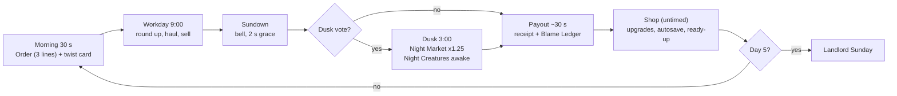
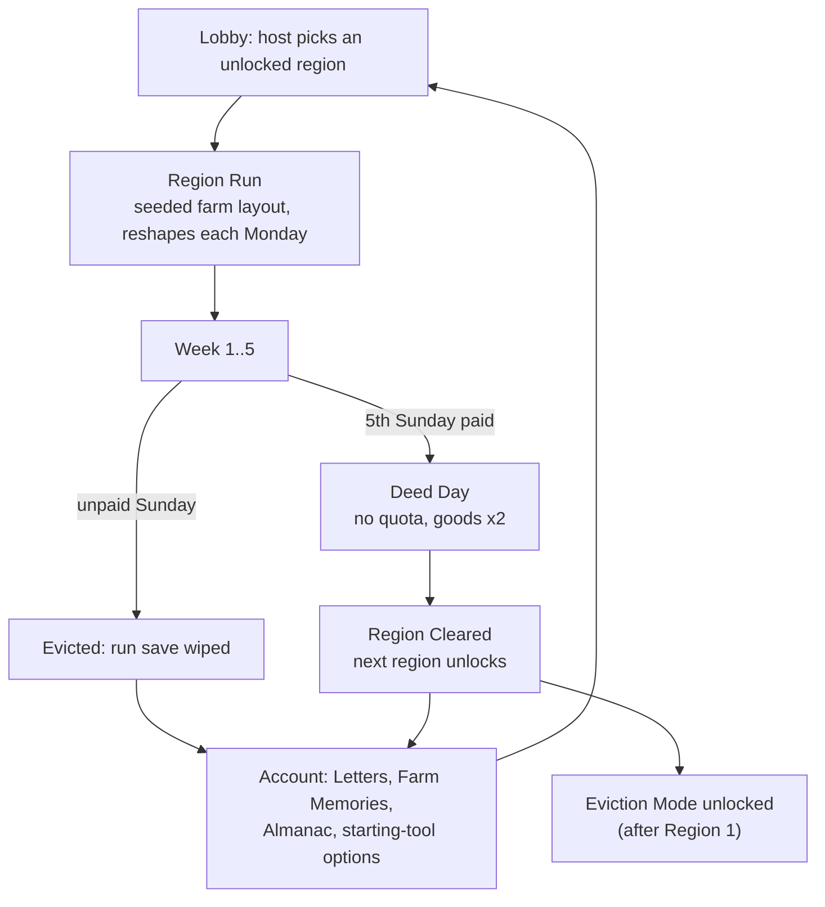

# 3. Core Loop Overview

> Owner: Creative Director · Sources: `day-loop.md`, `week-quota.md`, `region-campaign.md`, `shared-wallet-economy.md`, `goods-value.md`, `eviction-mode.md`, `meta-progression.md`
> Detailed rules and formulas live in the system chapters. This chapter shows how the four loops nest and feed each other.

## 3.1 Loop Stack

| Loop | Length | Goal | Fail state | Pillar |
|---|---|---|---|---|
| Moment-to-moment | 30–90 s per haul | Get one good sold, unbruised | Drop, bruise, escape, river | Everything Has Legs |
| Day | 10–15 min | Fill the Morning Order, earn money before sundown | A poor day (no hard fail) | Failure Is the Content |
| Week | 1–2 h | Pay the Landlord on Sunday | **Eviction** (run ends) | The Farm Gets Worse, You Get Better |
| Campaign | ~6 h per region | Pay 5 Sundays to clear the region | Run reset; account unlocks persist | The Farm Gets Worse, You Get Better |
| Endgame | Endless | Climb Eviction Mode rungs | First unpaid Sunday | Same |

## 3.2 Moment-to-Moment: Catch → Carry → Cross → Sell

```
   +---------+     +---------+     +-----------+     +---------+
   |  SPOT   | --> |  CATCH  | --> |   CARRY   | --> |  CROSS  |
   | (order, |     | net,    |     | 1-8 hands,|     | the     |
   |  price) |     | lure,   |     | struggle, |     | Bridge  |
   +---------+     | corner  |     | stamina   |     +----+----+
        ^          +----+----+     +-----+-----+          |
        |               | escape         | drop/bruise    | plank breaks /
        |               v                v                | river spit-out
        |          (chase again)   (value lost, blame)    v
        |                                            +---------+
        +------------- next good <------------------ |  SELL   |
                                                     | rest 2 s|
                                                     | in pen  |
                                                     +---------+
```

1. **Spot.** The Morning Order says what pays ×1.5 today. Goods show their worth (pig $60, chicken $15, egg $5, prize pumpkin $300).
2. **Catch.** Critters flee from threat and noise. Tools: net, feed bucket lure (built); lasso and whistle (planned). Sprint (6.5 m/s) beats the pig (5.6 m/s), but sprinting is loud.
3. **Carry.** A player has 2 hands. Carriers = ceil(hands/2): pig 2 hands (1 player), cow 6 (3), prize pumpkin 8 (4). Living goods struggle. Impacts above 400 N·s bruise and cut value. The last 3 touchers in a 3 s window share the blame (0.6 / 0.3 / 0.1).
4. **Cross.** The Bridge is the only crossing: 40 m, 20 planks, sagging in the middle. Overloaded planks break; the river spits goods and players out downstream at the "Lost & Found" pile.
5. **Sell.** A good is sold after resting **2.0 s** in the Sale Pen. Living goods can walk back out. Money enters the shared wallet instantly.

**Feeds the Day:** every sale adds money and fills order lines; every failure adds a Blame line and a Camcorder tape.

## 3.3 Daily Loop



| Phase | Duration | Key numbers |
|---|---|---|
| Morning | 30 s (skippable) | 3 order lines; filled lines pay ×1.5 |
| Workday | 540 s (range 300–720) | Market open |
| Sundown | last 30 s warning | Items landing within 2 s of the bell still count |
| Dusk (optional) | 180 s | Value ×1.25; majority vote, host breaks ties |
| Payout | ~30 s | Order Complete Bonus = $60 × week number |
| Shop | untimed | Upgrades (Planned), autosave |

Players caught outside the barn or market at the end are "lost in the dark": barn respawn fee and the `Stranded` blame verb. Unsold livestock wanders back into the wild pool.

**Feeds the Week:** the day's net money moves the crew toward (or away from) the Sunday Due. Upgrades bought in the Shop raise tomorrow's income.

## 3.4 Weekly Loop (Rent Sunday)

```
  Mon      Tue      Wed      Thu      Fri         SUNDAY
 [Day1]-->[Day2]-->[Day3]-->[Day4]-->[Day5]--> [Landlord arrives]
   |        |        |        |        |               |
   +--shop--+--shop--+--shop--+--shop--+        SundayAudit: 5 awards,
                                                Golden Egg reveal
   ("The Landlord doesn't believe in Saturdays")       |
                                                Balance >= Due ?
                                                 /           \
                                              YES             NO
                                               |          Collateral 60 s
                                    week +1, quota x1.35, (sell upgrades 50%)
                                    new Landlord rule,     /        \
                                    chaos cap +1,       paid       EVICTED
                                    respawn fee up        |       (run ends,
                                               \__________/        unlocks kept)
                                                    |
                                               next Monday
```

**Quota** `Q(w) = round_to_10(1,200 × 1.35^(w−1) × S_p × RegionDifficulty)`:

| Week | 4p | 3p | 2p | 1p |
|---|---|---|---|---|
| 1 | $1,200 | $1,020 | $780 | $540 |
| 2 | $1,620 | $1,380 | $1,050 | $730 |
| 3 | $2,190 | $1,860 | $1,420 | $980 |
| 4 | $2,950 | $2,510 | $1,920 | $1,330 |
| 5 | $3,990 | $3,390 | $2,590 | $1,790 |

Due = quota + any overdraft IOU (wallet floor −$200). Median income grows ×1.25/week against quota ×1.35/week: **upgrade choices are the skill that closes the gap.** Respawn fee by week: $25 / 30 / 40 / 45 / 50 / 55.

**Feeds the Campaign:** each paid Sunday is one rung toward the region deed; each eviction feeds account counters (Letters, Almanac, Farm Memories).

## 3.5 Campaign Loop (Regions)



| # | Region → Town | Signature | Difficulty | Phase |
|---|---|---|---|---|
| 1 | Grandpa's Farm → Muddlebury | The plank bridge; toll $5 per crossing with goods | 1.00 | Early Access |
| 2 | Misty Riverlands → Ferrytown | Rafts, islands, tides | 1.20 | Update 1 |
| 3 | Haunted Orchard → Hollow Hill | 40% night, hiding apples | 1.45 | Update 2 |
| 4* | Sunburnt Ranch → Dustwater | Stampedes, heat spoilage | 1.70 | Expansion idea |
| 5* | Frostbite Fjord → Icemouth | Ice physics, yaks | 2.00 | Expansion idea |

Each region's day draws its own species plus previous regions' species at half weight, so the roster widens. The bridge and market are fixed; the farm side is regenerated from the seed every week ("Farm moved again. Don't ask.").

**Endgame: Eviction Mode.** 3-day weeks, quota `$400 × 1.28^rung × S_p`, one permanent Eviction Notice per paid Sunday, daily seed, Steam leaderboards per crew size. Target median Rung 6.

## 3.6 How the Loops Feed Each Other

| From → To | What flows | Why it matters |
|---|---|---|
| Haul → Day | Money, order lines, blame lines, tapes | Each haul is a small story the receipt retells |
| Day → Week | Net cash vs. Due; Shop upgrades | Today's mistakes are Friday's panic |
| Week → Day | New Landlord rule, higher chaos cap, more species | Next Monday plays differently |
| Week → Campaign | Paid Sundays or eviction | Failure is a reset, not a loss |
| Campaign → Week | Starting-tool sidegrades, new region pools, RegionDifficulty | Variety without stat power |
| All → Account | Letters, Farm Memories (10–35 per day), Almanac | Every session leaves something behind |

The Day Modifier contract (weather, curses, Landlord rules, region twists, Eviction Notices) is the single pipe through which every loop changes the next, so content scales by multiplying systems rather than authoring levels.

**Status in build:** Partial. Moment-to-moment loop Built (pig/chicken AI, net and feed bucket, multi-hand carry, bruising, breakable bridge, river, Sale Pen 2 s acceptance). Daily loop Built (Morning/Workday/Dusk/Payout, receipt, order bonus). Weekly loop Partial (quota, Sunday pay/evict, Landlord rule draw; no shop, Collateral or cutscene). Campaign, PCG, meta and Eviction Mode Planned.
