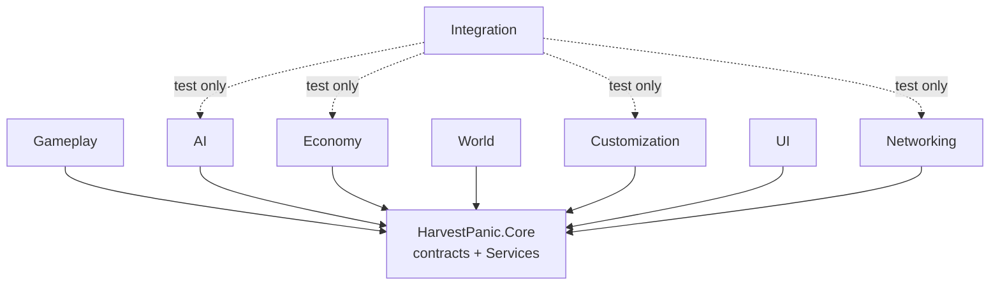
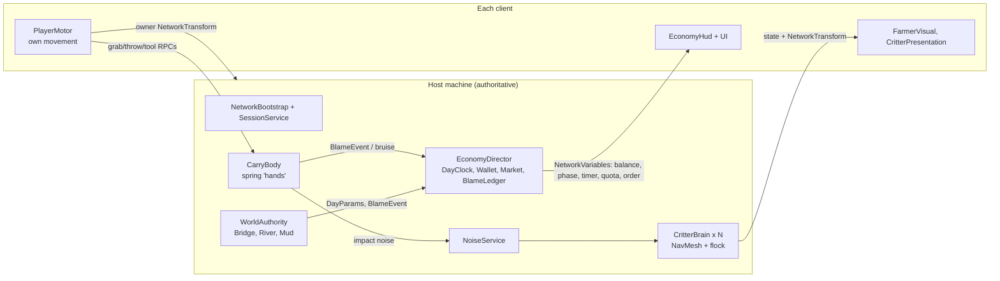

# 17. Technical Design

> **Owner**: Technical Director · **Last verified against `main`**: 2026-10-20 (EditMode 129/129, PlayMode 24 pass / 7 skipped, two-process LAN test PASS)
> **Authoritative sources**: `project.yaml`, `docs/architecture/unity-contracts.md`, `docs/engine/unity-setup.md`, `HarvestPanic/Packages/manifest.json`, `HarvestPanic/Assets/Scripts/**`

This chapter explains how HARVEST PANIC is built: which engine and packages it uses, how the code is split up, how four players share one farm over the internet, what the game must run at, and how a build gets made and checked. It is written so the project owner can follow it without reading code. Short jargon notes appear in *italics* the first time a term is used.

Historical note: the game was first prototyped in Unreal Engine. That build is archived on branch `archive/unreal-final` and nothing in this chapter depends on it.

---

## 17.1 Engine and Packages

| Item | Choice | Why |
|---|---|---|
| Engine | **Unity 6.3 LTS `6000.3.26f1`** (Apple Silicon editor) | *LTS* = Long-Term Support: two years of bug fixes with no breaking changes. Safe for a game shipping within that window. |
| Rendering | **Universal Render Pipeline (URP) 17.3** | Unity's lightweight renderer. Runs well on base M1 Macs and mid-range Windows PCs and suits the stylised art. |
| Language | C# | Unity's only scripting language. |
| Physics | PhysX (Unity built-in 3D physics) | Rigidbodies, joints and collisions drive carrying, ragdolls and the bridge. |
| Networking | **Netcode for GameObjects (NGO) 2.13.3** | Unity's official multiplayer library for small co-op games. |
| Transport (dev) | Unity Transport 2.7.4 (UDP over LAN / localhost) | No Steam account needed for testing. |
| Transport (ship) | Facepunch transport (community package, pinned commit) wrapping **Facepunch.Steamworks** | Steam lobbies, invites and Steam's relay network, so players never type an IP address. |
| Input | Input System 1.20.1 | Keyboard/mouse and gamepad from one action map; rebinding later. |
| Camera | Cinemachine 3.1.7 | First-person camera with shake and blend support. |
| AI pathing | AI Navigation 2.0.16 (NavMesh) | Critters path around fences, the corn maze and the bridge. |
| Level greybox | ProBuilder 6.1.3 | Fast in-editor blockout geometry. |
| Tests | Unity Test Framework 1.6.0 (NUnit) | Automated EditMode and PlayMode tests. |
| Dev multiplayer | Multiplayer Play Mode 2.0.2 | Runs extra "virtual players" inside the editor. |

**Rule:** only the Networking team edits `Packages/manifest.json` and `ProjectSettings/**`. Any new package needs a Technical Director review (licence, Mac arm64 support, Windows support, maintenance status).

---

## 17.2 Project Structure

The repository root holds docs, design and tools. The Unity project itself lives in the `HarvestPanic/` subfolder.

```
HarvestPanic/
  Assets/
    Scripts/        C# code, one folder (and one assembly) per team
    Scenes/         Bootstrap, MainMenu, Lobby, Muddlebury (+ Dev/, Networking/ test scenes)
    Prefabs/        Player, Critters, Goods, World, HUD, UI, Networking
    Resources/
      Data/         ScriptableObject data: Goods, Critters, DayModifiers, Networking config
      NetworkPrefabs/  one networked-prefab list per team
    Art/            in-house art, palette materials, fonts
    ThirdParty/<Pack>/  imported packs, unmodified (Animals, Characters, Environment, Props, Tripo, Fonts)
  Packages/         manifest.json + lock file (tracked)
  ProjectSettings/  tracked
  Library/ Temp/ Logs/ Builds/  generated, git-ignored
```

Scenes: **Bootstrap** (creates the persistent NetworkManager, then loads the menu) → **MainMenu** → **Lobby** (the walkable Lobby Yard) → **Muddlebury** (the playable farm, market and bridge). Dev scenes (`PlayerTest`, `CritterTest`, `EconomyTest`, `WardrobeTest`) and network test scenes (`NetTest_Lobby`, `NetTest_Farm`) only ship in development builds.

### 17.2.1 Assemblies (asmdefs)

An *assembly definition* (asmdef) splits code into separately compiled modules. This keeps compile times short, and more importantly it makes it **impossible** for one team's code to reach directly into another's. Teams can only talk through the shared Core.

| Assembly | Folder | Owns | References |
|---|---|---|---|
| `HarvestPanic.Core` | `Scripts/Core` | Contracts, Services locator, layers, ids | nothing (Unity only) |
| `HarvestPanic.Gameplay` | `Scripts/Gameplay` | Player body, first-person arms, carry, tools, noise | Core, NGO, Input, Cinemachine |
| `HarvestPanic.AI` | `Scripts/AI` | Critter brain, flock, spawn director, critter goods | Core, NGO, AI Navigation |
| `HarvestPanic.Economy` | `Scripts/Economy` | Day clock, wallet, market, Blame Ledger, receipts, HUD | Core, NGO, Input |
| `HarvestPanic.World` | `Scripts/World` | Bridge, planks, river, mud, world authority | Core, NGO, AI Navigation |
| `HarvestPanic.Customization` | `Scripts/Customization` | Loadouts, wardrobe, emotes, name tags, ping | Core, NGO, Input |
| `HarvestPanic.UI` | `Scripts/UI` | Menus, lobby flow, settings, theme | Core, Input, URP (no NGO) |
| `HarvestPanic.Networking` | `Scripts/Networking` | Bootstrap, session, approval, Steam, LAN discovery, chat | Core, NGO, Transport, Facepunch |
| `HarvestPanic.Integration` | `Scripts/Integration` | Test probes only (`SessionStateProbe`) | Core + AI, Economy, Customization, Networking |
| `HarvestPanic.Editor` (+ per-team `*.Editor`) | `Scripts/Editor`, `*/Editor` | Build script, asset builders, QA screenshot tools | Editor-only |
| `HarvestPanic.Tests.*` | `Scripts/Tests/{EditMode,PlayMode}/<Team>` | Automated tests | any |



Integration is the single, deliberate exception to "no cross-team references", and it holds only diagnostic code used by the multiplayer test.

---

## 17.3 Core Contracts and the Services Locator

### 17.3.1 How systems find each other

`Services` (in Core) is a tiny registry. A system announces "I provide the Economy" when it switches on, and anyone else can ask for "the Economy" without knowing which assembly built it.

```
Economy (OnEnable)  -> Services.Register<IEconomyService>(this)
Player carry        -> Services.TryGet(out IEconomyService eco)  // may be absent in a test scene
HUD                 -> Services.WhenAvailable<IEconomyService>(e => ...)  // order-independent
Economy (OnDisable) -> Services.Unregister(this)
```

The registry is cleared on every Play-mode entry and treats destroyed Unity objects as absent, so a stale reference cannot survive a scene change.

### 17.3.2 Contract catalogue

All contracts live in `Assets/Scripts/Core/Contracts/`. They are **add-only**: new members may be added, but changing or removing one needs lead review, because seven teams depend on them.

| Contract | Plain-English meaning | Provider → consumers |
|---|---|---|
| `ICarryable`, `ICarryableEvents` | "This object can be picked up" (hands needed, mass, grab points) and optional struggle/forced-release callbacks | goods, critters, props → Player carry |
| `NoiseEvent`, `INoiseService` | A sound in the world (source, loudness, radius, instigator) that animals hear | Player, emotes, impacts → AI, World |
| `CritterPersonality` | Data asset describing how a species behaves | AI → all spawners |
| `GoodsDefinition`, `IGoods`, `BruiseReport`, `TouchHistory` | What a sellable thing is worth, how damaged it is, who touched it | Economy → Player, AI |
| `BlameEvent`, `BlameVerb` (23 verbs) | "Player X did Y to item Z, costing $N" | any host code → Economy ledger |
| `DayModifier`, `DayParams`, `IDayModifierService` | A rule card (weather, Landlord rule) that changes tuning values for the day | Economy → AI, World, Player |
| `IEconomyService`, `WalletTxn` | Shared wallet, sales, fees | Economy → everyone |
| `IPlayerHooks` | Attach points and emote hook on the player body | Player → Customization |
| `IKnockable`, `Knockables` | "This can be shoved/knocked over" | Player → AI, hazards |
| `IMovementModifierSource`, `MovementModifiers` | Zones that change walk speed (mud) | World → Player motor |
| `IGoodsSoakable` | Goods that get wet in the river or rain | Economy → World |
| `InputModal` | A stack that blocks look/move while a menu is open | UI, Customization → Player |
| `ISessionService`, `ISessionSocial`, `ISessionPlatform`, `PlayerInfo` | Host/join/roster, kick and chat, Steam vs LAN | Networking → Frontend UI |
| `LevelMarker`, `MarkerRole`, `MarkerTag` | Empty objects placed in the level that say "spawn pigs here", "this is the market pen" | World → owners |
| `GameLayers`, `ImpactUnits`, `PlayerIds`, `Content` | Physics layers, impact scale, player ids, data lookup by id | all |

**Shared conventions**: a player id is the NGO client id (`ulong`), with reserved `PlayerIds.None` and `PlayerIds.Nature` (for blame on weather/river). Units are metres, seconds and newton-seconds. Every design-doc impact threshold (bruise 400, ragdoll 900, knockout 1800, plank 800) is in *design units* = Unity impulse × 10, converted with `ImpactUnits.ToDesign`. **Every state-changing call runs on the host only.**

### 17.3.3 Runtime architecture



---

## 17.4 Networking Model

### 17.4.1 Topology and authority

- **Host-authoritative listen server.** One player's game is both a player and the server (the *host*). Up to 3 clients join. `GameInfo.MaxPlayers = 4`. Solo play is a host with no clients, so there is one code path.
- The **host owns the truth** for: all physics bodies (goods, critters, props, planks), the wallet, the day clock and phase, AI, Blame Events, bruises and sales.
- **Clients own only their own movement.** Each player's capsule moves locally (instant response, no input lag) and is replicated by an owner-authoritative `NetworkTransform`. The host can still teleport or ragdoll a player through owner RPCs (barn respawn, knock-back).
- Everything else a client does is a **request**: "I want to grab object 42 with 2 hands", "throw at charge 0.7", "use tool". The host validates (range, line of sight, hands free, object not already held) and applies it.

### 17.4.2 What is replicated

| Data | Mechanism | Rate / size |
|---|---|---|
| Player position/rotation | `NetworkTransform` (owner) | 30 Hz tick, interpolated |
| Player state (Normal/Ragdoll/KnockedOut/Respawning), pitch, move mode, stamina | `NetworkVariable` (byte/float) | on change |
| Held object id, hands used, speed multiplier, load ratio | `PlayerCarry` NetworkVariables | on change |
| Goods and props bodies | `NetworkTransform` + `NetworkRigidbody` (server authority) | 30 Hz while moving, idle when asleep |
| Goods bruise, freshness, tags, last handler | NetworkVariables on `Goods` | on change |
| Critter state + body | `NetworkVariable<CritterState>` + server `NetworkTransform`; clients play procedural animation locally | 30 Hz while moving |
| Day phase, timer, balance, quota, IOU, calendar, morning order, active modifiers | NetworkVariables on `EconomyDirector` | on change (timer extrapolated client-side) |
| Receipts (payout, Sunday) | RPC to clients | once per day |
| Bridge plank states | `NetworkList<byte>` | on change |
| Farmer loadout (cosmetics) | `NetworkVariable<FarmerLoadout>` (20 bytes) | once at join / on wardrobe change |
| Emotes, pings | server-validated RPCs (unreliable for cosmetic FX) | on use |
| Chat | `ISessionSocial` RPC, cleaned and rate-limited | ≤ 5 lines burst |

Late joiners receive the current value of every NetworkVariable automatically on connect, so they see the right clock, wallet and cosmetics immediately.

**Prefab registration**: each team owns `Resources/NetworkPrefabs/<Team>.asset`. `NetworkBootstrap` loads every list at startup in sorted order, so all peers register identical prefab tables without anyone editing a shared file.

### 17.4.3 Transports: Steam vs LAN

| | LAN / localhost (Unity Transport) | Steam (Facepunch) |
|---|---|---|
| Used for | Development, automated tests, local play | Shipping builds |
| Discovery | UDP broadcast on port 47777, hosts expire after 5 s | Steam lobby, friend invite, "Join game" in Steam overlay |
| Connect | IP:port (default 7777) | Steam ID via Steam relay (no port forwarding) |
| Status | **Verified** (two-process test PASS) | **Coded, untested end-to-end** |

`SteamPlatform` initialises Steam lazily and falls back to LAN if Steam is missing (retry every 10 s, never throws). The config still uses the Spacewar test App ID **480**; a real App ID is required before any Steam test is meaningful. Command-line flag `-nosteam` forces LAN.

**Join gating** (`ConnectionApproval`, EditMode tested), checked in order: malformed request → **version mismatch** (protocol version and build version must both match; the player sees "Your farm is a different version (vX vs vY)") → lobby locked (e.g. during the payout cutscene) → farm full (4/4). Names are sanitised and de-duplicated.

### 17.4.4 Bandwidth and CPU budget

| Budget | Target |
|---|---|
| Host → each client | **96–128 kbps** (`64 + 16 × players`), voice excluded |
| Client → host | ≤ 32 kbps |
| Tick rate | 30 Hz |
| Playable latency | ≤ 150 ms RTT; "bad connection" icon at 250 ms; kick at 1,000 ms for 15 s |
| Host network CPU | ≤ 2 ms per frame at 4 players and 150 active bodies |
| Sleeping bodies | send nothing (rigidbody sleep = no updates) |

Planned optimisation if the budget is exceeded: distance-based update rates (30 / 10 / 2 Hz at < 30 m / 30–80 m / > 80 m), quantised rotations, and NGO interest management. These are not needed at the current Muddlebury population (~11 critters, ~10 goods).

### 17.4.5 Disconnects and host loss

- A client that drops "faints": its body ragdolls, anything held is released, the body despawns after 10 s, and its Blame entries stay on the receipt.
- **Host migration-lite (planned)**: no live hand-over. When the host leaves, clients return to the lobby with a **Resume** button that restarts from the last day-boundary Run Save, a copy of which every roster player keeps. This depends on the save system (17.6).

### 17.4.6 Proximity voice (planned, open decision)

Voice chat is not built. The design needs 3D positional voice and a loudness signal for the Noise Event system. Candidates: **Steam Voice via Facepunch** (no new dependency; we must do 3D placement and compression ourselves) or **Unity Vivox** (positional channels built in; an extra service and account). Recommendation: prototype Steam Voice first because the Steam dependency already exists; an ADR is required before Alpha. Every voice mechanic must have a non-voice fallback (emote shout, quiet walk).

---

## 17.5 Physics and Carry Networking

Carrying is the heart of the game, so it gets the most careful network design.

1. **Grab request.** The client raycasts locally to show the prompt, then sends a grab RPC. The host re-checks and creates a `CarryBody` on the object.
2. **Spring "hands".** Each grip is a spring-damper (stiffness 1500, damping 120, max 2,500 N per hand) pulling the grab point towards the carrier's hold point. Several carriers' forces add up, and carriers pulling different ways create torque, which is what makes a four-person pumpkin carry wobble. Below the required hand count the object is dragged, not lifted.
3. **Simulation on the host only.** Clients see the object through server `NetworkTransform` interpolation. Their own hold point is replicated through their player transform and camera pitch, so the host knows where "your hands" are.
4. **Bruises and blame.** While held and for a short window after release, the host converts collisions to design units, applies bruises (`IGoods.ApplyBruise`), emits impact noise, knocks players back (`IKnockable`) and records the touch history that the Blame Ledger reads.
5. **Throw.** Charged throw (hold up to 1 s); the host applies the impulse and tags the thrower as last handler.
6. **Conflict.** Two simultaneous grabs are resolved by host arrival order; the loser simply does not attach (the design calls for a "fumble" animation later).
7. **Known trade-off.** A client's own held item lags its hands by roughly one round trip. At ≤ 150 ms this reads as "wobbly", which suits the tone. If playtests show it feels broken, the fallback is client-side visual smoothing of the held object (cosmetic only, host stays authoritative).

**Ragdolls.** Player ragdoll uses the Ragdoll layer (capsule disabled meanwhile). Ragdoll-ragdoll and ragdoll-player collisions are off to stop physics explosions. Thresholds: ragdoll at impact 900, knockout at 1800 (design units).

**Physics layers**: 3 Player, 4 Water, 6 Critter, 7 Carryable, 8 Bridge, 9 Interactable, 10 Ragdoll. The collision matrix is verified by an automated test.

---

## 17.6 Save System

| Data | Current storage | Status |
|---|---|---|
| Settings (FOV, audio, video, controls) | `PlayerPrefs` JSON via `SettingsService` (swappable store for tests) | Built |
| Farmer loadout | `PlayerPrefs` JSON via `LoadoutStorage` | Built |
| **Run Save** (host): seed, week/day, roster, wallet + IOU, upgrades, active modifiers, Landlord rules, cellar goods, ledger week totals | JSON file in `Application.persistentDataPath`, 3 slots | **Planned (Alpha)** |
| **Account Profile** (each player): cosmetics, unlocks, Almanac, lifetime stats | Local file, Steam Cloud synced | **Planned** |

Run Save rules (from `save-persistence.md`): write only at safe boundaries (entering Shop, after Sunday), **never mid-day**, so no physics state is ever saved. Atomic write (write a temp file, then rename) with one `.bak` backup and a CRC32 checksum. Size ≤ 64 KB, write ≤ 50 ms. A `SaveVersion` integer with sequential migrations; a newer-than-known save is refused with a message. The Sunday result is written before the cutscene, so killing the app cannot dodge an eviction. The host's profile, not guests', decides shop unlocks (guests could edit their files). When Account Profiles arrive, the current `PlayerPrefs` loadout is migrated into the profile once.

---

## 17.7 Performance Budgets

Reference machine **"Mac Medium"**: base Apple M1, 8 GB unified memory, 1080p. Windows reference: GTX 1060 / RX 580 class, 8 GB RAM.

| Budget | Target |
|---|---|
| Frame rate | **60 fps** (16.6 ms) on Mac Medium with 4 players; never below 30 fps in worst-case chaos |
| CPU main thread | ≤ 10 ms (physics ≤ 3 ms, AI ≤ 1.5 ms, network ≤ 2 ms on host) |
| GPU | ≤ 12 ms |
| Draw calls (SRP batches) | ≤ 1,500 visible; use GPU instancing / SRP Batcher for fences, crops, hay |
| Triangles on screen | ≤ 1.5 M |
| Critter | ≤ 6k tris LOD0 (Tripo pig 5k, chicken 3k), 3 LODs, 1 material |
| Player body incl. cosmetics | ≤ 15k tris, ≤ 3 materials |
| First-person tool | ≤ 3k tris |
| Active critters | ≤ 30 simulated; animation culled when off-screen |
| Active physics bodies | ≤ 150 awake |
| Shadowed lights | 1 directional + ≤ 4 shadowed point/spot |
| Memory | ≤ 3 GB total process; textures ≤ 1.5 GB |
| Load time | Menu → farm ≤ 15 s on SSD |
| Players | 4 (8 is a post-launch experiment only) |

Known gap: **critter LODs are missing**; every critter renders at full detail. This must be fixed before Early Beta stress tests. Profiling is done with the Unity Profiler in a development build, captured during the full-day PlayMode playtest.

---

## 17.8 Platforms

| Platform | Status |
|---|---|
| macOS (Apple Silicon, arm64) | Primary dev platform; development and release builds via `BuildMac` / `BuildMacDev` |
| macOS (Intel) | Universal build target; untested |
| Windows 64-bit | `BuildWindows` exists, but **the Windows Build Support module is not installed** on the build machine, so no Windows build has been made |
| Steam | Both platforms; needs real App ID, depots, Steam Cloud config, store page |

Before beta: install Windows Build Support (Mono), make a Windows build, and test cross-platform play (Mac host + Windows client and the reverse). macOS release builds also need code signing and notarisation to avoid Gatekeeper warnings.

---

## 17.9 Build and Test Pipeline

All builds and tests run from the command line with Unity in *batchmode* (no editor window), so they can be scripted and later moved to CI.

| Step | Command (see `project.yaml` → `commands`) | Output |
|---|---|---|
| EditMode tests | `Unity -batchmode -nographics -projectPath HarvestPanic -runTests -testPlatform EditMode` | `Logs/editmode-results.xml` |
| PlayMode tests | same with `-testPlatform PlayMode` | `Logs/playmode-results.xml` |
| Mac build | `-executeMethod HarvestPanic.Editor.BuildScript.BuildMac` | `Builds/macOS/HarvestPanic.app` |
| Mac dev build | `...BuildScript.BuildMacDev` (includes test scenes) | `Builds/macOS-dev/` |
| Windows build | `...BuildScript.BuildWindows` | `Builds/Windows/` (blocked: module) |
| Two-process net test | `tools/net/two-process-test.sh` | PASS / FAIL, exit code |

**EditMode tests** (129) test pure logic without running the game: economy formulas, wallet, quota proration, blame ledger, day clock transitions, connection approval, chat rate limiting, name sanitising, arm IK maths, prompt parsing, contracts and the collision matrix. **PlayMode tests** (31; 24 pass, 7 skipped) run real scenes: critter flee, customization, economy HUD, a Muddlebury integration test, and a **full-day playtest** (Morning → Workday → carry and sell → Dusk → Payout → next day at 0.02 day speed). Skipped tests are screenshot/QA captures that only run when `HP_QA_DIR` is set.

**Two-process test**: launches a headless host and a headless client from the same dev build on `127.0.0.1`. It passes only if the client connects and is approved, both see 2 players, the NGO scene switch Lobby → Muddlebury works, the host reports critters, goods and the economy, and the client sees critters and the host's loadout.

Branch rule: one branch per task, merged through an integration branch; `main` must keep all suites green.

---

## 17.10 Asset Pipeline and Licensing

- **Force Text** serialization and **Visible Meta Files**: scenes and prefabs are readable text, merged with Unity SmartMerge. Binary assets (models, textures, audio, fonts) go through **Git LFS**.
- Third-party packs live unmodified under `Assets/ThirdParty/<Pack>/`; edited copies go in `Assets/Art/`.
- Every pack is logged in `THIRD_PARTY_LICENSES.md` (name, source, author, licence, date).
- Many assets are generated by editor scripts (`*AssetBuilder`, `BuildMuddlebury`) so prefabs and the level can be rebuilt reproducibly.

| Source | Licence | Notes |
|---|---|---|
| Quaternius animals, farmer, props | CC0 | Pig, chicken, cow, bull, sheep, alpaca, pigeon; farmer body + clips |
| Kenney Nature, Fantasy Town, Food, Survival kits | CC0 | Muddlebury environment |
| Lilita One, Nunito fonts | SIL OFL 1.1 | Licence files next to fonts |
| Tripo3D models (pig, chicken, pumpkin, egg basket, bucket, net, stall, gate) | Tripo plan terms | **Owner must confirm commercial rights before any public build** |
| Facepunch.Steamworks / community transport | MIT | **Not yet listed in THIRD_PARTY_LICENSES.md** — add before beta |

Only CC0, CC-BY (with credit) or explicitly commercial licences are allowed. The licences file header still references an old content path and should be tidied.

---

## 17.11 Security and Anti-Grief Basics

This is a friends co-op game, not competitive, so the goal is "a stranger cannot ruin the session", not anti-cheat.

| Threat | Mitigation | Status |
|---|---|---|
| Client fakes money, sales or bruises | Host-only state changes; clients send requests only | Built |
| Client spams RPCs (grab, emote) | Host validates range/state; emote and chat rate limits | Built (chat 5-line burst, refill 1.5 s); per-RPC rate limits planned |
| Offensive or broken names/chat | Sanitiser strips control, zero-width and rich-text characters, caps length, de-duplicates | Built |
| Version mismatch crashes | Protocol + build version check at join | Built |
| Griefer in lobby | Host kick (`ISessionSocial.Kick`); lobby privacy (friends-only / invite-only) | Kick built; privacy with Steam lobbies |
| Edited save/profile | Profiles are cosmetic only; host profile decides unlocks; checksums on saves | Planned |
| Pranks too harmful | Social features have capped "bounded harm" per design | Design rule |

---

## 17.12 Technical Debt and Open Decisions

1. Proximity voice provider (Steam Voice vs Vivox) — ADR before Alpha.
2. Steam path end-to-end test with a real App ID.
3. Windows build module and cross-platform play test.
4. Critter LODs and a performance capture at 4 players.
5. Run Save / Account Profile implementation (blocks host migration-lite, shop persistence and meta-progression).
6. Several system GDDs still describe the earlier prototype's tech (e.g. "listen server", "StateTree"); the Unity mapping in this chapter is authoritative where they conflict.
